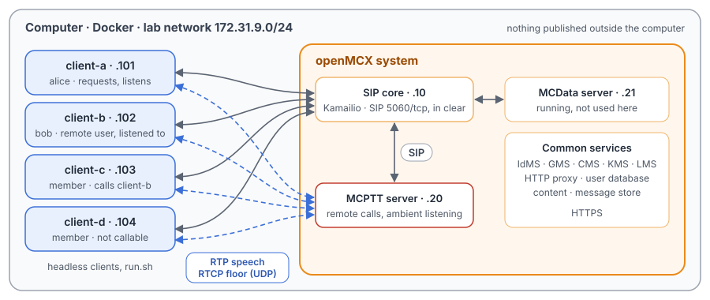
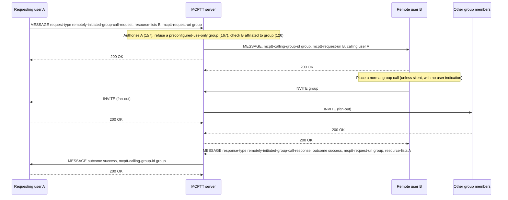
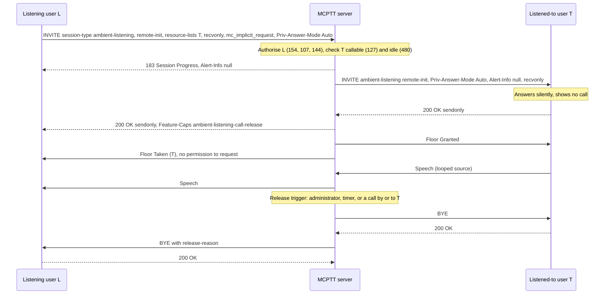

# Unit Test Tutorial 9: MCPTT remotely initiated group calls and ambient listening calls

One computer runs the openMCX system from the published images, with four headless clients in place of phones.
A script takes them through two MCPTT services in which one user makes another user's device act:

- a **remotely initiated group call** (TS 24.379 clause 10.1.5): client-a asks client-b's device, by SIP MESSAGE, to
  call a group; client-b's device places the call and reports the outcome. Then a silent request, refused requests
  (warnings 157, 120, 167), a busy remote user, and a request with an application priority;
- an **ambient listening call** (TS 24.379 clause 11.1.6): client-a listens to client-b's microphone without
  client-b's user being told, or client-b asks client-a to listen to it. Then the releases by the server (administrator,
  a call by or to the listened-to user, the private call timer), refused requests (warnings 154, 144, 127) and a busy
  target.

A capture of the lab network records every SIP message and every speech and floor control packet, so you can follow
each request and call in Wireshark.

The tutorial is built on the scenarios `tests/integration/remote_group_call_scenario.py` and
`tests/integration/ambient_listening_scenario.py` of the openMCX regression tests and uses the same images.
[Unit Test Tutorial 4](../04-private-call-services/README.md) shows the remotely initiated *private* call.

> **SIP in clear, for learning.** The system runs in its debug mode: SIP goes over TCP without TLS (port 5060), so
> Wireshark shows every message, its SDP and its MCPTT XML. A real system uses TLS (tutorials 1 to 5). Speech and
> floor control are not encrypted in this tutorial in either mode. The HTTPS traffic to the common services
> (sign-in, configuration, keys) stays encrypted and is not captured.

<p align="center"></p>

## The two services

| | Remotely initiated group call | Ambient listening call |
|---|---|---|
| Who asks | the requester (client-a), by SIP MESSAGE with `request-type` `remotely-initiated-group-call-request` | the listening user (client-a, `remote-init`), or the listened-to user (client-b, `local-init`), by INVITE with `session-type` `ambient-listening` |
| Who places the call | the remote user's device (client-b): a normal group call, of which client-b is the initiator | the server: a private call between the two, answered automatically |
| What the remote or listened-to user sees | a request indication, unless the request is silent (`notify-remote-user` false) | nothing at all: null `Alert-Info`, no call shown, its hangup ignored |
| Speech | as in any group call | only from the listened-to user; the listening user's floor requests are denied with cause #5 (receive only) |
| End | as in any group call | the listening user, the originator, or the server with a `<release-reason>` |

## What you need

- A computer with Docker and Docker Compose v2 (Linux, or Docker Desktop on macOS or Windows) and a bash shell for
  `run.sh` (on Windows: WSL or Git Bash).
- No phones, no network set-up, nothing to compile: the tutorial uses the **prebuilt openMCX images from Docker Hub**
  (`openmcx/openmcx-*:1.0.0`) and publishes no port; everything stays on the computer.
- [Wireshark](https://www.wireshark.org/) to look at the capture (optional: `run.sh` prints a summary).

## 1. Make the configuration

```bash
cd tutorials/unit-tests/09-remote-ambient-calls
docker compose run --rm setup
```

The setup container runs the generator of the regression lab (`tools/prepare-prearranged-test.py --debug-sip
--private-call`). It writes `./config` with these parts:

- a new certificate authority with the servers' and clients' certificates;
- the users `alice` (client-a), `bob` (client-b), `client-c` and `client-d`, all in the group `operations`;
- their rights (TS 24.484): alice may ask for remotely initiated group calls and make both types of ambient listening
  call, to bob and client-c only (`<PrivateCall>` list); bob may make locally initiated ambient listening calls only;
  client-c may make neither; client-d may not be called in private calls;
- a group `operations-ric-preconf` for preconfigured use only, of which alice is not a member;
- the MCPTT server's private call timer of 30 s, which also ends ambient listening calls.

It runs once. To start over, see step 5. The certificates last 30 days.

## 2. Start the system

```bash
docker compose up -d --wait
```

After about half a minute `--wait` returns and every service is healthy, with the capture already running.

| Address | Container |
|---|---|
| 172.31.9.10 | SIP core (Kamailio) |
| 172.31.9.20 | MCPTT server |
| 172.31.9.21 | MCData server (running, not used here) |
| 172.31.9.101 | client-a, user `alice` |
| 172.31.9.102 | client-b, user `bob` |
| 172.31.9.103 | client-c, user `client-c` |
| 172.31.9.104 | client-d, user `client-d` |

## 3. Run the steps

```bash
./run.sh
```

The script sends each command to a client and waits until the clients and the server show its result before going
on. It takes about two minutes, half a minute of it the private call timer:

```
2. Remotely initiated group call: client-a asks client-b to call operations
  $ client-a: remote-group-call sip:bob.mcptt@mcx.test sip:operations@mcx.test
  ok: client-b placed the call, every member is in it, and client-b is its initiator
  ok: client-a is told: success; client-b recorded the same
...
8. Ambient listening, remotely initiated: client-a listens to client-b, whose device shows nothing
  $ client-a: ambient remote sip:bob.mcptt@mcx.test
  ok: client-a listens; the floor is with client-b, which transmits
  ok: client-b shows no call: idle, no call type, not talking
...
13. The capture: captures/09-remote-ambient-calls-run.pcap.gz
```

Each command is the same program the clients run, with `--command`; the administrator's release is a command of the
MCPTT server. To type one yourself:

```bash
docker compose exec client-a mcx-client --config /config/client-a.json --command "ambient remote sip:bob.mcptt@mcx.test"
docker compose exec mcptt-server openmcx-mcptt-server --config /config/mcptt-server.json --command "ambient-release sip:bob.mcptt@mcx.test"
```

| Step | Command | What happens (TS 24.379) |
|---|---|---|
| 1 | `ambient-source` on client-a and client-b | Each client is given a WAV file to stand for its microphone when it is listened to. |
| 2 | `client-a: remote-group-call <bob> <operations>`, then `client-b: ptt`, `hangup` | The request (clause 10.1.5.2.1) names client-b in a `resource-lists` body and the group in `<mcptt-request-uri>`. The server checks client-a's right and client-b's affiliation (clause 10.1.5.4) and relays it with the group in `<mcptt-calling-group-id>`. client-b's device places a normal group call (clause 10.1.5.2.2), so client-b is its initiator, and reports `success`. |
| 3 | `… silent` | The same with `<notify-remote-user>` false: client-b's device places the call without telling its user. |
| 4 | from client-c; to a group client-b is not in | 403 with warning 157 (client-c may not ask) and 120 (client-b not affiliated to the group); nothing reaches client-b. |
| 5 | `client-b: call`, then the request | client-b is busy: its device places no call and reports `fail`; its own call goes on. |
| 6 | `… priority=mcpttp.5` | The request carries `<ric-app-level-priority>`; client-b's INVITE carries it as `Resource-Priority: mcpttp.5` (clause 10.1.5.2.2 step 2 b)). |
| 7 | to `operations-ric-preconf` | 403 with warning 167: a call on a preconfigured-use-only group (clause 10.1.5.4 step 2A). |
| 8 | `client-a: ambient remote <bob>`, `ptt`, `client-b: hangup`, `client-a: hangup` | client-a listens to client-b (clause 11.1.6.2.1.1). client-b's device answers silently and shows no call; the floor is with client-b for the whole call (TS 24.380); client-a's request is denied with cause #5. client-b's hangup does nothing: its user does not know about the call. client-a's hangup ends it. |
| 9 | `client-b: ambient local <alice>`, `hangup` | client-b asks client-a to listen to it (`local-init`); client-a is told and may end it, and so may client-b. |
| 10 | `ambient-release` (server); `client-b: call`; `client-c: private <bob>`; the timer | The server ends the call (clause 11.1.6.4.3): BYE to client-b, then BYE to client-a with the `<release-reason>` `administrator-action`, `call-request-initiated-by-listened-to-client`, `call-request-for-listened-to-client`, or, after 30 s, `private-call-expiry`. |
| 11 | from client-c; to client-d (two) | 403 with warning 154 (no ambient listening right), 144 (client-d not in alice's `<PrivateCall>` list) and 127 (client-d may not be called). |
| 12 | `client-c: private <bob>`, then `client-a: ambient remote <bob>` | client-b is in a private call: 480, and its call goes on. |

## 4. Look at the capture

`run.sh` copies the capture to `captures/09-remote-ambient-calls-run.pcap.gz`. The folder also holds a reference run,
`captures/09-remote-ambient-calls-full.pcap.gz` (318 KB, 7 612 frames, most of it the speech of the 30 s ambient
listening call): the frame numbers below and in the call flows are those of the reference. Wireshark opens the
compressed file directly (or `gunzip` it first).

The capture filter is `ip and not host 172.31.9.1 and (tcp port 5060 or (udp and not port 53) or icmp)`:

- SIP on 5060/tcp, with every TCP segment, so Wireshark rebuilds a message split over two segments;
- every UDP flow, since the speech and floor control ports come from the SDP and are not fixed;
- ICMP, which shows media sent to a closed port.

DNS, the encrypted HTTPS and the host's own traffic on the bridge (172.31.9.1) are left out.

Each request a client sends appears twice, because the SIP core challenges it with `407` first and the client sends
it again with its credentials; the frame numbers below are those of the second one.

Useful display filters:

| Filter | Shows |
|---|---|
| `sip.Method == "MESSAGE"` | The remotely initiated call requests, their relays and the outcome reports. |
| `sip.msg_body contains "ambient-listening"` | The ambient listening INVITEs and their answers. |
| `sip.Method == "BYE"` | The releases; the server's BYE to the listening user carries the `<release-reason>`. |
| `sip.Warning` | The refusals (157, 120, 167, 154, 144, 127). |
| `rtcp.app.name == "MCPT"` | Floor control: Granted to the listened-to user, Taken and Deny (cause 5) to the listening one. |

The Floor Deny's Reject Cause shows in Wireshark 4.2 only as the number `5` ("Receive only", TS 24.380 clause
8.2.6.2), without its name.

What to look for, in the reference run:

- **Remotely initiated group call** (frames 429 to 576): client-a's MESSAGE (429) with `remotely-initiated-group-call-request`,
  `<mcptt-request-uri>` the group and a `resource-lists` entry for bob. The server relays it to client-b (437) with
  the group in `<mcptt-calling-group-id>` and bob in `<mcptt-request-uri>`. client-b's INVITE to the group (450) is an
  ordinary prearranged call; the server invites alice (456), client-c (464) and client-d (473). client-b's report (512)
  carries `remotely-initiated-call-outcome` `success` and reaches client-a (576). client-b then talks (from 649).
- **Silent request** (frames 2172 to 2193): the relay to client-b (2180) has `<notify-remote-user>false`, and
  client-b still places the call (2193).
- **Refused requests** (frames 2491 to 2509, and 3119 to 3125): the 403s with warnings 157 (2497), 120 (2509) and 167
  (3125); no MESSAGE reaches client-b for them.
- **Busy remote user** (frames 2518 to 2709): client-b's own call (2518), the relayed request (2692), client-b's
  report with outcome `fail` (2702) and no INVITE from client-b in between.
- **Application priority** (frames 2810 to 2831): the relay carries `<ric-app-level-priority>mcpttp.5` (2818), and
  client-b's INVITE carries `Resource-Priority: mcpttp.5` (2831).
- **Ambient listening, remote-init** (frames 3134 to 3764): client-a's INVITE (3134) with `<session-type>ambient-listening`,
  `<ambient-listening-type>remote-init`, `Priv-Answer-Mode: Auto`, `mc_implicit_request` and `a=recvonly`. The server
  invites client-b (3144) with `Alert-Info: <file:///dev/null>` and `a=recvonly`; client-b answers `sendonly` (3146).
  client-a gets a 183 (3153) and a 200 OK (3155) with `Feature-Caps: *;+g.3gpp.mcptt.ambient-listening-call-release`.
  Floor Granted goes to client-b (3159), Floor Taken naming bob, with no permission to request, to client-a (3160).
  Speech flows only client-b → server → client-a (from 3162, 292 packets each way). client-a's Floor Request (3503)
  gets a Floor Deny with cause 5 (3505). client-b sends no BYE; client-a's BYE (3756) ends the call (the server's BYE
  to client-b, 3764).
- **Ambient listening, local-init** (frames 3779 to 3856): client-b's INVITE (3779) with `local-init` and
  `a=sendonly`; client-a is invited with the `Feature-Caps` release capability (3789), and client-b's 200 OK carries it
  too (3800). client-b's BYE (3847) ends it.
- **Server releases**: each time BYE to client-b first, then, after client-b's 200 OK, BYE with the `<release-reason>`
  to client-a: `administrator-action` (3926, 3933), `call-request-initiated-by-listened-to-client` (4022, 4030),
  `call-request-for-listened-to-client` (4370, 4378; the server invites client-b to client-c's call only after that,
  4383) and `private-call-expiry`, 30.0 s after the INVITE (4434 → 7468, 7475).
- **Refused ambient listening calls** (frames 7489 to 7533): the 403s with warnings 154 (7496), 144 (7514) and 127
  (7533), with no invitation sent.
- **Busy target** (frames 7544 to 7590): client-c's private call to client-b (7544), then client-a's ambient request
  (7583) answered 480 (7590); client-b is not invited.

- **A group call by the listened-to user** (frames 4018 to 4041): client-b's group call (4018) first ends the ambient
  call: BYE to client-b (4022), its 200 OK (4026), then BYE to client-a with `call-request-initiated-by-listened-to-client`
  (4030), as TS 24.379 clause 11.1.6.4.3 orders it. Only then is client-a, an affiliated member, invited to client-b's
  group call (4035), and it joins (200 OK, 4041).

## 5. Stop or start over

```bash
docker compose down -v        # remove the containers and their data (status files, capture)
rm -rf config                 # with down -v: start over at step 1
```

To run the steps again on the same system, run `./run.sh` again: the capture keeps everything since `up`. For a new
capture, `docker compose down -v` and `docker compose up -d --wait` first (the configuration stays).

## Images

The compose file names every image in full, all from Docker Hub:

| Image | What it is |
|---|---|
| `docker.io/openmcx/openmcx-setup:1.0.0` | The setup: the lab's generator |
| `docker.io/openmcx/openmcx-mcptt-server:1.0.0`, `docker.io/openmcx/openmcx-mcdata-server:1.0.0` | The MCPTT and MCData servers |
| `docker.io/openmcx/openmcx-common:1.0.0`, `docker.io/openmcx/openmcx-http-proxy:1.0.0`, `docker.io/openmcx/openmcx-user-db:1.0.0` | The common services |
| `docker.io/openmcx/openmcx-client:1.0.0` | The headless client (`openMCX/openmcx-client` repository) |
| `docker.io/openmcx/openmcx-kamailio:1.0.0` | The SIP core |
| `docker.io/library/mysql@sha256:…` | The SIP core's database |
| `docker.io/nicolaka/netshoot@sha256:…` | tcpdump, for the capture |

To use images you built yourself, change the `image:` lines in `docker-compose.yaml` (building them:
[docs/BUILD.md](../../../docs/BUILD.md)).

## When something does not work

- **A service stays unhealthy**: `docker compose logs <service>`.
- **A step of run.sh fails**: it prints the step that did not complete. `docker compose exec client-a cat
  /artifacts/client-a/status.json` shows a client's state (`service_outcomes`, `last_service_result`, `ambient`,
  `last_ambient`, `last_call_failure`), and `/artifacts/mcptt-server/status.json` the server's. Start over from a
  clean state with `docker compose down -v` and `docker compose up -d --wait`.
- **No capture, or `capture` exited**: `docker compose logs capture`. The capture container uses the host's network
  to reach the lab's bridge (`openmcx-ut09`), and the address range 172.31.9.0/24 must be free on the computer.
- **Certificates expired** (after 30 days): start over (step 5).

## How it is put together

- `docker-compose.yaml`: the regression lab of `prepare-prearranged-test.py --debug-sip --private-call`, written for
  the published images by `tools/tutorial-compose.py`. Each container has a fixed address, so the capture reads by
  role. The status files are in a volume, and the capture runs on the lab's bridge.
- `run.sh`: checks RG-01 to RG-06, RG-09 and RG-10 of `remote_group_call_scenario.py` and AL-01 to AL-13 (without
  AL-09a) of `ambient_listening_scenario.py`. Left out: the client's own refusal of a preconfigured-use-only group,
  which sends nothing (RG-11), and a call command that fails before any INVITE (AL-09a). The remotely initiated
  private call is in [Unit Test Tutorial 4](../04-private-call-services/README.md).
- `speech/`: the two spoken test messages the clients transmit (16 kHz WAV, made with espeak-ng).
- `captures/09-remote-ambient-calls-full.pcap.gz`: the reference run.

## Call flow

**Remotely initiated group call** (step 2), as in the regression's test report
([`tests/mcptt/REMOTE_INITIATED_TEST.md`](../../../tests/mcptt/REMOTE_INITIATED_TEST.md)). The SIP core and the
floor detail are left out; A = client-a, B = client-b, G = client-c and client-d.



**Ambient listening call, remote-init, then a server release** (steps 8 and 10), as in the regression's test report
([`tests/mcptt/AMBIENT_LISTENING_TEST.md`](../../../tests/mcptt/AMBIENT_LISTENING_TEST.md)). L = client-a, T =
client-b.



| Message | Frames |
|---|---|
| Remote call: request A → S; relay S → B; B's INVITE; fan-out to A, client-c, client-d | 429; 437; 450; 456, 464, 473 |
| Remote call: 200 OK to B; B's report; report to A | 493; 512; 576 |
| Ambient: L's INVITE; S → T INVITE; T's 200 OK; 183 and 200 OK to L | 3134; 3144; 3146; 3153, 3155 |
| Ambient: Floor Granted to T, Floor Taken to L; T's speech, to L; L's request, Floor Deny | 3159, 3160; 3162, 3164; 3503, 3505 |
| Administrator release: BYE to T; T's 200 OK; BYE with release-reason to L | 3926; 3930; 3933 |
| Timer release: INVITE; 30.0 s later BYE to T; BYE with release-reason to L | 4434; 7468; 7475 |
