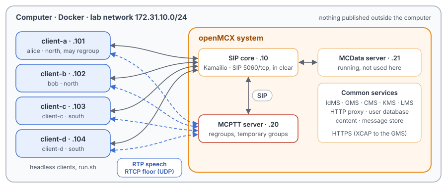
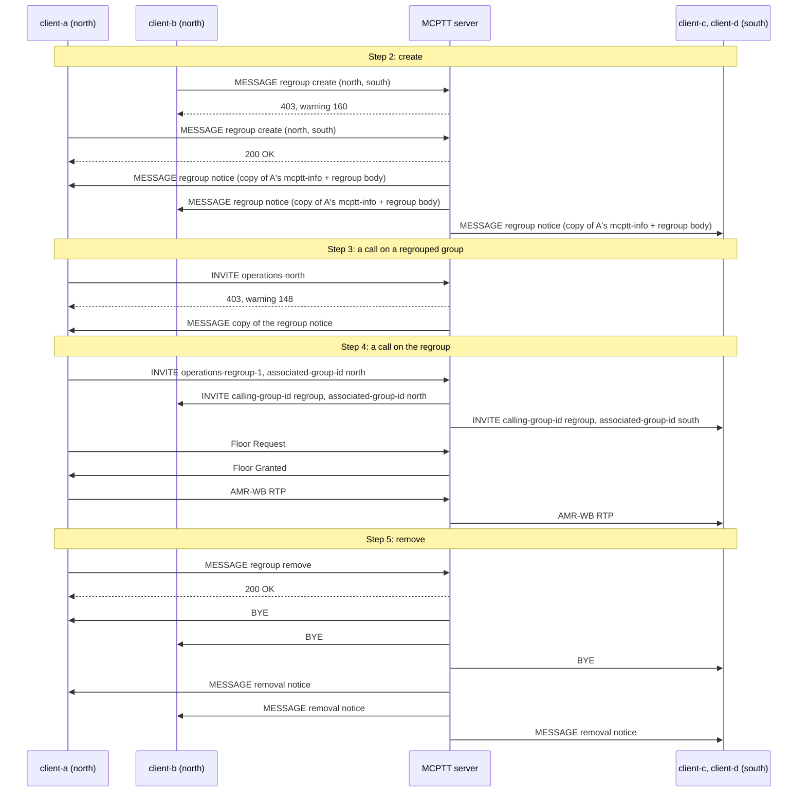

# Unit Test Tutorial 10: MCPTT regroups: group, user and GMS-formed temporary groups

One computer runs the openMCX system from the published images, with four headless clients in place of phones.
client-a and client-b are in the group `operations-north`, client-c and client-d in `operations-south`. A script
combines them for a while in three ways, and makes a call each time:

- a **group regroup** (TS 24.379 clause 16.2): both groups become one temporary group that takes its configuration from
  a preconfigured group;
- a **user regroup** (clause 16.3): a temporary group of two named users;
- a **temporary group formed by the GMS** (TS 24.481 clauses 6.3.14 and 6.3.15).

While a group is combined, a call on it is refused; once the combination is removed, the groups carry their own calls
again. A capture of the lab network records every SIP message and every speech and floor control packet, so you can
follow each step in Wireshark.

The tutorial is built on two scenarios of the openMCX regression tests, `tests/integration/regroup_scenario.py` and
`tests/integration/temporary_group_scenario.py`, and uses the same images. [Unit Test Tutorial 1](../01-group-call-basics/README.md)
explains a prearranged group call, which is what a call on a regroup is.

> **SIP in clear, for learning.** The system runs in its debug mode: SIP goes over TCP without TLS (port 5060), so
> Wireshark shows every message, its SDP and its MCPTT XML. A real system uses TLS (tutorials 1 to 5). Speech and
> floor control are not encrypted in this tutorial in either mode. The HTTPS traffic to the common services
> (sign-in, configuration, keys, and here the XCAP requests to the GMS that form a temporary group) stays encrypted and
> is not captured.

<p align="center"></p>

## Three ways to combine

| | Group regroup | User regroup | Temporary group formed by the GMS |
|---|---|---|---|
| Asked for with | a SIP MESSAGE to the MCPTT service, `<regroup-action>create</regroup-action>` and `<groups-for-regroup>` (TS 24.379 clause 16.2.1.1) | the same with `<users-for-regroup>` (clause 16.3.1.1) | an XCAP `POST` to the GMS (TS 24.481 clause 6.3.14), over HTTPS |
| Configuration | the preconfigured group named in the request | the preconfigured group named in the request | the temporary group's own document |
| Members | everyone in the constituent groups | the named users only | everyone in the constituent groups |
| Told by | a SIP MESSAGE from the server to each affiliated member | a SIP MESSAGE to each named user | the same regroup MESSAGE (an openMCX choice, see step 7) |
| The constituent groups | regrouped: no call of their own | not regrouped | regrouped: no call of their own |
| Removed by | a SIP MESSAGE, `<regroup-action>remove</regroup-action>` (clause 16.2.1.2) | the same | an XCAP `DELETE` (TS 24.481 clause 6.3.15) |

## What you need

- A computer with Docker and Docker Compose v2 (Linux, or Docker Desktop on macOS or Windows) and a bash shell for
  `run.sh` (on Windows: WSL or Git Bash).
- No phones, no network set-up, nothing to compile: the tutorial uses the **prebuilt openMCX images from Docker Hub**
  (`openmcx/openmcx-*:1.0.0`) and publishes no port; everything stays on the computer.
- [Wireshark](https://www.wireshark.org/) to look at the capture (optional: `run.sh` prints a summary).

## 1. Make the configuration

```bash
cd tutorials/unit-tests/10-dynamic-groups
docker compose run --rm setup
```

The setup container runs the generator of the regression lab (`tools/prepare-prearranged-test.py --debug-sip
--regroup`). It writes `./config` with these parts:

- a new certificate authority with the servers' and clients' certificates;
- the users `alice` (client-a), `bob` (client-b), `client-c` and `client-d`; alice and bob in `operations-north`,
  client-c and client-d in `operations-south`;
- the preconfigured group `operations-preconf`, marked `<preconfigured-group-use-only>`: it cannot be called itself, it
  only lends its configuration to a regroup (TS 24.379 clause 16.1);
- the rights (TS 24.484 `<allow-regroup>` and the GMS's own setting): only alice may regroup and form temporary groups.

It runs once. To start over, see step 5. The certificates last 30 days.

## 2. Start the system

```bash
docker compose up -d --wait
```

After about half a minute `--wait` returns and every service is healthy, with the capture already running.

| Address | Container |
|---|---|
| 172.31.10.10 | SIP core (Kamailio) |
| 172.31.10.20 | MCPTT server |
| 172.31.10.21 | MCData server (running, not used here) |
| 172.31.10.101 | client-a, user `alice`, in `operations-north` |
| 172.31.10.102 | client-b, user `bob`, in `operations-north` |
| 172.31.10.103 | client-c, user `client-c`, in `operations-south` |
| 172.31.10.104 | client-d, user `client-d`, in `operations-south` |

## 3. Run the steps

```bash
./run.sh
```

The script sends each command to a client and waits until the clients and the server show its result before going
on. It takes about a minute:

```
2. A group regroup: client-b may not create one, client-a may
  $ client-b: regroup create sip:operations-regroup-1@mcx.test sip:operations-preconf@mcx.test sip:operations-north@mcx.test,sip:operations-south@mcx.test
  ok: client-b refused: 403, warning 160
  $ client-a: regroup create sip:operations-regroup-1@mcx.test sip:operations-preconf@mcx.test sip:operations-north@mcx.test,sip:operations-south@mcx.test
  ok: client-a answered 200
  ok: every member of both groups told of the regroup
...
8. The capture: captures/10-dynamic-groups-run.pcap.gz
```

Each command is the same program the clients run, with `--command`. To type one yourself:

```bash
docker compose exec client-a mcx-client --config /config/client-a.json --command "group sip:operations-regroup-1@mcx.test"
```

| Step | Command | What happens (TS 24.379 unless noted) |
|---|---|---|
| 2 | `client-b: regroup create …`, `client-a: regroup create …` | bob has no `<allow-regroup>`: 403 with warning 160 (clause 16.2.2.2 step 3), nothing is created. alice's request is accepted (clause 16.2.3.1): the server marks both groups regrouped, answers 200 and tells every affiliated member of both groups (clauses 16.2.4.1 and 16.2.2.4), who is then affiliated with the regroup (clause 16.2.2.4 step 3 h)). Each notice carries a copy of alice's mcptt-info body and her Accept-Contact header fields (clause 16.2.2.4 step 3 b) and d)). |
| 3 | `client-a: call` | client-a calls its own group, which is regrouped: 403 with warning 148, and the server sends client-a a copy of the regroup notice (clause 10.1.1.4.1 step 5 b)). |
| 4 | every client `group <regroup>`, `client-a: call`, `client-a: ptt` | The clients use the regroup at once, with the preconfigured group's configuration (clause 16.1), and target it rather than their own groups (clause 16.2.1.3 step 5). client-a's call names the group it calls from, `operations-north`, in `<associated-group-id>` (clause 10.1.1.2.1.1 step 14 d)). The call invites the members of both groups, each INVITE naming the regroup in `<mcptt-calling-group-id>` and the member's own group in `<associated-group-id>` (clause 6.3.4.1.2 step 6b), and client-a's speech reaches client-c and client-d. |
| 5 | `client-a: regroup remove …`, every client back to its group | Removal (clause 16.2.3.2): 200, the call on the regroup is released, every member is told, and the groups are free again. |
| 6 | `client-a: regroup users …`, `client-a: group <user regroup>`, `client-a: call`, `client-a: regroup remove …` | A user regroup of alice and client-c (clause 16.3): only they are told; client-c is invited to the call without having selected the regroup, and bob and client-d are not. The removal tells both, without the list of users (clause 16.2.2.5). |
| 7 | `client-b: temporary-create …`, `client-a: temporary-create …`, calls, `client-a: temporary-delete …` | A temporary group formed by the GMS (TS 24.481 clauses 6.3.14 and 6.3.15): bob is refused 403, alice's request forms it. The MCPTT server applies it as a group regroup: the members are told, a call on `operations-north` is refused with 148, a call on the temporary group joins both groups, and alice's teardown ends the call and frees the groups. |

## 4. Look at the capture

`run.sh` copies the capture to `captures/10-dynamic-groups-run.pcap.gz`. The folder also holds a reference run,
`captures/10-dynamic-groups-full.pcap.gz` (172 KB, 2 922 frames): the frame numbers below and in the call flow are
those of the reference. Wireshark opens the compressed file directly (or `gunzip` it first).

The capture filter is `ip and not host 172.31.10.1 and (tcp port 5060 or (udp and not port 53) or icmp)`:

- SIP on 5060/tcp, with every TCP segment, so Wireshark rebuilds a message split over two segments;
- every UDP flow, since the speech and floor control ports come from the SDP and are not fixed;
- ICMP, which shows media sent to a closed port.

DNS, the encrypted HTTPS (including the XCAP requests of step 7) and the host's own traffic on the bridge
(172.31.10.1) are left out.

Useful display filters:

| Filter | Shows |
|---|---|
| `sip.Method == "MESSAGE"` | The regroup requests and the notices; open the `application/vnd.3gpp.mcptt-regroup+xml` part of each. |
| `sip.Warning` | The refusals: 160 (not allowed to regroup) and 148 (group is regrouped). |
| `sip.Method == "INVITE" \|\| sip.Method == "BYE"` | The calls on the combined groups and their release. |
| `rtp` | Speech: AMR-WB. |

Each client request appears twice in a row: the SIP core challenges it with `407 Proxy Authentication Required`, and
the client sends it again with its credentials. The frame numbers below are those of the second one.

What to look for, in the reference run:

- **A refused regroup** (frames 422 to 428): bob's MESSAGE (422) with `<regroup-action>create</regroup-action>`, the
  server's 403 (426) with `Warning: 399 mcptt-server "160 user not authorised to request creation of a regroup"`. No notice
  follows.
- **The group regroup** (frames 434 to 465): alice's MESSAGE (434) names `sip:operations-regroup-1@mcx.test` in
  `<mcptt-regroup-uri>`, the preconfigured group and both groups in `<groups-for-regroup>`. The server answers 200
  (438, to alice 440) and tells alice (445), bob (449), client-c (461) and client-d (465), each with the same three
  items. Each notice is a multipart body: first a copy of alice's `application/vnd.3gpp.mcptt-info+xml` body (her
  `<mcptt-client-id>`), then the regroup body; and it has both Accept-Contact header fields of her request,
  `+g.3gpp.mcptt` and the MCPTT ICSI (clause 16.2.2.4 step 3 b) and d)). The removal and user regroup notices below
  are built the same way from their own requests.
- **A call on a regrouped group** (frames 481 to 497): alice's INVITE on `operations-north` (481) gets 403 (485, to
  alice 497) with `Warning: 399 mcptt-server "148 group is regrouped"`, and the server sends her a copy of the regroup notice
  (490). Nobody is invited.
- **The call on the regroup** (frames 580 to 759): alice's INVITE (580), with `operations-north` in
  `<associated-group-id>`, and the server's INVITEs to bob (591), client-c (600) and client-d (606), members of both
  groups. Each names `operations-regroup-1` in `<mcptt-calling-group-id>` and the member's own group in
  `<associated-group-id>`: `operations-north` for bob, `operations-south` for client-c and client-d. alice's Floor Request (749) and Floor Granted (750), her
  speech from 755, reaching client-c from 759.
- **Removal** (frames 2120 to 2172): alice's MESSAGE with `<regroup-action>remove</regroup-action>` (2120), the 200
  (2124), the call released with BYEs to client-c (2129), client-d (2134), alice (2137) and bob (2142), then the
  removal notices to alice (2154), bob (2158), client-c (2166) and client-d (2172).

  Like every removal notice, they carry neither `<groups-for-regroup>` nor `<users-for-regroup>`: TS 24.379 clause
  16.2.2.5 step 3 e) leaves both out.
- **The user regroup** (frames 2314 to 2468): alice's MESSAGE (2314) with `<users-for-regroup>` naming alice and
  client-c, the 200 (2318), the notices to alice (2324) and client-c (2329) only. alice's call on the user regroup
  (2363) invites client-c (2373) and nobody else. The removal (2445) ends the call (BYE to client-c 2454) and the
  notices to alice (2465) and client-c (2468) name neither users nor groups.
- **The temporary group** (frames 2518 to 2859): its formation and teardown are XCAP requests over HTTPS, so the
  capture shows only their effect. The regroup notices for `sip:operations-temp-1@mcx.test` to alice (2518), bob
  (2523), client-c (2528) and client-d (2533). alice's call on `operations-north` (2545) is refused 403 with warning
  148 (2549), followed by a copy of the notice (2553). The call on the temporary group (2642) invites bob (2653),
  client-c (2662) and client-d (2668). After alice's teardown the server releases the call (BYE 2819) and sends the
  removal notices (2844 to 2859).

  > **Note.** Telling the members of a temporary group with the regroup notice is an openMCX choice: TS 24.481 lets a
  > client learn of it from its group documents, and does not define a SIP notice. Following that choice, the server
  > also sends the copy of the notice after a refused call (2553), which TS 24.379 clause 10.1.1.4.1 step 5 b) iii)
  > asks for only when the group is regrouped "based on a preconfigured group". No SIP request formed the temporary
  > group, so these notices have no mcptt-info body to copy: they carry the regroup body alone, with the
  > `+g.3gpp.mcptt` Accept-Contact header field.

## 5. Stop or start over

```bash
docker compose down -v        # remove the containers and their data (status files, capture)
rm -rf config                 # with down -v: start over at step 1
```

To run the steps again on the same system, run `./run.sh` again: the capture keeps everything since `up`. For a new
capture, `docker compose down -v` and `docker compose up -d --wait` first (the configuration stays).

## Images

The compose file names every image in full, all from Docker Hub:

| Image | What it is |
|---|---|
| `docker.io/openmcx/openmcx-setup:1.0.0` | The setup: the lab's generator |
| `docker.io/openmcx/openmcx-mcptt-server:1.0.0`, `docker.io/openmcx/openmcx-mcdata-server:1.0.0` | The MCPTT and MCData servers |
| `docker.io/openmcx/openmcx-common:1.0.0`, `docker.io/openmcx/openmcx-http-proxy:1.0.0`, `docker.io/openmcx/openmcx-user-db:1.0.0` | The common services, among them the GMS |
| `docker.io/openmcx/openmcx-client:1.0.0` | The headless client (`openMCX/openmcx-client` repository) |
| `docker.io/openmcx/openmcx-kamailio:1.0.0` | The SIP core |
| `docker.io/library/mysql@sha256:…` | The SIP core's database |
| `docker.io/nicolaka/netshoot@sha256:…` | tcpdump, for the capture |

To use images you built yourself, change the `image:` lines in `docker-compose.yaml` (building them:
[docs/BUILD.md](../../../docs/BUILD.md)).

## When something does not work

- **A service stays unhealthy**: `docker compose logs <service>`.
- **A step of run.sh fails**: it prints the step that did not complete. `docker compose exec client-a cat
  /artifacts/client-a/status.json` shows a client's regroups (`regroups`), its last regroup answer (`regroup_result`)
  and its last XCAP answer (`xcap_last`); `/artifacts/mcptt-server/status.json` shows the server's `regroups` and
  `regrouped_groups`. Start over from a clean state with `docker compose down -v` and `docker compose up -d --wait`.
- **No capture, or `capture` exited**: `docker compose logs capture`. The capture container uses the host's network
  to reach the lab's bridge (`openmcx-ut10`), and the address range 172.31.10.0/24 must be free on the computer.
- **Certificates expired** (after 30 days): start over (step 5).

## How it is put together

- `docker-compose.yaml`: the regression lab of `prepare-prearranged-test.py --debug-sip --regroup`, written for the
  published images by `tools/tutorial-compose.py`. Each container has a fixed address, so the capture reads by role. The
  status files are in a volume, and the capture runs on the lab's bridge.
- `run.sh`: the steps RG-01, RG-02, RG-04, RG-05, RG-07, RU-02, RU-04 and RU-05 of
  `tests/integration/regroup_scenario.py` and TG-01, TG-02, TG-04, TG-05 and TG-06 of
  `tests/integration/temporary_group_scenario.py`. Left out: removal by an unauthorised user and of an unknown regroup
  (warnings 161, 163), a reused identity (165), the late notice to a member affiliating later, removal decided by the
  server, chat calls on a regroup or temporary group, and the GMS's own refusals (430).
- `speech/`: the two spoken test messages the clients transmit (16 kHz WAV, made with espeak-ng).
- `captures/10-dynamic-groups-full.pcap.gz`: the reference run.

## Call flow

The group regroup of steps 2 to 5, drawn from the reference capture (the regression's test reports have no diagram
for it). A = client-a, B = client-b, C/D = client-c and client-d, S = MCPTT server. Each SIP arrow passes through the
SIP core; the 407 challenges, the 200 OKs to the notices and the floor Acks are left out.



| Message | Frames |
|---|---|
| B's regroup request; 403 with warning 160 | 422; 426, 428 |
| A's regroup request; 200 OK | 434; 438, 440 |
| Notices to A, B, C, D | 445, 449, 461, 465 |
| A's INVITE on `operations-north`; 403 with warning 148; copy of the notice | 481; 485, 497; 490 |
| A's INVITE on the regroup; INVITEs to B, C, D | 580; 591, 600, 606 |
| Floor Request; Floor Granted; A's speech; to C | 749; 750; 755; 759 |
| A's removal request; 200 OK | 2120; 2124 |
| BYEs to A, D, B, C | 2137, 2134, 2142, 2129 |
| Removal notices to A, B, C, D | 2154, 2158, 2166, 2172 |
