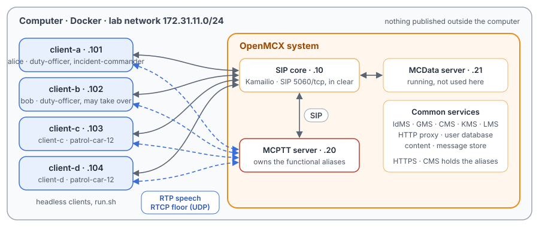
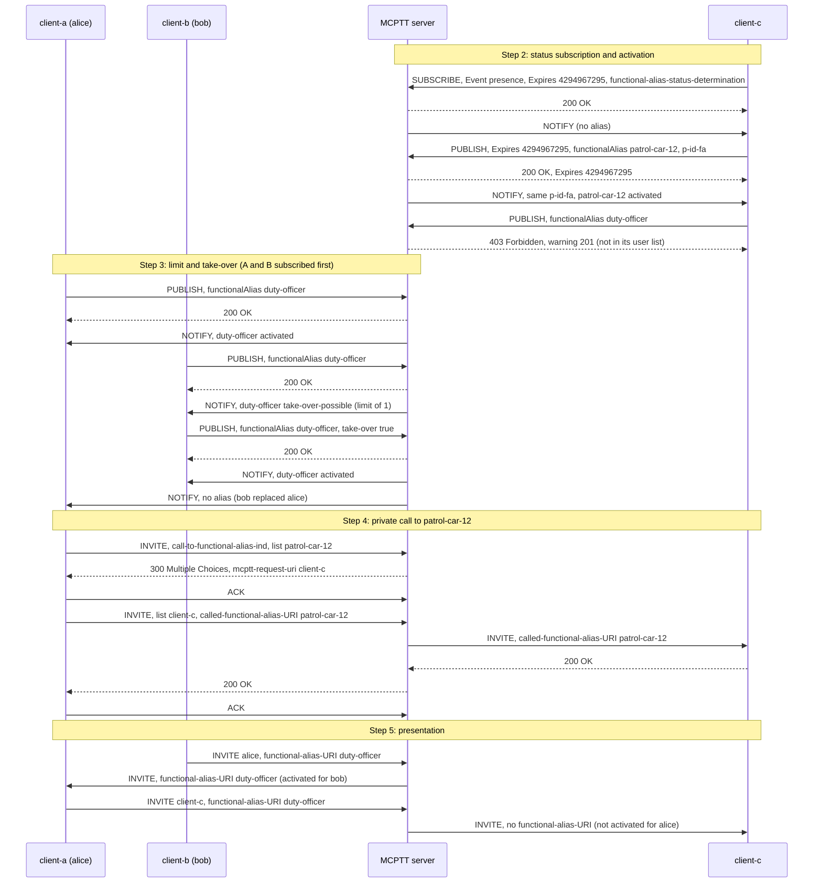

# Unit Test Tutorial 11: MCPTT functional aliases: activation, take-over, calls, presentation

One computer runs the OpenMCX system from the published images, with four headless clients in place of phones. A
functional alias is a name for a role, such as `duty-officer` or `patrol-car-12`, that users take on and give up; a call to the
alias reaches whoever holds it (TS 24.379 clause 9A). A script takes the clients through:

- subscribing to one's own alias status, activating aliases, a user who may not, the limit of users per alias, and
  taking an alias over from another user, each outcome told by a NOTIFY;
- a private call to an alias: the server answers with the user behind it, and the caller calls that user;
- presenting the caller's alias, but only while the caller holds it;
- a first-to-answer call and an ad hoc call to an alias;
- a broadcast ad hoc call, where the invited users only listen;
- deactivation, and a call to an alias nobody holds.

A capture of the lab network records every SIP message and every speech and floor control packet, so you can follow
each step in Wireshark.

The tutorial is built on the regression scenario `tests/integration/functional_alias_scenario.py` and uses the same
images. [Unit Test Tutorial 3](../03-private-calls/README.md) explains private calls,
[Unit Test Tutorial 4](../04-private-call-services/README.md) first-to-answer calls and
[Unit Test Tutorial 8](../08-adhoc-group-calls/README.md) ad hoc calls. A real deployment with phones is in the End to
End Tutorials 1 to 5.

> **SIP in clear, for learning.** The system runs in its debug mode: SIP goes over TCP without TLS (port 5060), so
> Wireshark shows every message, its SDP and its MCPTT XML. A real system uses TLS (End to End Tutorials 1 to 5). Speech
> and floor control are not encrypted in this tutorial in either mode. The HTTPS traffic to the common services
> (sign-in, configuration, keys) stays encrypted and is not captured.

<p align="center"></p>

## The aliases of this lab

| Alias | Who may activate it | Users at a time | Take-over |
|---|---|---|---|
| `sip:duty-officer.alias@mcx.test` | alice, bob | 1 | allowed by the alias; only bob has the user right (`<allow-takeover-functional-alias-other-user>`) |
| `sip:patrol-car-12.alias@mcx.test` | client-c, client-d | 2 | no |
| `sip:incident-commander.alias@mcx.test` | alice | 1 | nobody activates it |

Before its first change, a client subscribes to its own alias status: a SIP SUBSCRIBE to the MCPTT service with
`Event: presence`, `Expires: 4294967295` and `<request-type>functional-alias-status-determination</request-type>`
(clauses 9A.2.1.1 and 9A.2.1.3). A client then changes its aliases with a SIP PUBLISH: `Event: presence`,
`Expires: 4294967295` to activate and `0` to deactivate, and a PIDF body in the `urn:3gpp:ns:mcpttPresInfoFA:1.0`
namespace listing the aliases, with a `<p-id-fa>` that names the request (clauses 9A.2.1.2 and 9A.3.1).

The server answers the PUBLISH 200 once it has checked the user's own rights, or 403 with warning 201 for an alias the
user may not change (clause 9A.2.2.2.3). Whether the change itself succeeds (the alias's user list, its limit,
take-over: clause 9A.2.2.3.3) comes in the NOTIFY that carries the same `<p-id-fa>` (clause 9A.2.2.2.5): each alias the
user holds with `status="activated"`, an alias the user may take over with `status="take-over-possible"`, and a refused
or deactivated alias left out. The aliases themselves are defined in the CMS (TS 23.280 clause 7.4.2.2.13).

## What you need

- A computer with Docker and Docker Compose v2 (Linux, or Docker Desktop on macOS or Windows) and a bash shell for
  `run.sh` (on Windows: WSL or Git Bash).
- No phones, no network set-up, nothing to compile: the tutorial uses the **prebuilt OpenMCX images from Docker Hub**
  (`openmcx/openmcx-*:1.0.0`) and publishes no port; everything stays on the computer.
- [Wireshark](https://www.wireshark.org/) to look at the capture (optional: `run.sh` prints a summary).

## 1. Make the configuration

```bash
cd tutorials/unit-tests/11-functional-aliases
docker compose run --rm setup
```

The setup container runs the generator of the regression lab (`tools/prepare-prearranged-test.py --debug-sip
--private-call --adhoc --functional-alias`). It writes `./config` with these parts:

- a new certificate authority with the servers' and clients' certificates;
- the users `alice` (client-a), `bob` (client-b), `client-c` and `client-d`, all in the group `operations`;
- the three aliases above, their user lists, limits and take-over settings;
- private call and ad hoc call rights; client-d may be called (in other labs it may not).

It runs once. To start over, see step 5. The certificates last 30 days.

## 2. Start the system

```bash
docker compose up -d --wait
```

After about half a minute `--wait` returns and every service is healthy, with the capture already running.

| Address | Container |
|---|---|
| 172.31.11.10 | SIP core (Kamailio) |
| 172.31.11.20 | MCPTT server, which owns the aliases |
| 172.31.11.21 | MCData server (running, not used here) |
| 172.31.11.101 | client-a, user `alice` |
| 172.31.11.102 | client-b, user `bob` |
| 172.31.11.103 | client-c, user `client-c` |
| 172.31.11.104 | client-d, user `client-d` |

## 3. Run the steps

```bash
./run.sh
```

The script sends each command to a client and waits until the clients and the server show its result before going
on. It takes about a minute:

```
3. The limit and take-over: duty-officer may be active for one user at a time
  $ client-a: fa activate sip:duty-officer.alias@mcx.test
  ok: client-a activated duty-officer
  $ client-b: fa activate sip:duty-officer.alias@mcx.test
  ok: client-b over the limit: PUBLISH 200, then NOTIFY "take-over-possible" (bob may take it over)
  $ client-b: fa takeover sip:duty-officer.alias@mcx.test
  ok: client-b takes it over: NOTIFY "activated", now only client-b
  ok: client-a is told by NOTIFY that it no longer holds duty-officer
...
4. A private call to an alias: the server answers 300 with a user behind it, and client-a calls that user
  $ client-a: private-fa sip:patrol-car-12.alias@mcx.test auto
  ok: client-a and client-c in a private call
...
10. The capture: captures/11-functional-aliases-run.pcap.gz
```

Each command is the same program the clients run, with `--command`. To type one yourself:

```bash
docker compose exec client-c mcx-client --config /config/client-c.json --command "fa activate sip:patrol-car-12.alias@mcx.test"
```

| Step | Command | What happens (TS 24.379 unless noted) |
|---|---|---|
| 1 | `answer-mode auto` on every client | Each client answers incoming private calls automatically. |
| 2 | `client-c`, `client-d: fa activate patrol-car-12`; `client-c: fa activate duty-officer` | client-c first subscribes to its alias status (clause 9A.2.1.3); the first NOTIFY lists no alias. Its PUBLISH is answered 200, and the NOTIFY with its `<p-id-fa>` lists patrol-car-12 `activated`; the same for client-d (patrol-car-12 allows two). client-c's PUBLISH for duty-officer, whose user list does not name it, is refused by the participating checks: 403 with warning 201 (clause 9A.2.2.2.3 steps 4A and 4B), and no NOTIFY follows. |
| 3 | `client-a`, `client-b: fa activate duty-officer`; `client-b`, then `client-a: fa takeover duty-officer` | duty-officer allows one user: alice gets it. bob's PUBLISH is answered 200, but the limit is reached (clause 9A.2.2.3.3 step 5), and since the alias and bob allow take-over, his NOTIFY offers duty-officer as `take-over-possible`. bob's next PUBLISH, with `<take-over>true</take-over>`, replaces alice (step 6): bob's NOTIFY lists duty-officer `activated`, and alice's NOTIFY no longer lists it. alice lacks the user right, so she is offered no take-over: her client sends a plain activation, which her NOTIFY leaves out. |
| 4 | `client-a: private-fa patrol-car-12 auto` | The INVITE names the alias in its resource list with `<call-to-functional-alias-ind>true`. The server picks a user behind it and answers **300 Multiple Choices** with that user in `<mcptt-request-uri>` and a session identity in the Contact (clause 11.1.1.4.2 step 8a). client-a then calls client-c itself, naming the alias in `<called-functional-alias-URI>` and without the indicator (clause 11.1.1.2.1.1), and client-c is told which alias was called. |
| 5 | `client-b: fa use duty-officer`, `client-b: private <alice>`; `client-a: fa use duty-officer`, `client-a: private <client-c>`; `client-b: call` | A caller's alias goes in `<functional-alias-URI>`. The server presents it only while it is activated for the caller (clause 11.1.1.3.1.1, and 10.1.1.3.1.1 step 6a for a group call): alice sees bob's duty-officer; client-c does not see duty-officer on alice's call, since bob holds it; every member sees it on bob's group call. |
| 6 | `client-a: first-to-answer-fa patrol-car-12`, `client-d: answer` | A first-to-answer call to the alias rings both users behind it, each told the called alias; client-d answers first, and client-c's invitation is cancelled (CANCEL, 487). |
| 7 | `client-a: adhoc patrol-car-12` | An ad hoc participant list naming the alias stands for the users who activated it; each invitation carries the called alias (clause 17.4.2.2 step 12b). bob is not invited. |
| 8 | `client-a: adhoc broadcast <bob> <client-c>`, `client-b: ptt`, `client-a: ptt` | A broadcast ad hoc call (`<broadcast-ind>true`): bob's Floor Request is denied with cause #5, receive only (TS 24.380 clause 8.2.6.2); client-a's speech reaches both, and the server ends the call when client-a stops (clause 4.12). |
| 9 | `client-c: fa deactivate patrol-car-12`; `client-b: private-fa patrol-car-12 auto`; `client-b: private-fa incident-commander auto` | Deactivation is a PUBLISH with `Expires: 0`, answered 200, and client-c's NOTIFY no longer lists patrol-car-12, which then resolves to client-d, so the 300 names client-d. incident-commander is held by nobody: 403 with warning 145 "unable to determine called party" (clause 11.1.1.4.2 step 8a b)). |

## 4. Look at the capture

The script `run.sh` copies the capture of your run to `captures/11-functional-aliases-run.pcap.gz`. The folder also holds a reference run,
[`captures/11-functional-aliases-full.pcap.gz`](captures/11-functional-aliases-full.pcap.gz) (151 KB, 2 564 frames): the frame numbers below and in the call flow are
those of the reference. Wireshark opens the compressed file directly (or `gunzip` it first).

The capture filter is `ip and not host 172.31.11.1 and (tcp port 5060 or (udp and not port 53) or icmp)`:

- SIP on 5060/tcp, with every TCP segment, so Wireshark rebuilds a message split over two segments;
- every UDP flow, since the speech and floor control ports come from the SDP and are not fixed;
- ICMP, which shows media sent to a closed port.

DNS, the encrypted HTTPS and the host's own traffic on the bridge (172.31.11.1) are left out.

Useful display filters:

| Filter | Shows |
|---|---|
| `sip.Method == "PUBLISH" && frame contains "functionalAlias"` | The alias changes (the clients' affiliation PUBLISHes at start-up use `Event: presence` too, without that element). |
| `sip.CSeq.method == "PUBLISH" && sip.Status-Code` | The answers to every PUBLISH (affiliation and alias): 200, or 403 with warning 201. |
| `frame contains "functional-alias-status-determination"` | The clients' subscriptions to their own alias status. |
| `sip.Method == "NOTIFY" && frame contains "p-id-fa"` | The status NOTIFYs: the aliases each user holds, after each change. |
| `sip.Status-Code == 300` | The redirects of the calls to an alias. |
| `frame contains "functional-alias"` | Every message naming an alias: `<functional-alias-URI>`, `<called-functional-alias-URI>`, `<call-to-functional-alias-ind>`. |
| `rtcp.app.name == "MCPT"` | Floor control of the broadcast ad hoc call. |

Each client request appears twice when the SIP core challenges it (`407 Proxy Authentication Required`, then the
request again with credentials); the frames below are those of the request that went through.

What to look for, in the reference run:

- **The status subscription and activation** (frames 405 to 477): client-c's SUBSCRIBE (405, 408; 409 at the server)
  has `Event: presence`, `Expires: 4294967295` and `<request-type>functional-alias-status-determination</request-type>`;
  the server answers 200 (410) and sends the first NOTIFY (412, at client-c 416), with no alias. client-c's PUBLISH
  (414, 420; 424 at the server) carries `Expires: 4294967295`, a `<p-id-fa>` and
  `<fa:functionalAlias functionalAliasID="sip:patrol-car-12.alias@mcx.test"/>`; the server's 200 (426, to client-c 428)
  repeats `Expires`, and its NOTIFY (427, at client-c 429) carries the same `<p-id-fa>` and patrol-car-12 with
  `status="activated"`. client-d subscribes (439) and activates patrol-car-12 the same way (451; 200 457; NOTIFY 458).
  client-c's PUBLISH for duty-officer (471) gets 403 with `Warning: 399 mcptt-server "201 user not authorized to change
  the functional alias status"` (475, 477), and no NOTIFY.
- **The limit and take-over** (frames 479 to 576): alice subscribes (482) and activates duty-officer (494; 200
  500; NOTIFY 501, `activated`). bob subscribes (513); his PUBLISH (525) gets 200 (531), and his NOTIFY (532)
  lists duty-officer with `status="take-over-possible"`. bob's next PUBLISH (545) adds `<fa:take-over>true</fa:take-over>`:
  200 (549), and the NOTIFY (557) lists duty-officer `activated`; alice's NOTIFY (551, at alice 553) no longer lists it.
  alice's request (568) has no `<take-over>`, since she was not offered one: 200 (572), and her NOTIFY (574) still
  lists no alias.
- **A private call to patrol-car-12** (frames 582 to 644): client-a's INVITE (589) has `<call-to-functional-alias-ind>true` and
  the resource list `sip:patrol-car-12.alias@mcx.test`. The server answers 300 (593, to client-a 597) with `<mcptt-request-uri>`
  `sip:client-c.mcptt@mcx.test`, the session identity in the Contact, and nobody invited. client-a's new INVITE (607)
  names client-c in its list, carries `<called-functional-alias-URI>` patrol-car-12 and no indicator; the server's INVITE to
  client-c (617) carries the called alias too; client-a gets 200 (632) and ends the call (644).
- **Presentation** (frames 659 to 808): bob's INVITE to alice (666) and the server's INVITE to her (676) carry
  `<functional-alias-URI>` duty-officer. alice's INVITE (724) asks for duty-officer too, but the server's INVITE to client-c
  (734) leaves it out: duty-officer is bob's. bob's group call (782) presents duty-officer to alice (792), client-c (802)
  and client-d (808).
- **First-to-answer** (frames 1034 to 1095): client-a's INVITE (1041), `<session-type>first-to-answer</session-type>`
  with the indicator; INVITEs to client-c (1052) and client-d (1058) with `Priv-Answer-Mode: Manual` and the called alias;
  client-d's 200 (1070), the 200 to client-a (1079), then the CANCEL to client-c (1091) and its 487 (1095).
- **Ad hoc** (frames 1123 to 1148): client-a's INVITE (1130) lists only `sip:patrol-car-12.alias@mcx.test`; the server invites
  client-c (1140) and client-d (1148), each with the called alias, and not bob.
- **Broadcast ad hoc** (frames 1317 to 2430): client-a's INVITE (1324) has `<broadcast-ind>true` and lists bob and
  client-c, who are invited with it (1334, 1343). bob's Floor Request (1402) is denied (1403, cause 5). client-a's
  Floor Request (1405), Floor Granted (1406), Floor Taken to bob and client-c (1407, 1408), then about 6.7 s of speech
  from 1404, 337 RTP packets to each listener. client-a's Floor Release (2423) ends the call: BYEs to bob (2432), alice
  (2428) and client-c (2430).
- **Deactivation and an alias nobody holds** (frames 2450 to 2560): client-c's PUBLISH with `Expires: 0` (2454) gets 200
  (2458), and its NOTIFY (2460) no longer lists patrol-car-12. bob's call to patrol-car-12 now gets a 300 naming client-d (2479), and
  bob's INVITE (2493) reaches client-d (2503). bob's call to incident-commander (2552) gets 403 with
  `Warning: 399 mcptt-server "145 unable to determine called party"` (2556, 2560); nobody is invited.

## 5. Stop or start over

```bash
docker compose down -v        # remove the containers and their data (status files, capture)
rm -rf config                 # with down -v: start over at step 1
```

To run the steps again on the same system, run `./run.sh` again: the capture keeps everything since `up`. For a new
capture, `docker compose down -v` and `docker compose up -d --wait` first (the configuration stays).

## Images

The compose file names every image in full, all from Docker Hub:

| Image | What it is |
|---|---|
| `docker.io/openmcx/openmcx-setup:1.0.0` | The setup: the lab's generator |
| `docker.io/openmcx/openmcx-mcptt-server:1.0.0`, `docker.io/openmcx/openmcx-mcdata-server:1.0.0` | The MCPTT and MCData servers |
| `docker.io/openmcx/openmcx-common:1.0.0`, `docker.io/openmcx/openmcx-http-proxy:1.0.0`, `docker.io/openmcx/openmcx-user-db:1.0.0` | The common services, among them the CMS with the alias definitions |
| `docker.io/openmcx/openmcx-client:1.0.0` | The headless client (`OpenMCX/openmcx-client` repository) |
| `docker.io/openmcx/openmcx-kamailio:1.0.0` | The SIP core |
| `docker.io/library/mysql@sha256:…` | The SIP core's database |
| `docker.io/nicolaka/netshoot@sha256:…` | tcpdump, for the capture |

To use images you built yourself, change the `image:` lines in `docker-compose.yaml` (building them:
[docs/BUILD.md](../../../docs/BUILD.md)).

## When something does not work

- **A service stays unhealthy**: `docker compose logs <service>`.
- **A step of run.sh fails**: it prints the step that did not complete. `docker compose exec client-a cat
  /artifacts/client-a/status.json` shows a client's last alias answer (`last_fa_result`), the redirect it followed
  (`functional_alias_redirect`) and the aliases it was shown (`calling_functional_alias`, `called_functional_alias`);
  `/artifacts/mcptt-server/status.json` shows the server's `functional_aliases` (each alias and the users holding it).
  Start over from a clean state with `docker compose down -v` and `docker compose up -d --wait`.
- **No capture, or `capture` exited**: `docker compose logs capture`. The capture container uses the host's network
  to reach the lab's bridge (`openmcx-ut11`), and the address range 172.31.11.0/24 must be free on the computer.
- **Certificates expired** (after 30 days): start over (step 5).

## How it is put together

- `docker-compose.yaml`: the regression lab of `prepare-prearranged-test.py --debug-sip --private-call --adhoc
  --functional-alias`, written for the published images by `tools/tutorial-compose.py`. Each container has a fixed
  address, so the capture reads by role. The status files are in a volume, and the capture runs on the lab's bridge.
- `run.sh`: the steps FA-01 to FA-11 of `tests/integration/functional_alias_scenario.py`, in the same order. Not covered
  (and not implemented, see `tests/mcptt/FUNCTIONAL_ALIAS_TEST.md`): location-based activation, binding an alias to a
  group, and the lists of aliases a user may call or be called from.
- `speech/`: the two spoken test messages the clients transmit (16 kHz WAV, made with espeak-ng).
- `captures/11-functional-aliases-full.pcap.gz`: the reference run.

## Call flow

The regression's test report has no diagram for functional aliases; this one is drawn from the reference capture.
A, B, C = client-a, client-b, client-c; S = the MCPTT server. Each SIP arrow passes through the SIP core; the 407
challenges are left out.



| Message | Frames |
|---|---|
| client-c's status SUBSCRIBE; 200; first NOTIFY | 405, 408, 409; 410, 413; 412, 416 |
| client-c's PUBLISH (patrol-car-12); 200; NOTIFY, patrol-car-12 activated | 414, 420, 424; 426, 428; 427, 429 |
| client-c's PUBLISH (duty-officer); 403, warning 201 | 467, 471, 473; 475, 477 |
| alice's PUBLISH (duty-officer); 200; NOTIFY, activated | 488, 494, 498; 500, 502; 501, 503 |
| bob's PUBLISH (duty-officer); 200; NOTIFY, take-over-possible | 519, 525, 529; 531, 533; 532, 534 |
| bob's PUBLISH with take-over; 200; NOTIFY, activated; alice's NOTIFY | 541, 545, 547; 549, 552; 557, 558; 551, 553 |
| alice's PUBLISH (duty-officer, no offer); 200; NOTIFY without it | 564, 568, 570; 572, 575; 574, 576 |
| alice's INVITE to patrol-car-12; 300 | 589, 591; 593, 597 |
| alice's INVITE to client-c; INVITE to client-c; 200 to alice | 607, 611; 617; 632 |
| bob's INVITE to alice; INVITE to alice with duty-officer | 666, 668; 676 |
| alice's INVITE to client-c; INVITE to client-c without the alias | 724, 726; 734 |
