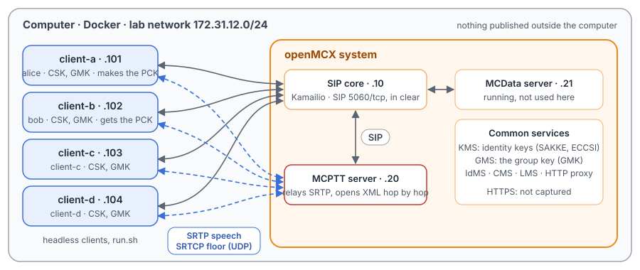
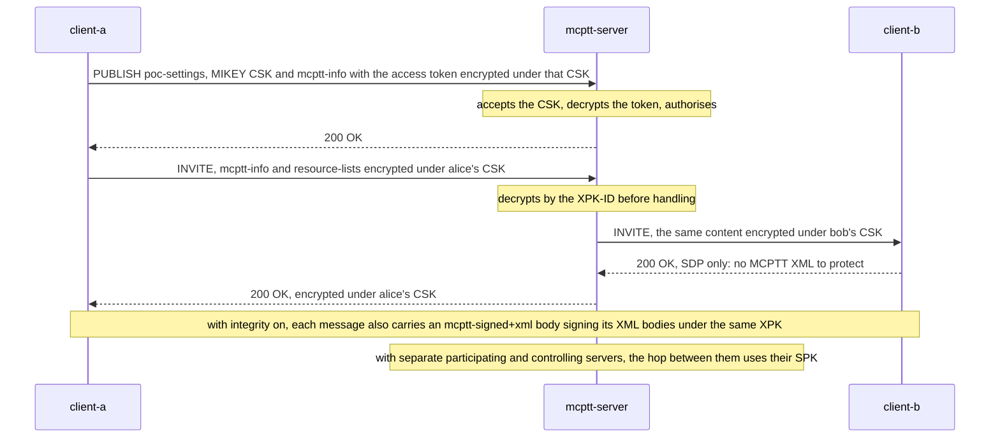
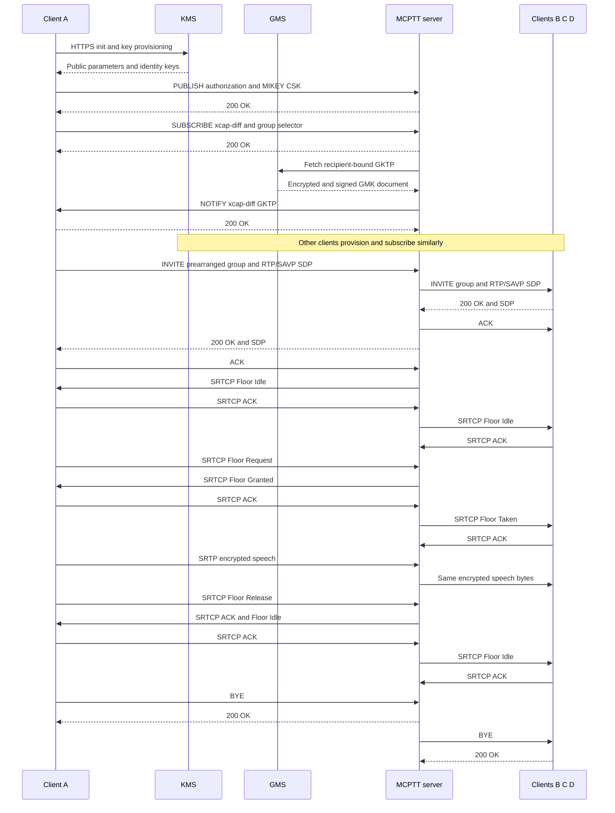

# Unit Test Tutorial 12: MCPTT protected calls: the keys, SRTP and SRTCP, XML protection

One computer runs the openMCX system from the published images, with four headless clients in place of phones. This
time the system protects what it carries, as TS 33.180 defines it, and a script shows each layer:

- the **keys**: each client's client-server key (CSK), uploaded to the server at sign-in; the group's media key (GMK),
  delivered to every member by the server; and, for a private call, a private call key (PCK) the caller makes and
  sends to the callee, end to end;
- a **protected group call**: speech in SRTP under the GMK, floor control in SRTCP under each client's CSK;
- a **protected private call**: the PCK in the SDP offer (MIKEY-SAKKE), speech under the PCK, then a second call with a
  new PCK;
- a **tampered key**: the callee refuses it;
- **XML protection**: every MCPTT XML body encrypted and signed, between each client and the server.

A capture of the lab network records it all, so you can see in Wireshark what is protected and what stays readable.

The tutorial is built on the protected labs of the openMCX regression tests (`tools/regress.py`, labs `xml-protection`
and `xml-integrity`), with steps of `tests/integration/protected_private_scenario.py`,
`tests/integration/xml_protection_scenario.py` and `tests/integration/prearranged_scenario.py`, and uses the same
images.
[Unit Test Tutorial 1](../01-group-call-basics/README.md) explains the group call and
[Unit Test Tutorial 3](../03-private-calls/README.md) the private call underneath.

> **Encrypted on purpose.** In Unit Test Tutorials 1 to 11 the speech, the floor control and the MCPTT XML are in clear
> for learning. Here they are encrypted: that is what this tutorial shows. The capture holds no keys, and nothing in
> openMCX exports them, so Wireshark cannot decrypt the speech, the floor control or the XML; you see their structure
> (headers, key identifiers, lengths) and that the content is opaque. SIP itself still goes in clear over TCP (the
> system's debug mode, port 5060) so that you can read the signalling; a real system adds TLS on top. The HTTPS traffic
> to the common services (sign-in, the identity keys from the KMS) stays encrypted and is not captured.

<p align="center"></p>

## The keys

| Key | Protects | Made by, sent by | Seen in the capture | TS 33.180 |
|---|---|---|---|---|
| Identity keys (SAKKE, ECCSI) | the key transport below | the KMS, to each client and server | not at all (HTTPS) | clause 5.3 |
| CSK, client-server key | floor control (SRTCP) and MCPTT XML between a client and the server | the client, in the PUBLISH of its service authorisation, as a MIKEY-SAKKE I_MESSAGE to the server | `application/mikey` in the PUBLISH; CSK-ID with purpose tag `2` | clause 9.2.1 |
| GMK, group master key | group speech (SRTP), end to end | the group management, in an xcap-diff NOTIFY to each member: a GKTP, a MIKEY-SAKKE I_MESSAGE per member | `<mgktp:GKTP id="…">` in the NOTIFY; GMK-ID with purpose tag `0`, a GUK-ID per member | clauses 5.7, 7.3 |
| PCK, private call key | private call speech (SRTP), end to end | the caller, in its SDP offer, as a MIKEY-SAKKE I_MESSAGE to the callee; the server passes it on unchanged | `a=key-mgmt:mikey …` in the INVITE; PCK-ID with purpose tag `1` | clauses 7.2.1, 5.6 |

The purpose tag is the four most significant bits of a key identifier (TS 33.180 annex G): `0` GMK, `1` PCK, `2` CSK.

## What you need

- A computer with Docker and Docker Compose v2 (Linux, or Docker Desktop on macOS or Windows) and a bash shell for
  `run.sh` (on Windows: WSL or Git Bash).
- No phones, no network set-up, nothing to compile: the tutorial uses the **prebuilt openMCX images from Docker Hub**
  (`openmcx/openmcx-*:v1`) and publishes no port; everything stays on the computer.
- [Wireshark](https://www.wireshark.org/) to look at the capture (optional: `run.sh` prints a summary).

## 1. Make the configuration

```bash
cd tutorials/unit-tests/12-protected-media
docker compose run --rm setup
```

The setup container runs the generator of the regression lab (`tools/prepare-prearranged-test.py --debug-sip
--private-call --protected --key-parameters-iei 0x79 --xml-protection --integrity-protection`). It writes `./config`
with these parts:

- a new certificate authority with the servers' and clients' certificates;
- the users `alice` (client-a), `bob` (client-b), `client-c` and `client-d`, all in the group `operations`;
- protection for every client and the server: protected media and floor control, XML confidentiality and integrity
  (`security` in each configuration), the KMS and GMS addresses, and the key parameters profile of the group key;
- private call rights, as in [Unit Test Tutorial 3](../03-private-calls/README.md).

It runs once. To start over, see step 5. The certificates last 30 days.

## 2. Start the system

```bash
docker compose up -d --wait
```

After about half a minute `--wait` returns and every service is healthy, with the capture already running. Each client
then fetches its identity keys from the KMS (HTTPS, not captured), signs in, uploads its CSK and receives the GMK.

| Address | Container |
|---|---|
| 172.31.12.10 | SIP core (Kamailio) |
| 172.31.12.20 | MCPTT server |
| 172.31.12.21 | MCData server (running, not used here) |
| 172.31.12.101 | client-a, user `alice` |
| 172.31.12.102 | client-b, user `bob` |
| 172.31.12.103 | client-c, user `client-c` |
| 172.31.12.104 | client-d, user `client-d` |

## 3. Run the steps

```bash
./run.sh
```

The script sends each command to a client and waits until the clients and the server show its result before going
on. It takes about a minute:

```
1. Four clients signed in with keys: a CSK each (uploaded to the server), the group key (GMK), XML protection on
  ok: client-a to client-d authorized and affiliated, each with a CSK and XML protection
  ok: each CSK-ID has the purpose tag 2 (TS 33.180 annex G)
...
3. A protected private call: client-a sends a new PCK to client-b in the SDP offer (MIKEY-SAKKE)
  $ client-a: private sip:bob.mcptt@mcx.test auto
  ok: one PCK-ID at both parties, starting with the bits 0001
...
7. The capture: captures/12-protected-media-run.pcap.gz
```

Each command is the same program the clients run, with `--command`. To type one yourself:

```bash
docker compose exec client-a mcx-client --config /config/client-a.json --command "private sip:bob.mcptt@mcx.test auto"
```

| Step | Command | What happens |
|---|---|---|
| 1 | (none: sign-in) | Each client uploads its CSK in the PUBLISH of its service authorisation (TS 33.180 clause 9.2, TS 24.379 clause 7.3), with the access token already encrypted under that CSK; the server accepts the CSK first, then decrypts the token. The server sends each member the GMK in an xcap-diff NOTIFY (TS 33.180 clause 5.7). All four hold the same GMK-ID, each its own CSK-ID. |
| 2 | `client-a: call`, `client-a: ptt` | A group call whose SDP says `RTP/SAVP` and carries no key: the GMK is already known (TS 33.180 clause 7.3). Floor control goes in SRTCP under each client's CSK (clause 9.4.2), the speech in SRTP under the GMK; the server relays it without being able to read it. |
| 3 | `client-a: private <bob> auto`, both `ptt`, `client-b: hangup` | client-a makes a PCK and puts it, encrypted to bob's identity, in `a=key-mgmt:mikey` of its offer (TS 24.379 clause 11.1.1.2.1.1 step 11, TS 33.180 clause 7.2.1). The server passes the I_MESSAGE to bob unchanged (TS 24.379 clause 6.3.2.2.3). Both use the PCK for their speech; client-c and client-d receive none of it. The PCK ends with the call. |
| 4 | `client-a: private <bob> auto`, `client-a: hangup` | Every call has its own PCK (TS 33.180 clause 5.6). |
| 5 | `client-a: private <bob> auto tamper-key` | client-a alters its I_MESSAGE (a test aid of the client); bob cannot authenticate it and answers 488 with warning `136 authentication of the MIKEY-SAKKE I_MESSAGE failed` (TS 24.379 clause 11.1.1.2.1.2 step 4, table 4.4.2-2). |
| 6 | (none: the counters) | Every client and the server encrypted, decrypted, signed and verified MCPTT XML, and refused nothing (TS 24.379 clauses 6.6.2 and 6.6.3). |

## 4. Look at the capture

`run.sh` copies the capture to `captures/12-protected-media-run.pcap.gz`. The folder also holds a reference run,
`captures/12-protected-media-full.pcap.gz` (249 KB, 3 745 frames): the frame numbers below and in the call flow are
those of the reference. Wireshark opens the compressed file directly (or `gunzip` it first).

The capture filter is `ip and not host 172.31.12.1 and (tcp port 5060 or (udp and not port 53) or icmp)`:

- SIP on 5060/tcp, with every TCP segment, so Wireshark rebuilds a message split over two segments;
- every UDP flow, since the speech and floor control ports come from the SDP and are not fixed;
- ICMP, which shows media sent to a closed port.

DNS, the encrypted HTTPS and the host's own traffic on the bridge (172.31.12.1) are left out.

Useful display filters:

| Filter | Shows |
|---|---|
| `mikey` | The MIKEY-SAKKE I_MESSAGEs Wireshark finds in SIP: the CSKs in the PUBLISHes and the PCKs in the INVITEs. |
| `sip.Event == "xcap-diff" && sip contains "GKTP"` | The NOTIFYs that bring each member the GMK. |
| `sdp.media contains "SAVP"` | The SDP offers and answers of the protected calls. |
| `rtp` | The speech; Wireshark labels it SRTP (it learns `RTP/SAVP` from the SDP) and shows only `SRTP Encrypted Payload`. |
| `rtcp` | The floor control in SRTCP. |
| `sip contains "EncryptedData"` | Messages whose MCPTT XML is encrypted: every one that carries MCPTT XML (REGISTERs, ACKs, the 407 challenges and responses without a body have none). |

What is protected and what stays readable:

| In the capture | Readable | Protected |
|---|---|---|
| SIP | request line, headers (`From`, `To` with the public user identities, `Contact`, …), the SDP | the MCPTT XML bodies: each sensitive element is an `<EncryptedData>` (AES-128-GCM, `KeyName` the CSK-ID), each URI in a list `sip:<ciphertext>;iv=…;key-id=…;alg=128-aes-gcm@…`; every XML body is signed in an `application/vnd.3gpp.mcptt-signed+xml` part |
| MIKEY-SAKKE I_MESSAGE | the header (version, data type 26, the key identifier as CSB-ID), the identities (IDRi, IDRr: e.g. `sip:alice.mcptt@mcx.test`), the KMS names, the timestamp | the key itself (SAKKE-encrypted to the recipient) and the ECCSI signature over the message |
| SRTP speech | the RTP header (payload type, sequence number, timestamp, SSRC), and at the end the MKI (key identifier) and, for a group call, the ROC | the AMR-WB payload, with a 16-octet AES-GCM tag |
| SRTCP floor control | the first 8 octets: version, subtype, packet type, length, SSRC; at the end the E flag and SRTCP index and the MKI | the application name (`MCPT`) and the floor message itself, with its tag |

Two things Wireshark 4.2 shows in a way that may surprise:

- **"Application name is not a string"** (an expert error) on every floor control packet: the four octets that hold
  `MCPT` are encrypted. The subtype in the clear first octet still tells the message type (for example 21 for Floor
  Idle with acknowledgement, 10 for Floor Ack).
- **`SRTP Encrypted Payload`** runs to the end of the packet: Wireshark does not split off the tag, the MKI and the ROC.
  The last octets of a group call packet are the MKI (8 octets) and the ROC (4 octets), of a private call packet the
  MKI (4 octets).

What to look for, in the reference run:

- **The CSKs** (frames 42 to 71): client-c's PUBLISH (42), bob's (54), alice's (62), client-d's (71), each with an
  `application/mikey` part: an I_MESSAGE of data type 26 (SAKKE) whose CSB-ID is the CSK-ID, purpose tag 2 (alice's:
  `0x2357155e`). The `<mcptt-access-token>` and the client ID next to it are `<EncryptedData>`.
- **The GMK** (frames 416 to 471): the server's xcap-diff NOTIFYs to client-c (416), bob (420), alice (422) and
  client-d (471), each with one `<mgktp:GKTP id="7689598">`: the GMK-ID `0x0075557e`, purpose tag 0, the same for all.
  The I_MESSAGE inside (hex) is different for each member: its CSB-ID is the member's GUK-ID (alice's `0x06ad560a`),
  the GMK-ID diversified with the member's identity (TS 33.180 clause 5.2.3).
- **The group call** (frames 536 to 2106): alice's INVITE (543, after the SIP core's `407` to 536) with
  `m=audio 4000 RTP/SAVP 96`, no `a=key-mgmt`, and its `<mcptt-request-uri>` and `<mcptt-client-id>` encrypted;
  the server's INVITEs to bob (553), client-c (563) and client-d (569), each encrypted under that member's own CSK; the
  200 OK to alice (582). Floor control: Floor Idle to bob (599) ends with `80000001` (E flag, index 1) and bob's CSK-ID
  as MKI, to alice (612) with alice's; alice's Floor Ack and Floor Request from 660. alice's first speech packet (745)
  ends with `0075557e 06ad560a 00000000`: the GMK-ID, her GUK-ID, the ROC. The packet the server sends bob (747) carries
  the very same payload: the server cannot decrypt it. alice ends the call (2103, 2106).
- **The private call** (frames 2191 to 3640): alice's INVITE (2198) with `a=key-mgmt:mikey ARoFARBLJ0YA…`, an
  I_MESSAGE whose CSB-ID is the PCK-ID `0x104b2746` (purpose tag 1), and its resource-lists entry for bob encrypted.
  The server's INVITE to bob (2208) carries the same I_MESSAGE, octet for octet. bob's 200 OK (2211, to alice 2220)
  carries no key. alice's speech (from 2236) and bob's (from 2921) end with the PCK-ID as MKI. bob ends the call (3640).
- **The new PCK** (frame 3660): the next offer's PCK-ID is `0x12bf12b7`.
- **The tampered key** (frames 3710 to 3739): alice's INVITE (3717), the server's to bob (3727), bob's 488 with
  `Warning: 399 mcx "136 authentication of the MIKEY-SAKKE I_MESSAGE failed"` (3729), relayed to alice (3739).

## 5. Stop or start over

```bash
docker compose down -v        # remove the containers and their data (status files, capture)
rm -rf config                 # with down -v: start over at step 1
```

To run the steps again on the same system, run `./run.sh` again: the capture keeps everything since `up`. For a new
capture, `docker compose down -v` and `docker compose up -d --wait` first (the configuration stays).

## Images

The compose file names every image in full, all from Docker Hub:

| Image | What it is |
|---|---|
| `docker.io/openmcx/openmcx-setup:v1` | The setup: the lab's generator |
| `docker.io/openmcx/openmcx-mcptt-server:v1`, `docker.io/openmcx/openmcx-mcdata-server:v1` | The MCPTT and MCData servers |
| `docker.io/openmcx/openmcx-common:v1`, `docker.io/openmcx/openmcx-http-proxy:v1`, `docker.io/openmcx/openmcx-user-db:v1` | The common services, among them the KMS and the GMS |
| `docker.io/openmcx/openmcx-client:v1` | The headless client (`openMCX/openmcx-client` repository) |
| `docker.io/openmcx/openmcx-kamailio:6.1.4-2` | The SIP core |
| `docker.io/library/mysql@sha256:…` | The SIP core's database |
| `docker.io/nicolaka/netshoot@sha256:…` | tcpdump, for the capture |

To use images you built yourself, change the `image:` lines in `docker-compose.yaml` (building them:
[docs/BUILD.md](../../../docs/BUILD.md)).

## When something does not work

- **A service stays unhealthy**: `docker compose logs <service>`.
- **A step of run.sh fails**: it prints the step that did not complete. `docker compose exec client-a cat
  /artifacts/client-a/status.json` shows a client's keys (`csk_id`, `group_key_id`, `private_key_id`), whether it is
  ready for protected calls (`protected_ready`, `protected_media`, `protected_floor`), its XML protection counters
  (`xml_protection`) and its last refused call (`last_call_failure`); `/artifacts/mcptt-server/status.json` has the
  server's `xml_protection`. Start over from a clean state with `docker compose down -v` and
  `docker compose up -d --wait`.
- **No capture, or `capture` exited**: `docker compose logs capture`. The capture container uses the host's network
  to reach the lab's bridge (`openmcx-ut12`), and the address range 172.31.12.0/24 must be free on the computer.
- **Certificates expired** (after 30 days): start over (step 5).

## How it is put together

- `docker-compose.yaml`: the regression lab of `prepare-prearranged-test.py --debug-sip --private-call --protected
  --key-parameters-iei 0x79 --xml-protection --integrity-protection` (the `xml-integrity` lab of `tools/regress.py`),
  written for the published images by `tools/tutorial-compose.py`. Each container has a fixed address, so the capture
  reads by role. The status files are in a volume, and the capture runs on the lab's bridge.
- `run.sh`: XP-00 to XP-06 of `tests/integration/xml_protection_scenario.py`, PP-01 to PP-04 of
  `tests/integration/protected_private_scenario.py`, and a protected group call as `prearranged_scenario.py` makes it in
  the `protected-prearranged` lab. Left out: first-to-answer, ambient listening and emergency protected private calls
  (PP-05 to PP-07), protected emergency group calls, the replay and tamper tests of SRTP and SRTCP packets
  (`protected_negative_scenario.py`, which injects packets into the lab), and separate participating and controlling
  servers (the SPK between them).
- `speech/`: the two spoken test messages the clients transmit (16 kHz WAV, made with espeak-ng).
- `captures/12-protected-media-full.pcap.gz`: the reference run.

## Call flow

Two diagrams of the regression's test reports. The first, from
[`tests/mcptt/XML_PROTECTION_TEST.md`](../../../tests/mcptt/XML_PROTECTION_TEST.md), shows how the XML is protected
hop by hop:



The second, from [`tests/mcptt/EMERGENCY_PROTECTED_TEST.md`](../../../tests/mcptt/EMERGENCY_PROTECTED_TEST.md), shows
the keys and a protected group call; its emergency re-INVITE and alert are left out here (they are in
[Unit Test Tutorial 5](../05-emergency-imminent-peril/README.md)). SIP arrows pass through the SIP core; authentication
challenges and conference subscriptions are omitted.



| Message | Frames |
|---|---|
| CSK PUBLISH: client-c, bob, alice, client-d | 42, 54, 62, 71 |
| GKTP NOTIFY to client-c, bob, alice, client-d | 416, 420, 422, 471 |
| Group INVITE A → core (after 407), core → S; S → B, C, D | 536, 543; 545; 553, 563, 569 |
| 200 OK to A | 582 |
| SRTCP Floor Idle to B, to A; A's floor control from | 599, 612; 660 |
| SRTP speech A → S, S → B (same bytes) | 745, 747 |
| BYE from A (after 407) | 2103, 2106 |
| Private INVITE A → core with the PCK (after 407); core → B, unchanged | 2191, 2198; 2208 |
| 200 OK from B, to A (no key) | 2211, 2220 |
| SRTP speech A, B (MKI = PCK-ID) | from 2236, from 2921 |
| Second private call: INVITE with a new PCK | 3660 |
| Tampered key: INVITE A, to B; 488 from B, to A | 3717, 3727; 3729, 3739 |
