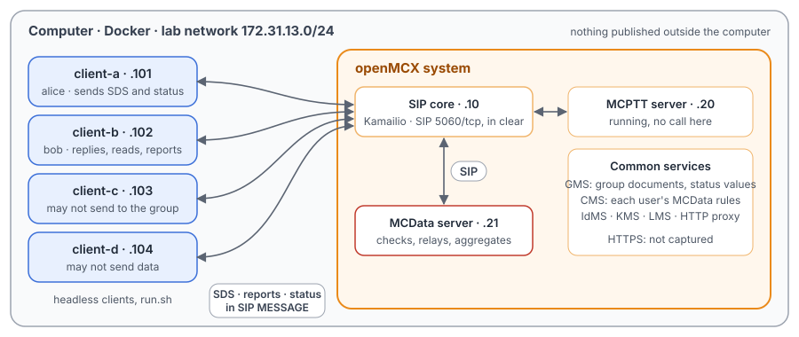
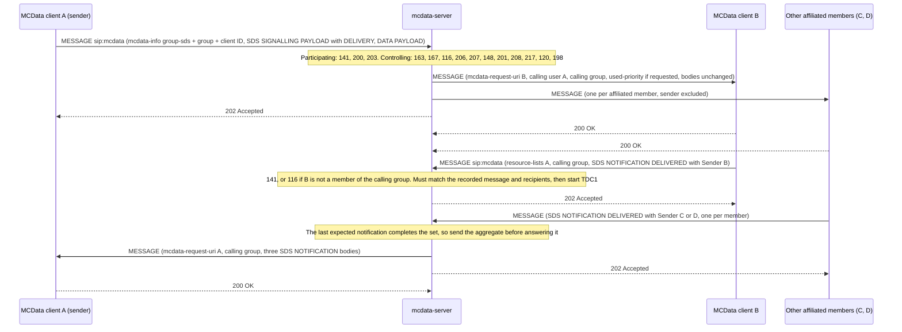

# Unit Test Tutorial 13: MCData short data service, delivery reports and status messages

One computer runs the openMCX system from the published images, with four headless clients in place of phones. This
time they use **MCData** (TS 24.282) instead of speech. A script takes them through the short data service (SDS):

- a one-to-one SDS and a reply in the same conversation;
- disposition notifications: delivered, read, and delivered and read;
- SDS the server refuses (transmission control);
- a group SDS to every affiliated member, with the members' notifications gathered into one message;
- a member that is not affiliated, which receives nothing;
- **enhanced status**: a member shares one of the group's operational values ("On scene", "En route", …).

A capture of the lab network records it all, so you can follow each SDS, each notification and each status in
Wireshark.

The tutorial is built on two scenarios of the openMCX regression tests, `tests/integration/mcdata_sds_scenario.py` and
`tests/integration/mcdata_status_scenario.py`, and uses the same images.

> **SIP in clear, for learning.** The system runs in its debug mode: SIP goes over TCP without TLS (port 5060), so
> Wireshark shows every message and its bodies. A real system uses TLS (End to End Tutorials 1 to 5). Here every SDS,
> notification and status travels **inside SIP MESSAGE requests** (the signalling control plane, TS 24.282 clause
> 9.2.2), so the capture holds all of MCData. The HTTPS traffic to the common services (sign-in, the group documents
> and the MCData rules) stays encrypted and is not captured.

<p align="center"></p>

## How MCData short data travels

| | What it is | In the capture |
|---|---|---|
| Sign-in | After its MCPTT sign-in each client signs in to MCData with a PUBLISH `poc-settings` to the MCData service `sip:mcdata@mcx.test` (access token, client ID) and affiliates to its MCData group with a PUBLISH `presence` (TS 24.282 clauses 7 and 8) | PUBLISH to `sip:mcdata@mcx.test` |
| An SDS | A SIP MESSAGE to `sip:mcdata@mcx.test` with three bodies: `mcdata-info` XML (`<request-type>one-to-one-sds</request-type>` or `group-sds`), the binary **SDS SIGNALLING PAYLOAD** (date, conversation, message ID, what to report) and the binary **DATA PAYLOAD** (the text, or the status id); a one-to-one SDS also names its target in a `resource-lists` body (clause 9.2.2.2.1) | MESSAGE with `multipart/mixed` |
| The MCData server | It combines the participating and controlling MCData functions: it checks the sender's rights (clause 11.1), sends the message on to each target with `<mcdata-calling-user-id>` (and `<mcdata-calling-group-id>` for a group), and answers the sender `202 Accepted` | MESSAGEs from 172.31.13.21, a `202` |
| A notification | The receiving client reports with an **SDS NOTIFICATION** in a SIP MESSAGE to the MCData service, naming the original sender in `resource-lists`; the server passes it on (clause 12.2) | MESSAGE with a SDS NOTIFICATION part |

What a sender can ask for, and what comes back (TS 24.282 tables 15.2.3-1 and 15.2.5-1):

| Asked for (`sds …`) | Disposition request type | Notification that comes back |
|---|---|---|
| `delivery` | 1, delivery | 2, DELIVERED, as soon as the message arrives |
| `read` | 2, read | 3, READ, when the user has displayed it (`sds-display`) |
| `both` | 3, delivery and read | 4, DELIVERED AND READ if displayed within TDU1 (3 s here); otherwise DELIVERED at TDU1 expiry and READ later |

For a group SDS the server gathers the members' notifications for TDC1 (3 s here) and sends them to the sender in one
MESSAGE (clause 12.2.3); a notification that comes later goes on its own.

## What you need

- A computer with Docker and Docker Compose v2 (Linux, or Docker Desktop on macOS or Windows) and a bash shell for
  `run.sh` (on Windows: WSL or Git Bash).
- No phones, no network set-up, nothing to compile: the tutorial uses the **prebuilt openMCX images from Docker Hub**
  (`openmcx/openmcx-*:v1`) and publishes no port; everything stays on the computer.
- [Wireshark](https://www.wireshark.org/) to look at the capture (optional: `run.sh` prints a summary).

## 1. Make the configuration

```bash
cd tutorials/unit-tests/13-mcdata-sds-status
docker compose run --rm setup
```

The setup container runs the generator of the regression lab (`tools/prepare-prearranged-test.py --debug-sip
--private-call --mcdata`). It writes `./config` with these parts:

- a new certificate authority with the servers' and clients' certificates;
- the users `alice` (client-a), `bob` (client-b), `client-c` and `client-d`, each with an MCData ID
  (`sip:alice.mcdata@mcx.test`, …), all MCData members of the group `operations`;
- each user's MCData rules (TS 24.282 `<ruleset>`): alice may send one-to-one SDS to bob and client-c only, at most 300
  bytes; bob accepts one-to-one SDS only from alice; client-c may send, but not to the group; client-d may not send
  data at all;
- the group `operations`: SDS allowed, enhanced status allowed, with the operational values `1` "On scene", `2` "En
  route" and `3` "Available"; the group `operations-noemergency` has a value but does not allow enhanced status;
- the MCData server's limits and timers: 1000 bytes over the signalling plane, 500 per one-to-one SDS; TDC1 3 s for
  gathering notifications. The clients use TDU1 3 s.

It runs once. To start over, see step 5. The certificates last 30 days.

## 2. Start the system

```bash
docker compose up -d --wait
```

After about half a minute `--wait` returns and every service is healthy, with the capture already running. Each client
then signs in to MCPTT and to MCData and affiliates to `operations`.

| Address | Container |
|---|---|
| 172.31.13.10 | SIP core (Kamailio) |
| 172.31.13.20 | MCPTT server (running, no call here) |
| 172.31.13.21 | MCData server |
| 172.31.13.101 | client-a, user `alice` |
| 172.31.13.102 | client-b, user `bob` |
| 172.31.13.103 | client-c, user `client-c` |
| 172.31.13.104 | client-d, user `client-d` |

## 3. Run the steps

```bash
./run.sh
```

The script sends each command to a client and waits until the clients and the server show its result before going
on. It takes about a minute:

```
2. A one-to-one SDS from alice to bob, and bob replies in the same conversation
  $ client-a: sds sip:bob.mcdata@mcx.test hello-bob
  ok: client-a's SDS answered 202
  ok: bob receives it from alice, rendered to the user
...
6. A group SDS asking for read: two read it, the third later
  ok: TDC1 expiry sends both READ notifications in one aggregate
...
9. The capture: captures/13-mcdata-sds-status-run.pcap.gz
```

Each command is the same program the clients run, with `--command`. To type one yourself:

```bash
docker compose exec client-a mcx-client --config /config/client-a.json --command "sds read sip:bob.mcdata@mcx.test hi"
```

| Step | Command | What happens (TS 24.282) |
|---|---|---|
| 1 | (none: sign-in) | Each client signs in to MCData (clause 7.2) and affiliates to `operations` (clause 8.2). |
| 2 | `client-a: sds <bob> hello-bob`, `client-b: sds-reply <id> hello-alice` | A one-to-one SDS (clause 9.2.2.2.1): the server checks it (clause 11.1), sends it to bob with alice as calling user (clause 9.2.2.4.1.1) and answers alice `202`. bob's reply carries the same conversation ID and the first message's ID as InReplyTo (clause 9.2.1.2). |
| 3 | `sds delivery …`, `sds read …` with `client-b: sds-display <id>`, `sds both …` | bob's client sends the notification alice asked for (clause 9.2.1.3, 12.2.1): DELIVERED at once; READ only after the display; DELIVERED AND READ for a display within TDU1. The server passes it to alice (clause 12.2.2). |
| 4 | client-d to alice, alice to client-d, client-c to bob | Refused with 403 and a warning (clause 9.2.2.3.1 steps 7 and 8, clause 9.2.2.4.2 step 5, table 4.9.2-2): `200` client-d may not send data; `229` client-d is not among alice's targets; `230` bob does not accept SDS from client-c. Nothing is sent on. |
| 5 | `client-a: sds-group delivery operations to-everyone` | A group SDS (clause 9.2.2.4.2 step 6): to every other affiliated member with the group as calling group, not to alice. The three DELIVERED notifications reach alice together in one MESSAGE once all three have reported (clause 12.2.3 step 15c). |
| 6 | `sds-group read …`; bob and client-d display it, client-c later | The two READ notifications are held for TDC1 and then sent together; client-c's late one goes on its own, with client-c as calling user (clause 12.2.3 steps 15c and 15d). |
| 7 | `client-d: mcdata-deaffiliate`, a group SDS, `client-d: mcdata-affiliate` | Only affiliated members receive a group SDS (clause 6.3.4). |
| 8 | `sds-status-values`, `sds-status operations 1`, … | Enhanced status (clause 14.2): the client reads the operational values from the group document, sends the id of one as a group SDS, and each member shows the matching value from its own copy of the document. The client refuses a group without enhanced status and an unknown id; an unknown id sent anyway (`force`, a test aid) is discarded by each member; client-c, without the right to send to the group, gets 403 with warning `201`. |

## 4. Look at the capture

`run.sh` copies the capture to `captures/13-mcdata-sds-status-run.pcap.gz`. The folder also holds a reference run,
`captures/13-mcdata-sds-status-full.pcap.gz` (89 KB, 970 frames): the frame numbers below and in the call flow are
those of the reference. Wireshark opens the compressed file directly (or `gunzip` it first).

The capture filter is `ip and not host 172.31.13.1 and (tcp port 5060 or (udp and not port 53) or icmp)`: SIP on
5060/tcp, with every TCP segment, so Wireshark rebuilds a message split over two segments. Short data over the
signalling control plane needs nothing else: there is no media plane in this tutorial, and the only other traffic of
the lab is the encrypted HTTPS to the common services. DNS and the host's own traffic on the bridge (172.31.13.1) are
left out.

Useful display filters:

| Filter | Shows |
|---|---|
| `sip.Method == "MESSAGE"` | Every SDS, notification and status, with the 202 and 403 answers in between. |
| `frame contains "one-to-one-sds"` | The one-to-one SDS and their replies. |
| `frame contains "group-sds"` | The group SDS and the enhanced statuses (which are group SDS). |
| `sip.Status-Code == 202` | The server accepting an SDS or a notification. |
| `sip.Status-Code == 403` | The refusals, each with its `Warning: 399 mcx "<code> …"`. |

Wireshark 4.2 shows the `mcdata-info` and `resource-lists` XML, but not the binary MCData parts: it lists
`Media type: application/vnd.3gpp.mcdata-signalling (38 bytes)` and `…mcdata-payload (15 bytes)`. Their first octet
says what they are (TS 24.282 clause 15): `01` SDS SIGNALLING PAYLOAD, `05` SDS NOTIFICATION, `03` DATA PAYLOAD.

- In an SDS SIGNALLING PAYLOAD, after the type: 5 octets date and time, 16 octets conversation ID, 16 octets message
  ID, then optional fields: `8x` the disposition request type `x` (`81` delivery, `82` read, `83` both), `21` and 16
  octets InReplyTo.
- In an SDS NOTIFICATION, the second octet is the notification type (`02` DELIVERED, `03` READ, `04` DELIVERED AND
  READ), then date and time, conversation ID and message ID, then `51` and a length introduce the Sender (the
  notifying user's MCData ID in text).
- In a DATA PAYLOAD, the second octet is the number of payloads; each starts with `78`, two octets of length and the
  content type (`01` text, `06` enhanced status), then the content: you can read the text, or the status id, in the
  bytes.

What to look for, in the reference run:

- **MCData sign-in** (frames 35 to 392): each client's PUBLISH `poc-settings` to `sip:mcdata@mcx.test` (client-c's
  35, alice's 60, bob's 118, client-d's 192, each challenged by the SIP core with `407` first), then its affiliation,
  a PUBLISH `presence` with an MCData PIDF (from 227).
- **One-to-one SDS** (frames 426 to 459): alice's MESSAGE (430, after the `407` to 426) with
  `<request-type>one-to-one-sds</request-type>`, a `resource-lists` entry for bob and the two binary parts; the SIP
  core passes it to the MCData server (432), which sends it to bob (434, to bob 439) with
  `<mcdata-calling-user-id>sip:alice.mcdata@mcx.test</mcdata-calling-user-id>` and answers alice `202` (436, to alice
  438). bob's reply (450, to alice 459) carries the InReplyTo field `21` with the first message's ID.
- **Notifications** (frames 470 to 574): alice's SDS asking for delivery (470, the SDS SIGNALLING PAYLOAD ends with
  `81`); bob's notification (483), a MESSAGE to the MCData service naming alice in `resource-lists`, with an SDS
  NOTIFICATION of type `02`; the server passes it to alice (493). The read request (510, `82`) gets a type `03` only
  after bob's display (bob's 526, to alice 534); the delivery-and-read request (550, `83`) gets one type `04` (574).
- **Refusals** (frames 586 to 620): client-d's SDS (590) gets `403` with `Warning: 399 mcx "200 …"` (594, to client-d
  596); alice's to client-d (602) gets `229` (606); client-c's to bob (614) gets `230` (618). None is sent on.
- **Group SDS and one aggregated notification** (frames 622 to 685): alice's group SDS (626) with
  `<request-type>group-sds</request-type>` and `81`; the server sends it to bob (630), client-c (632) and client-d
  (639), with `<mcdata-calling-group-id>sip:operations@mcx.test</mcdata-calling-group-id>`, never to alice, and
  answers `202` (634). The members' notifications (663, 667, 671) come back as one MESSAGE to alice (685) with three
  SDS NOTIFICATION parts, each with its Sender, and the calling group but no calling user.
- **Gathering for TDC1** (frames 700 to 777): after bob and client-d display the group SDS read request (704), the
  first READ reaches the server at 736 and the two go to alice together at 760, 3.0 s later (TDC1). client-c's late
  READ goes on its own (777), with client-c as calling user.
- **Not affiliated** (frames 789 to 837): client-d's PUBLISH with `Expires: 0` (789, 792) ends its affiliation; the
  group SDS (809) goes to bob (813) and client-c (815) only. client-d affiliates again (833, 837).
- **Enhanced status** (frames 855 to 967): alice's status (855) is a group SDS whose DATA PAYLOAD holds content type
  `06` and the text `1`; the server sends it to the three others (859, 861, 863), and each shows "On scene". bob's `2`
  (891, sent on from 895). alice's unknown id `9`, sent with the test aid (927, sent on from 931), is discarded by each
  member. client-c's status (963) gets `403` with warning `201` (967). The two the client refused itself (a group
  without enhanced status, an unknown id) never reach the network.

One detail about order: TS 24.282 clause 9.2.2.4.2 lists the server sending the SDS on (step 6) before answering `202`
(steps 7 and 8). The server's answer and its messages to the members are separate SIP transactions, so on the wire the
`202` can come before the last copy: for the group SDS above, `202` (634) goes between client-c's copy (632) and
client-d's (639).

## 5. Stop or start over

```bash
docker compose down -v        # remove the containers and their data (status files, capture)
rm -rf config                 # with down -v: start over at step 1
```

To run the steps again on the same system, run `./run.sh` again: the capture keeps everything since `up`, and each
step looks for its own text. For a new capture, `docker compose down -v` and `docker compose up -d --wait` first (the
configuration stays).

## Images

The compose file names every image in full, all from Docker Hub:

| Image | What it is |
|---|---|
| `docker.io/openmcx/openmcx-setup:v1` | The setup: the lab's generator |
| `docker.io/openmcx/openmcx-mcptt-server:v1`, `docker.io/openmcx/openmcx-mcdata-server:v1` | The MCPTT and MCData servers |
| `docker.io/openmcx/openmcx-common:v1`, `docker.io/openmcx/openmcx-http-proxy:v1`, `docker.io/openmcx/openmcx-user-db:v1` | The common services, among them the GMS and the CMS |
| `docker.io/openmcx/openmcx-client:v1` | The headless client (`openMCX/openmcx-client` repository) |
| `docker.io/openmcx/openmcx-kamailio:6.1.4-2` | The SIP core |
| `docker.io/library/mysql@sha256:…` | The SIP core's database |
| `docker.io/nicolaka/netshoot@sha256:…` | tcpdump, for the capture |

To use images you built yourself, change the `image:` lines in `docker-compose.yaml` (building them:
[docs/BUILD.md](../../../docs/BUILD.md)).

## When something does not work

- **A service stays unhealthy**: `docker compose logs <service>`.
- **A step of run.sh fails**: it prints the step that did not complete. `docker compose exec client-a cat
  /artifacts/client-a/status.json` shows a client's MCData state: `mcdata_authorized`, `mcdata_affiliated`,
  `mcdata_inbox` (the SDS it received), `mcdata_notifications` (the notifications it received), `mcdata_sent`,
  `mcdata_last_result` (the answer to its last SDS, with the warning), `mcdata_enhanced_status`;
  `/artifacts/mcdata-server/status.json` has the server's bindings and affiliations per MCData ID. Start over from a
  clean state with `docker compose down -v` and `docker compose up -d --wait`.
- **No capture, or `capture` exited**: `docker compose logs capture`. The capture container uses the host's network
  to reach the lab's bridge (`openmcx-ut13`), and the address range 172.31.13.0/24 must be free on the computer.
- **Certificates expired** (after 30 days): start over (step 5).

## How it is put together

- `docker-compose.yaml`: the regression lab of `prepare-prearranged-test.py --debug-sip --private-call --mcdata` (the
  `smoke-mcdata` lab of `tools/regress.py`), written for the published images by `tools/tutorial-compose.py`. Each
  container has a fixed address, so the capture reads by role. The status files are in a volume, and the capture runs
  on the lab's bridge.
- `run.sh`: SD-01 to SD-05, SD-07 (three of its refusals), SD-08 with AG-01 and AG-02, and SD-09 of
  `tests/integration/mcdata_sds_scenario.py`, and ES-01 to ES-05 of `tests/integration/mcdata_status_scenario.py`.
  Left out: the affiliation status subscription (AF), application IDs and priorities (SD-06, SD-11), the other
  refusals (SD-07, SD-10), ad hoc group SDS (AD), functional aliases (FA, see
  [Unit Test Tutorial 11](../11-functional-aliases/README.md) for the MCPTT ones), re-delivery (RD), the MCData
  emergency alert (EA) and the group document subscription (`mcdata_group_subscription_scenario.py`). File
  distribution, the message store and SDS over the media plane are the subject of
  Unit Test Tutorial 14.
- `captures/13-mcdata-sds-status-full.pcap.gz`: the reference run.

## Call flow

The group SDS with a delivery notification, from the regression's test report
([`tests/mcdata/MCDATA_SDS_TEST.md`](../../../tests/mcdata/MCDATA_SDS_TEST.md)). The SIP core is left out: every request
and response passes through it, and it adds `P-Asserted-Identity`. The MCData server combines the participating and
controlling functions. The recipients' `200 OK` responses end at the server; the sender learns about delivery only
from the notifications it asked for. The report draws the `202` after the copies; in the reference run it comes
between them (see the note above).



| Message | Frames |
|---|---|
| A → S MESSAGE group SDS with DELIVERY (alice to the SIP core, the SIP core to the server) | 626, 628 |
| S → B, C, D MESSAGE (server to the SIP core) | 630, 632, 639 |
| S → A 202 Accepted (server to the SIP core) | 634 |
| B, C, D → S MESSAGE SDS NOTIFICATION DELIVERED (after the SIP core's `407`) | 663, 667, 671 |
| S → A MESSAGE with the three notifications (server to the SIP core) | 685 |
