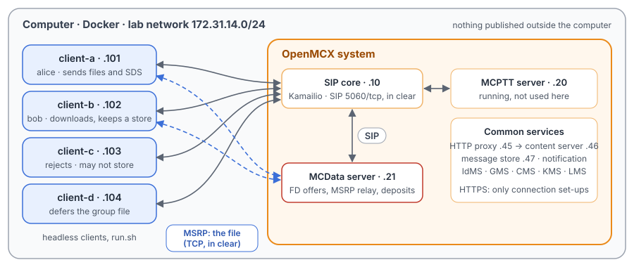
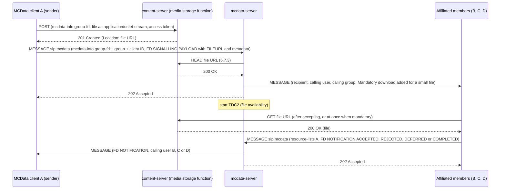
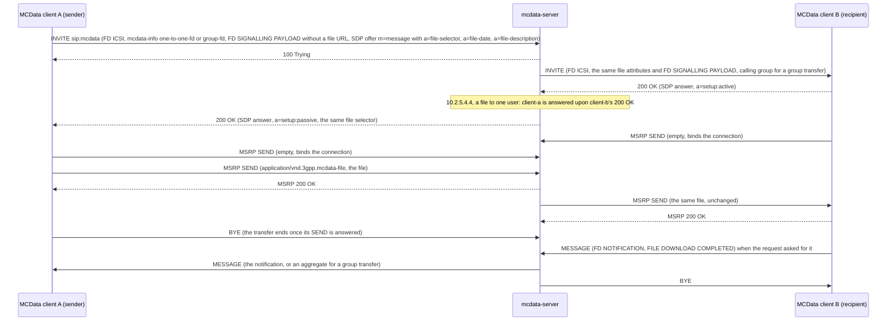
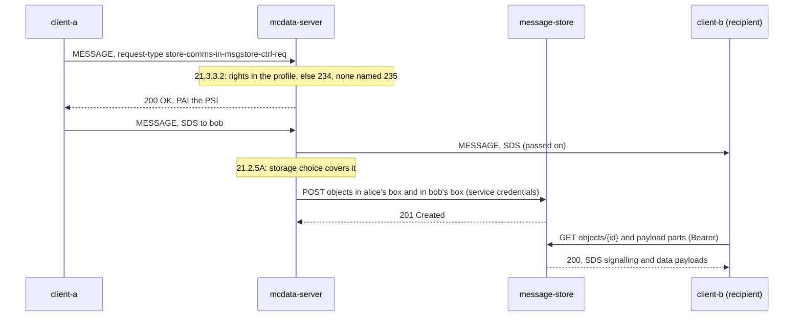

# Unit Test Tutorial 14: MCData file distribution by HTTP and MSRP, and the message store

One computer runs the OpenMCX system from the published images, with four headless clients in place of phones.
A script takes them through MCData file distribution and the MCData message store (TS 24.282):

- a file sent to one user over HTTP: uploaded to the content server, offered by SIP, downloaded at once;
- a file sent to a group: each member accepts, rejects or defers it, and the sender is told;
- a file sent over the media plane: carried in MSRP through the MCData server, not by URL;
- the message store: users switch storage on (or are refused), and an SDS and a file are deposited and found again.

A capture of the lab network records every SIP message and every MSRP packet, so you can follow each step in
Wireshark.

The tutorial is built on three scenarios of the OpenMCX regression tests, `tests/integration/mcdata_fd_scenario.py`,
`mcdata_media_scenario.py` and `mcdata_msgstore_scenario.py`, and uses the same images. For a deployment with phones,
see the [End to End Tutorials](../../README.md).

> **SIP in clear, for learning.** The system runs in its debug mode: SIP goes over TCP without TLS (port 5060), so
> Wireshark shows every message and its MCData XML. A real system uses TLS (End to End Tutorials 1 to 5). MSRP is in
> clear in this tutorial. The HTTPS traffic to the common services stays encrypted: the capture keeps only the first
> packet (SYN) of each connection to the HTTP proxy, the content server and the message store, so you can see when a
> file is uploaded, downloaded or deposited, but not its content.

<p align="center"></p>

## A file over HTTP or over the media plane

| | Over HTTP (TS 24.282 clauses 10.2.2 to 10.2.4) | Over the media plane (clause 10.2.5, TS 24.582 clause 7) |
|---|---|---|
| Where the file goes | the sender uploads it to the content server (the media storage function) and gets its URL | in the session: MSRP SEND requests to the MCData server, which relays them to the recipient |
| What the SIP request carries | a SIP MESSAGE with the file URL and its metadata (FD signalling payload) | a SIP INVITE with an `m=message` stream and the file in `a=file-selector` (name, size, SHA-256) |
| How the recipient gets it | downloads it from the URL, now (mandatory, or small enough) or after accepting | receives it in MSRP once it accepts the INVITE |
| What the sender is told | FD notifications by SIP MESSAGE: accepted, rejected, deferred, completed | the 200 OK, and a completed notification by SIP MESSAGE |

## What you need

- A computer with Docker and Docker Compose v2 (Linux, or Docker Desktop on macOS or Windows) and a bash shell for
  `run.sh` (on Windows: WSL or Git Bash).
- No phones, no network set-up, nothing to compile: the tutorial uses the **prebuilt OpenMCX images from Docker Hub**
  (`openmcx/openmcx-*:1.0.0`) and publishes no port; everything stays on the computer.
- [Wireshark](https://www.wireshark.org/) to look at the capture (optional: `run.sh` prints a summary).

## 1. Make the configuration

```bash
cd tutorials/unit-tests/14-mcdata-files-msgstore
docker compose run --rm setup
```

The setup container runs the generator of the regression lab (`tools/prepare-prearranged-test.py --debug-sip --mcdata
--msgstore`, the `msgstore` lab of `tools/regress.py`). It writes `./config` with these parts:

- a new certificate authority with the servers' and clients' certificates;
- the users `alice` (client-a), `bob` (client-b), `client-c` and `client-d`, all in the group `operations`, each with
  an MCData ID;
- the MCData rights: everyone may send and receive files; files up to 64 bytes are offered as a mandatory download;
  the sender is told of a group's decisions in one message after TDC1 (3 s);
- the message store rights: alice may store all her private and group communications, bob his private ones, client-c
  none.

It runs once. To start over, see step 5. The certificates last 30 days.

## 2. Start the system

```bash
docker compose up -d --wait
```

After about half a minute `--wait` returns and every service is healthy, with the capture already running.

| Address | Container |
|---|---|
| 172.31.14.10 | SIP core (Kamailio) |
| 172.31.14.20 | MCPTT server (running, not used here) |
| 172.31.14.21 | MCData server |
| 172.31.14.45 | HTTP proxy (the clients' way to the content server and the message store) |
| 172.31.14.46 | content server (media storage function) |
| 172.31.14.47 | message store |
| 172.31.14.101 | client-a, user `alice` |
| 172.31.14.102 | client-b, user `bob` |
| 172.31.14.103 | client-c, user `client-c` |
| 172.31.14.104 | client-d, user `client-d` |

## 3. Run the steps

```bash
./run.sh
```

The script sends each command to a client and waits until the clients and the servers show its result before going
on. It takes about half a minute:

```
2. File distribution over HTTP to one user: upload, offer, automatic download, notifications
  $ client-a: fd-send completed sip:bob.mcdata@mcx.test /tmp/note-1234.txt
  ok: the FD request is accepted (202) and names the uploaded file by its URL
  ok: client-b downloads the small file at once (mandatory), its hash verified
...
4. File distribution over the media plane: the file travels in MSRP, not by URL
  $ client-a: fd-media mandatory completed sip:bob.mcdata@mcx.test /tmp/photo-1234.bin
  ok: the file offer is accepted (200 OK to the INVITE)
...
6. The capture: captures/14-mcdata-files-msgstore-run.pcap.gz
```

Each command is the same program the clients run, with `--command`. The files are random text made in the client's
`/tmp`; their names carry a number that changes with each run. To type a command yourself:

```bash
docker compose exec client-b mcx-client --config /config/client-b.json --command "mcdata-msgstore sync"
```

| Step | Command | What happens (TS 24.282) |
|---|---|---|
| 2 | `client-a: fd-send completed <bob> /tmp/note.txt` | client-a uploads the 40-byte file to the content server (clause 10.2.2), then sends the FD request by SIP MESSAGE with its URL and metadata, asking for the completed notification (clause 10.2.3). The MCData server checks the file and offers it to bob as a mandatory download, since it is small (clause 11.2). bob downloads it, checks its SHA-256, and client-a is told it was accepted and completed (clause 12.2). |
| 3 | `client-a: fd-send completed group=operations /tmp/report.txt`; `client-b: fd-accept`, `client-c: fd-reject`, `client-d: fd-defer` | A group distribution: every other member is offered the 600-byte file, without mandatory download. bob downloads it, client-c rejects it, client-d defers its decision. The server collects the notifications for TDC1 and sends them to client-a in one SIP MESSAGE (clause 12.2.3 step 15c). |
| 4 | `client-a: fd-media mandatory completed <bob> /tmp/photo.bin` | The file goes over the media plane: an INVITE with an `m=message` stream and the file selector; the MCData server invites bob and answers client-a only once bob has accepted (clause 10.2.5.4.4); client-a then sends the 200 bytes in MSRP, and the server relays them to bob, who checks the size and hash and sends the completed notification (clause 10.2.5, TS 24.582 clause 7). |
| 5 | `client-a: mcdata-msgstore-ctrl enable all-private all-group`, `client-b: … enable private=<alice>`, `client-c: … enable all-private`; `client-a: sds <bob> …`; `client-a: fd-send <bob> /tmp/kept.bin`; `client-b: mcdata-msgstore sync`, `payload` | Storage control by SIP MESSAGE to the MCData service (clauses 21.3.2.2 and 21.3.3.2): 200 for alice and bob, 403 with warning 234 for client-c. Then the MCData server deposits the SDS in alice's and bob's areas of the message store, and the file distribution in bob's: the message store fetches the file from the content server itself (clause 21.2.5A). bob finds both with a synchronisation, and the stored file has the same SHA-256 as the one sent. |

## 4. Look at the capture

The script `run.sh` copies the capture of your run to `captures/14-mcdata-files-msgstore-run.pcap.gz`. The folder also holds a reference run,
[`captures/14-mcdata-files-msgstore-full.pcap.gz`](captures/14-mcdata-files-msgstore-full.pcap.gz) (75 KB, 850 frames): the frame numbers below and in the call flow
are those of the reference. Wireshark opens the compressed file directly (or `gunzip` it first).

The capture filter is
`ip and not host 172.31.14.1 and ((tcp and not port 8443 and not port 3306) or (udp and not port 53) or icmp or (tcp
port 8443 and tcp[tcpflags] & tcp-syn != 0 and (host 172.31.14.45 or host 172.31.14.46 or host 172.31.14.47)))`:

- every TCP flow except HTTPS (8443) and the SIP core's database (3306): SIP on 5060, and MSRP, whose ports come from
  the SDP and are not fixed;
- every UDP flow and ICMP, as in the other tutorials;
- the SYN of each HTTPS connection to the HTTP proxy, the content server and the message store: an upload, a
  download, a deposit or a message store request starts with one, so they mark when the HTTP side acts.

DNS, the encrypted HTTPS content and the host's own traffic on the bridge (172.31.14.1) are left out.

Useful display filters:

| Filter | Shows |
|---|---|
| `sip.Method == "MESSAGE"` | The FD requests, offers and notifications, the storage control and the SDS. |
| `frame contains "one-to-one-fd" \|\| frame contains "group-fd"` | The file distribution requests and offers (`<request-type>` in the MCData XML). |
| `msrp` | The file over the media plane: the empty SEND that binds each connection, the SEND with the file, and the 200s. |
| `tcp.flags.syn == 1 && tcp.flags.ack == 0 && tcp.port == 8443` | When a client or a server opens an HTTPS connection: upload, download, deposit. |

Wireshark 4.2 decodes the MCData XML but not the FD signalling payload (the binary part with the file URL, the
metadata and the notification type), which it shows as data in the multipart body. The SHA-256 is in that payload for a
file over HTTP, and in `a=file-selector` for a file over the media plane.

What to look for, in the reference run:

- **A file to one user over HTTP** (frames 493 to 545): client-a opens a connection to the HTTP proxy (493) and
  uploads the file, then sends the FD request (497, again 501 after the SIP core's `407`; 503 at the MCData server)
  with `<request-type>one-to-one-fd</request-type>` and a `resource-lists` body naming bob. The MCData server checks
  the file at the content server (505), offers it to bob (507, at bob 512) and answers client-a 202 (509). bob tells
  the server it accepted it (516) and only then downloads it (518). client-a gets two notifications, accepted and completed
  (536, 545).
- **A file to the group** (frames 562 to 650): the request (562, 566; 568 at the server) has
  `<request-type>group-fd</request-type>` and no `resource-lists`. The offers reach bob (578), client-c (585) and
  client-d (589), not client-a. Their decisions come back (bob 600, client-c 624, client-d 636), and client-a gets them
  all in one SIP MESSAGE with three FD signalling parts (650), 3 s (TDC1) after the first.
- **A file over the media plane** (frames 656 to 735): client-a's INVITE (656, 663; 665 at the server) offers an
  `m=message` stream with `a=file-selector`. The MCData server answers `100 Trying` (667) and invites bob
  first (669, at bob 673). Only upon bob's 200 OK (675; 682 at the server) does it answer client-a 200 OK
  (685, at client-a 689), as TS 24.282 clause 10.2.5.4.4 requires. The invitation and the 200 OK carry the MCData
  session identity as Contact, with `g.3gpp.mcdata.fd`, its ICSI and `isfocus` (clause 6.3.7.1.23 steps 5 and 6).
  Then client-a sends the file over MSRP (697,
  `Byte-Range: 1-200/200`, `application/vnd.3gpp.mcdata-file`); the server relays it to bob (700), gets bob's MSRP 200
  (708) and answers client-a's SEND with an MSRP 200 (709). The server releases bob's leg (715) and client-a its own (735).
- **The message store** (frames 749 to 833): client-a's storage control request (749, 752; 753 at the server) has
  `<request-type>store-comms-in-msgstore-ctrl-req</request-type>` with `<store-all-private-comms-in-msgstore>` and
  `<store-all-group-comms-in-msgstore>`, answered 200 (754). bob's (758, 762) names alice in a
  `vnd.3gpp.mcdata-msgstore-ctrl-request+xml` body, answered 200 (766). client-c's (770, 773) is refused 403 with
  warning `234 user not authorized to enable or disable the storage of MCData communications into the MCData message
  store` (775). After the SDS (779, 783; 785 at the server, 789 at bob, 202 at 795) the MCData server opens a
  connection to the message store (798) to deposit it; after the next file distribution (813, 817; 819 at the server)
  it deposits that too (833).

## 5. Stop or start over

```bash
docker compose down -v        # remove the containers and their data (status files, capture)
rm -rf config                 # with down -v: start over at step 1
```

To run the steps again on the same system, run `./run.sh` again: its files and texts get new names, and the capture
keeps everything since `up`. For a new capture, `docker compose down -v` and `docker compose up -d --wait` first (the
configuration stays).

## Images

The compose file names every image in full, all from Docker Hub:

| Image | What it is |
|---|---|
| `docker.io/openmcx/openmcx-setup:1.0.0` | The setup: the lab's generator |
| `docker.io/openmcx/openmcx-mcptt-server:1.0.0`, `docker.io/openmcx/openmcx-mcdata-server:1.0.0` | The MCPTT and MCData servers |
| `docker.io/openmcx/openmcx-common:1.0.0`, `docker.io/openmcx/openmcx-http-proxy:1.0.0`, `docker.io/openmcx/openmcx-user-db:1.0.0` | The common services, among them the content server, the message store and the notification server |
| `docker.io/openmcx/openmcx-client:1.0.0` | The headless client (`OpenMCX/openmcx-client` repository) |
| `docker.io/openmcx/openmcx-kamailio:1.0.0` | The SIP core |
| `docker.io/library/mysql@sha256:…` | The SIP core's database |
| `docker.io/nicolaka/netshoot@sha256:…` | tcpdump, for the capture |

To use images you built yourself, change the `image:` lines in `docker-compose.yaml` (building them:
[docs/BUILD.md](../../../docs/BUILD.md)).

## When something does not work

- **A service stays unhealthy**: `docker compose logs <service>`.
- **A step of run.sh fails**: it prints the step that did not complete. `docker compose exec client-a cat
  /artifacts/client-a/status.json` shows a client's files (`mcdata_files`, `mcdata_files_sent`,
  `mcdata_media_files`), its notifications (`mcdata_file_notifications`) and its message store state (`msgstore`);
  `/artifacts/mcdata-server/status.json` has the server's transfers and deposit counters. Start over from a clean state
  with `docker compose down -v` and `docker compose up -d --wait`.
- **No capture, or `capture` exited**: `docker compose logs capture`. The capture container uses the host's network
  to reach the lab's bridge (`openmcx-ut14`), and the address range 172.31.14.0/24 must be free on the computer.
- **Certificates expired** (after 30 days): start over (step 5).

## How it is put together

- `docker-compose.yaml`: the regression lab of `prepare-prearranged-test.py --debug-sip --mcdata --msgstore`, written
  for the published images by `tools/tutorial-compose.py` with this tutorial's capture filter. Each container has a
  fixed address, so the capture reads by role. The status files are in a volume, and the capture runs on the lab's
  bridge.
- `run.sh`: FD-01 and FD-02 of `tests/integration/mcdata_fd_scenario.py`, MP-13 of `mcdata_media_scenario.py`, and
  MS-01, MS-02 (one case), MS-03 and MS-06 of `mcdata_msgstore_scenario.py`. Left out: the file availability timer,
  the rejections, the functional alias and the releases of file distributions (FD-03 to FD-11); the group and refused
  files over the media plane and the SDS over the media plane (in the media scenario); and the message store client
  operations, notification channels and upload by reference (MS-07 to MS-12).
- `captures/14-mcdata-files-msgstore-full.pcap.gz`: the reference run.

## Call flow

The three flows of the regression's test reports, with the SIP core and the HTTP proxy left out of the arrows: every
SIP request passes through the SIP core and every HTTP request through the HTTP proxy.

**A file over HTTP** ([`tests/mcdata/MCDATA_FD_TEST.md`](../../../tests/mcdata/MCDATA_FD_TEST.md), a group
distribution; a one-to-one one has a `resource-lists` body naming the single target):



**A file over the media plane** ([`tests/mcdata/MCDATA_MEDIA_TEST.md`](../../../tests/mcdata/MCDATA_MEDIA_TEST.md)):



**The message store** ([`tests/mcdata/MCDATA_MESSAGE_STORE_TEST.md`](../../../tests/mcdata/MCDATA_MESSAGE_STORE_TEST.md)):



| Message | Frames |
|---|---|
| Upload connection; FD request A → core, core → S; S checks the file | 493; 497, 501, 503; 505 |
| Offer S → core, core → B; 202 to A; B's notification; download connection | 507, 512; 509; 516; 518 |
| Notifications to A (accepted and completed) | 536, 545 |
| Group FD request; offers to B, C, D; decisions from B, C, D; the aggregate to A | 562, 566, 568; 578, 585, 589; 600, 624, 636; 650 |
| Media plane: INVITE A; 100 from S; INVITE to B; B's 200, at S; 200 from S, at A | 656, 663, 665; 667; 669, 673; 675, 682; 685, 689 |
| Media plane: MSRP SEND from A; SEND to B; MSRP 200s; BYE to B; A's BYE | 697; 700; 708, 709; 715; 735 |
| Storage control A, B, C; answers | 749, 758, 770; 754, 766, 775 |
| SDS A → B; 202; deposit connection; file deposit connection | 779, 789; 795; 798; 833 |
