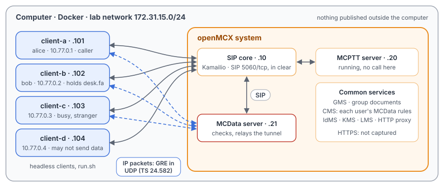
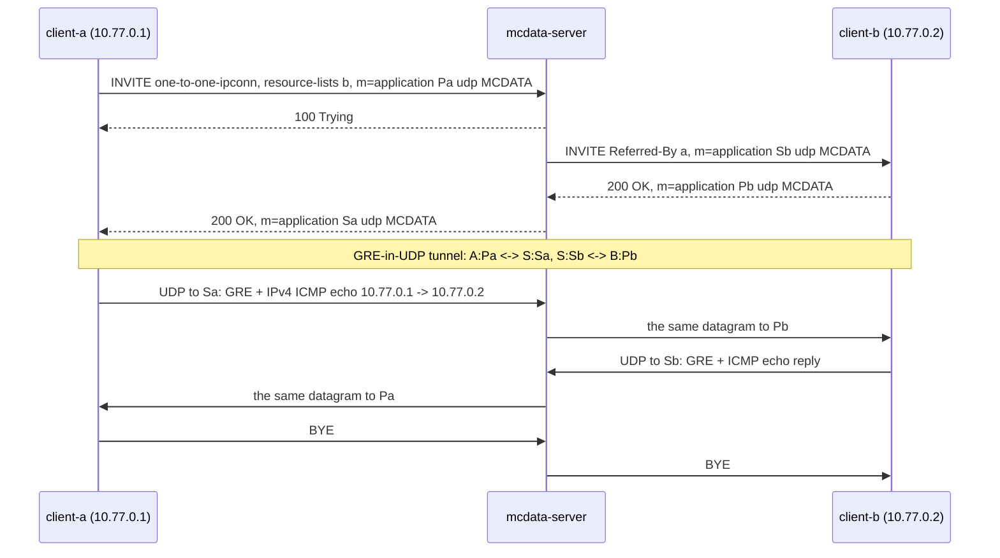

# Unit Test Tutorial 15: MCData IP connectivity: a GRE-in-UDP tunnel between two users

One computer runs the OpenMCX system from the published images, with four headless clients in place of phones. This
time two users connect **IP applications** through MCData (TS 24.282 clause 20): a session set up with SIP carries
real IPv4 packets between the two clients in a GRE-in-UDP tunnel (TS 24.582 clause 13), relayed by the MCData server.
A script takes them through:

- a session from client-a to client-b, and ICMP echo (ping) both ways through it;
- a packet for an address the other side does not have, and datagrams from a stranger, both dropped;
- the release by either party;
- a busy client (486), and the refusals of the MCData rules (warnings 200, 229, 230) and of an alias nobody holds
  (145);
- a session to a **functional alias** (a 300 names the user, then the session reaches that user).

A capture of the lab network records the SIP and every tunnel datagram, so you can follow each session in Wireshark
and look inside the tunnel.

The tutorial is built on a scenario of the OpenMCX regression tests, `tests/integration/mcdata_ipconn_scenario.py`,
and uses the same images. [Unit Test Tutorial 13](../13-mcdata-sds-status/README.md) introduces MCData itself.

> **SIP in clear, for learning.** The system runs in its debug mode: SIP goes over TCP without TLS (port 5060), so
> Wireshark shows every message, its SDP and its MCData XML. A real system uses TLS (End to End Tutorials 1 to 5). The
> tunnel is not encrypted either. The HTTPS traffic to the common services (sign-in, the MCData rules) stays encrypted
> and is not captured.

<p align="center"></p>

## How an IP connectivity session works

| | What it is | In the capture |
|---|---|---|
| The request | client-a sends an INVITE to the MCData service `sip:mcdata@mcx.test` with `<request-type>one-to-one-ipconn</request-type>`, the target in a `resource-lists` body, the IP connectivity feature tag and ICSI (`+g.3gpp.mcdata.ipconn`, `…icsi.mcdata.ipconn`), and an SDP offer `m=application <port> udp MCDATA` with `a=fmtp:MCDATA mcdata-ipconn-s-port=<port>` (TS 24.282 clause 20.2.1, TS 24.582 clause 13.5) | INVITE to `sip:mcdata@mcx.test` |
| The MCData server | It combines the participating and controlling MCData functions. It checks the caller's rights (clause 20.3.1, clause 11.1), invites the called client with Referred-By naming the caller, and puts **its own** address and a port of its own in each SDP (clauses 20.4.0a, 20.4.0b, 20.4.1). It answers the caller 200 only when the called client has accepted (clause 20.4.2) | INVITEs and 200s from 172.31.15.21 |
| The tunnel | Each IP packet travels in a UDP datagram to the port the other side named in its SDP, behind a 4-octet GRE header (protocol `0x0800`, IPv4). The server relays each datagram unchanged to the other leg, and only from the address and source port negotiated in SDP (TS 24.582 clauses 13.2 to 13.4) | UDP between a client and .21 |
| The IP application | TS 24.582 clause 13.1.1 leaves it to the implementation. Here each client is its own IP application at a tunnel address (`10.77.0.1` to `10.77.0.4`): it answers ICMP echo requests for its address and drops everything else | ICMP inside GRE |
| The release | Either client ends the session with BYE; the server ends the other leg with BYE | BYE |

## What you need

- A computer with Docker and Docker Compose v2 (Linux, or Docker Desktop on macOS or Windows) and a bash shell for
  `run.sh` (on Windows: WSL or Git Bash).
- No phones, no network set-up, nothing to compile: the tutorial uses the **prebuilt OpenMCX images from Docker Hub**
  (`openmcx/openmcx-*:1.0.0`) and publishes no port; everything stays on the computer. No TUN device or extra privilege
  is needed: the tunnel is ordinary UDP.
- [Wireshark](https://www.wireshark.org/) to look at the capture (optional: `run.sh` prints a summary).

## 1. Make the configuration

```bash
cd tutorials/unit-tests/15-mcdata-ip-connectivity
docker compose run --rm setup
```

The setup container runs the generator of the regression lab (`tools/prepare-prearranged-test.py --debug-sip
--private-call --mcdata`). It writes `./config` with these parts:

- a new certificate authority with the servers' and clients' certificates;
- the users `alice` (client-a), `bob` (client-b), `client-c` and `client-d`, each with an MCData ID
  (`sip:alice.mcdata@mcx.test`, …) and a tunnel address (`10.77.0.1` to `10.77.0.4`, `mcdata.ipconn.address`);
- each user's MCData rules (TS 24.282 `<ruleset>`): alice may send one-to-one to bob and client-c only; bob accepts
  one-to-one only from alice; client-c accepts anyone; client-d may not transmit data at all;
- the functional alias `sip:desk.fa@mcx.test`, which alice or bob may take.

It runs once. To start over, see step 5. The certificates last 30 days.

## 2. Start the system

```bash
docker compose up -d --wait
```

After about half a minute `--wait` returns and every service is healthy, with the capture already running. Each client
then signs in to MCPTT and to MCData.

| Address | Container |
|---|---|
| 172.31.15.10 | SIP core (Kamailio) |
| 172.31.15.20 | MCPTT server (running, not used here) |
| 172.31.15.21 | MCData server |
| 172.31.15.101 | client-a, user `alice`, tunnel address 10.77.0.1 |
| 172.31.15.102 | client-b, user `bob`, tunnel address 10.77.0.2 |
| 172.31.15.103 | client-c, user `client-c`, tunnel address 10.77.0.3 |
| 172.31.15.104 | client-d, user `client-d`, tunnel address 10.77.0.4 |

## 3. Run the steps

```bash
./run.sh
```

The script sends each command to a client and waits until the clients and the server show its result before going
on. It takes about half a minute:

```
2. client-a opens an IP connectivity session with client-b
  $ client-a: ipcon sip:bob.mcdata@mcx.test
  ok: the session is open at both clients
  ok: client-b learns the caller and the Referred-By identity
  ok: the MCData server holds one tunnel, a port facing each client
3. IP packets both ways through the tunnel: ICMP echo between 10.77.0.1 and 10.77.0.2
  $ client-a: ipcon-ping 10.77.0.2 5 64
  ok: five 64-byte echoes from client-a are answered, data unchanged, TTL 64
...
10. The capture: captures/15-mcdata-ip-connectivity-run.pcap.gz
```

Each command is the same program the clients run, with `--command`. To type one yourself:

```bash
docker compose exec client-a mcx-client --config /config/client-a.json --command "ipcon-ping 10.77.0.2 3"
```

| Step | Command | What happens (TS 24.282 unless noted) |
|---|---|---|
| 1 | — | The four clients sign in to MCData. |
| 2 | `client-a: ipcon <bob>` | client-a's INVITE to the MCData service (clause 20.2.1). The server invites bob with Referred-By naming alice (clause 20.4.1) and answers alice only after bob's 200 OK (clause 20.4.2). Each side gets the server's address and a port of the server's own. |
| 3 | `client-a: ipcon-ping 10.77.0.2 5 64`, `client-b: ipcon-ping 10.77.0.1 3 1200` | Five echo requests from 10.77.0.1 to 10.77.0.2 and their replies, then three 1200-byte echoes the other way: IPv4 in GRE in UDP, each datagram relayed unchanged (TS 24.582 clauses 13.1 to 13.4). |
| 4 | `client-a: ipcon-ping 10.77.0.99 2` | Packets for an address client-b does not have: the server relays them, client-b's IP application drops them, nothing answers. |
| 5 | client-c sends three GRE datagrams to the server's tunnel port | They come from an address outside the session: the server drops them (TS 24.582 clause 13.3), nothing reaches client-b. |
| 6 | `client-a: ipcon close` | client-a's BYE; the server ends client-b's leg with BYE. |
| 7 | `client-a: ipcon <client-c>`, `client-b: ipcon <client-c>`, `client-c: ipcon close` | client-c already has a session, so it answers bob's invitation 486 Busy Here, which the server passes back (clause 20.3.2). The called party may release a session too. |
| 8 | `client-d: ipcon <alice>`, `client-a: ipcon <client-d>`, `client-c: ipcon <bob>`, `client-a: ipcon fa=<nobody.fa>` | The server refuses before inviting anyone: 403 with warning 200 (no right to transmit), 229 (target outside the caller's one-to-one list), 230 (caller outside the target's incoming list), 145 (an alias nobody holds) (clauses 20.3.1, 11.1, 20.4.2 step 5a). |
| 9 | `client-b: mcdata-fa activate <desk.fa>`, `client-a: ipcon fa=<desk.fa>` | client-b takes the alias: it subscribes to its functional alias status (clause 22.2.1.3), its activation is answered 200 and the outcome comes by NOTIFY (clauses 22.2.2.2.3 and 22.2.2.2.5). A session to a functional alias: the server answers 300 (Multiple Choices) naming the user holding it, and client-a invites that user with the alias in `<called-functional-alias-URI>` (clause 20.4.2 step 5a1, clause 20.2.1). |

## 4. Look at the capture

The script `run.sh` copies the capture of your run to `captures/15-mcdata-ip-connectivity-run.pcap.gz`. The folder also holds a reference
run, [`captures/15-mcdata-ip-connectivity-full.pcap.gz`](captures/15-mcdata-ip-connectivity-full.pcap.gz) (74 KB, 815 frames): the frame numbers below and in the call
flow are those of the reference. Wireshark opens the compressed file directly (or `gunzip` it first).

The capture filter is `ip and not host 172.31.15.1 and (tcp port 5060 or (udp and not port 53) or icmp)`: SIP on
5060/tcp, with every TCP segment, so Wireshark rebuilds a message split over two segments, and every UDP flow. The
tunnel is UDP on ports taken from the SDP, so the default filter already holds all of it. DNS, the encrypted HTTPS and
the host's own traffic on the bridge (172.31.15.1) are left out.

**To look inside the tunnel**, tell Wireshark that the tunnel ports carry GRE: **Analyze → Decode As…**, field
`UDP port`, value the server's port (in the reference `46050`, then `55373`, `34577` and `33118`), current `GRE`.
Each datagram then shows GRE, IPv4 from 10.77.0.1 to 10.77.0.2 and the ICMP echo inside. From the command line:
`tshark -r 15-mcdata-ip-connectivity-full.pcap.gz -d udp.port==46050,gre -d udp.port==55373,gre`.

Useful display filters:

| Filter | Shows |
|---|---|
| `sip.CSeq.method == "INVITE" \|\| sip.CSeq.method == "BYE"` | The sessions: requests, invitations, answers, releases. |
| `sdp.media.format == "MCDATA"` | The SDP offers and answers with the tunnel ports. |
| `sip.Warning` | The refusals and their warning texts. |
| `udp` | The tunnel datagrams (decoded as GRE with Decode As). |
| `icmp` | With Decode As: the pings inside the tunnel. |

Three things Wireshark 4.2 shows in a confusing way:

- **Tunnel datagrams as "Data".** GRE-in-UDP has no fixed port here (RFC 8086's 4754 is not used), so Wireshark needs
  Decode As, as above.
- **"Invalid media format" on the MCDATA line.** Wireshark only knows registered media formats; `MCDATA` (TS 24.582)
  is not one of them. The SDP is correct.
- **Each client request twice.** The SIP core challenges the first INVITE or BYE of a client with 407 (Proxy
  Authentication Required) and the client sends it again with credentials.

What to look for, in the reference run:

- **Setup** (frames 431 to 459): client-a's INVITE (438, after the 407 to 431) with `one-to-one-ipconn` and
  `m=application 48358 udp MCDATA`. The server invites bob (444, at bob 448) with `Referred-By: <sip:alice@mcx.test>`
  and its own end `172.31.15.21:55373`. bob answers 200 OK (450, at the server 452) with its port 33873; only then does
  the server answer client-a (455, at client-a 459) with its other end `172.31.15.21:46050`.
- **Pings** (frames 467 to 498): five 104-byte datagrams from client-a to the server (467 to 471), the same five from
  the server to bob (472 to 476), bob's five replies (477 to 481) relayed to client-a (482 to 486); then bob's three
  1200-byte echoes (487 to 489, relayed 490 to 492) and client-a's replies (493 to 495, relayed 496 to 498). Every
  datagram goes between the ports of the SDP.
- **A packet for nobody** (frames 499 to 502): two echoes to 10.77.0.99 from client-a (499, 500), relayed to bob (501,
  502), and no reply.
- **The stranger** (frames 503 to 505): three datagrams from client-c (172.31.15.103) to the server's port 46050. The
  server sends nothing on to bob.
- **Release** (frames 506 to 519): client-a's BYE (509, after the 407 to 506), the server's 200 OK to it (512), then
  the server's BYE to bob (513, at bob 516) and bob's 200 OK (518). No datagram after it.
- **Busy** (frames 524 to 605): client-a's session with client-c (531, invited 537, 200 OK 543, at client-a 552).
  bob's INVITE (567) makes the server invite client-c (572), which answers 486 Busy Here (577); the server passes 486
  back to bob (585, at bob 588). Then client-c's BYE (598) and the server's BYE to client-a (602, at client-a 605).
- **Refusals** (frames 612 to 682): 403 with warning 200 to client-d (623, at client-d 627), 229 to client-a (642,
  645), 230 to client-c (661, 664), 145 to client-a (679, 682). No invitation goes out for any of them.
- **bob takes the alias** (frames 687 to 713): client-b subscribes to its functional alias status (690, after the 407
  to 687; TS 24.282 clause 22.2.1.3); the MCData server accepts (693, at client-b 695) and its first NOTIFY lists no
  activated alias (694, at client-b 696). client-b's PUBLISH activating `desk.fa` (702, after the 407 to 697) is
  answered 200 (708, at client-b 709; clause 22.2.2.2.3 step 8), and the outcome comes by NOTIFY (710, at client-b
  711): `<functionalAlias functionalAliasID="sip:desk.fa@mcx.test" status="activated"/>` (clause 22.2.2.2.5).
- **The functional alias** (frames 718 to 790): client-a's INVITE to `desk.fa` (724) is answered 300 (728, at
  client-a 732) with `<mcdata-request-uri>` naming bob; client-a invites bob through the server (743), with
  `<called-functional-alias-URI>sip:desk.fa@mcx.test`; bob is invited (748, at bob 752), answers (754), and client-a
  gets its 200 OK (762, at client-a 764). Two pings cross the tunnel (772 to 779), then bob's BYE (783) ends it.

  > **The Contact of the controlling MCData function.** In its INVITE to the called client (TS 24.282 clause 20.4.1
  > step 7) and in its 200 OK to the caller (clause 6.3.7.1.23 steps 5 and 6 c)), the MCData server's Contact is an
  > MCData session identity, the MCData service URI with the session's `mcdata-session` parameter, with the media
  > feature tags `g.3gpp.mcdata.ipconn` and `isfocus` and the ICSI `urn:urn-7:3gpp-service.ims.icsi.mcdata.ipconn`
  > (448, 459, 764). The 300 for the functional alias carries a session identity as well (732, clause 20.4.2 step
  > 5a1 B)). The clients send their ACK and BYE to that identity, and the SIP core routes them to the MCData server.

## 5. Stop or start over

```bash
docker compose down -v        # remove the containers and their data (status files, capture)
rm -rf config                 # with down -v: start over at step 1
```

To run the steps again on the same system, `docker compose down -v` and `docker compose up -d --wait` first: the steps
count echoes and drops from a fresh start (the configuration stays).

## Images

The compose file names every image in full, all from Docker Hub:

| Image | What it is |
|---|---|
| `docker.io/openmcx/openmcx-setup:1.0.0` | The setup: the lab's generator |
| `docker.io/openmcx/openmcx-mcptt-server:1.0.0`, `docker.io/openmcx/openmcx-mcdata-server:1.0.0` | The MCPTT and MCData servers |
| `docker.io/openmcx/openmcx-common:1.0.0`, `docker.io/openmcx/openmcx-http-proxy:1.0.0`, `docker.io/openmcx/openmcx-user-db:1.0.0` | The common services, among them the CMS |
| `docker.io/openmcx/openmcx-client:1.0.0` | The headless client (`OpenMCX/openmcx-client` repository) |
| `docker.io/openmcx/openmcx-kamailio:1.0.0` | The SIP core |
| `docker.io/library/mysql@sha256:…` | The SIP core's database |
| `docker.io/nicolaka/netshoot@sha256:…` | tcpdump, for the capture |

To use images you built yourself, change the `image:` lines in `docker-compose.yaml` (building them:
[docs/BUILD.md](../../../docs/BUILD.md)).

## When something does not work

- **A service stays unhealthy**: `docker compose logs <service>`.
- **A step of run.sh fails**: it prints the step that did not complete. `docker compose exec client-a cat
  /artifacts/client-a/status.json` shows a client's session in `mcdata_ipconn` (state `inviting`, `open`, `rejected`,
  `closed` or `released`, with the SIP status and warning, the server's end in `peer`), its IP application counters in
  `mcdata_ipconn_counters` and the echo replies in `mcdata_ipconn_pings`; `/artifacts/mcdata-server/status.json` lists
  the server's tunnels in `ipconn_sessions` (ports, datagrams each way, drops). Start over from a clean state with
  `docker compose down -v` and `docker compose up -d --wait`.
- **No capture, or `capture` exited**: `docker compose logs capture`. The capture container uses the host's network
  to reach the lab's bridge (`openmcx-ut15`), and the address range 172.31.15.0/24 must be free on the computer.
- **Certificates expired** (after 30 days): start over (step 5).

## How it is put together

- `docker-compose.yaml`: the regression lab of `prepare-prearranged-test.py --debug-sip --private-call --mcdata` (the
  `mcdata-ipconn` lab of `tools/regress.py`), written for the published images by `tools/tutorial-compose.py`. Each
  container has a fixed address, so the capture reads by role. The status files are in a volume, and the capture runs
  on the lab's bridge.
- `run.sh`: IP-01 to IP-08 of `tests/integration/mcdata_ipconn_scenario.py`, in order. Left out: the idle and setup
  timers (`mcdata.ipconn.idle_ms`, 300 s, and `setup_ms`, 30 s) and IPv6, which the scenario does not exercise either.
- `captures/15-mcdata-ip-connectivity-full.pcap.gz`: the reference run.

## Call flow

The session and its traffic (steps 2, 3 and 6), as in the regression's test report
([`tests/mcdata/MCDATA_IPCONN_TEST.md`](../../../tests/mcdata/MCDATA_IPCONN_TEST.md)). Each SIP arrow passes through
the SIP core; the 407 challenges are left out.



In the reference run Pa is 48358, Sa 46050, Sb 55373 and Pb 33873.

| Message | Frames |
|---|---|
| A → S INVITE (after the 407 to the first one); the server's 100 Trying | 438, 440; 442 |
| S → B INVITE with Referred-By; B → S 200 OK | 444, 448; 450, 452 |
| S → A 200 OK (only after B's 200 OK) | 455, 459 |
| Echo requests A → S, S → B | 467 to 471; 472 to 476 |
| Echo replies B → S, S → A | 477 to 481; 482 to 486 |
| A → S BYE (after the 407 to the first one); S → A 200 OK; S → B BYE | 509, 510; 512, 515; 513, 516 |
