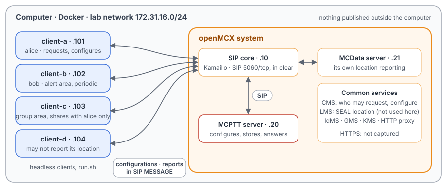
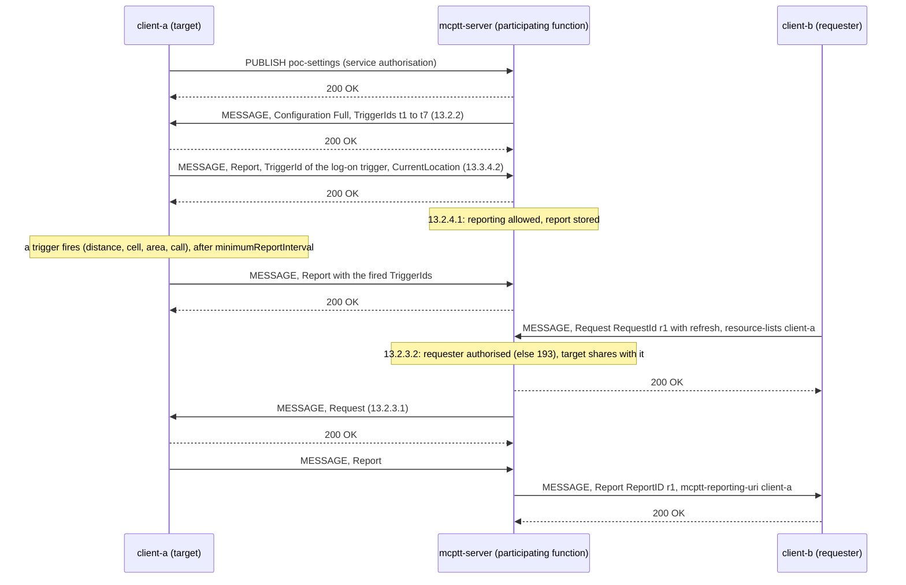
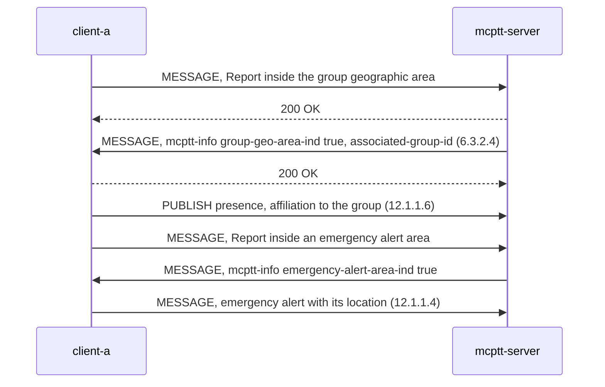

# Unit Test Tutorial 16: MCPTT and MCData location: reports, triggers, requests and areas

One computer runs the openMCX system from the published images, with four headless clients in place of phones. Each
client has a simulated position, and a script moves the clients about and takes them through MCPTT **location
management** (TS 24.379 clause 13):

- the reporting configuration each client receives at log-on, and its first report;
- the triggers that make a client report again: distance travelled, entering and leaving a zone, a cell change, a
  group call, a periodic timer;
- an authorised user asking where another user is, from what the server stores or fresh from the client, with a
  filter, and a user who does not share its location;
- refused requests and configurations;
- an authorised user changing another user's configuration;
- areas the server watches: the group's geographic area (leaving it de-affiliates the client), and an emergency alert
  area (entering it raises an emergency alert, and the client reports as an emergency).

The MCData server configures its own location reporting for every client too (TS 24.282 clause 17), so the capture
also shows the same reports going to MCData.

The tutorial is built on `tests/integration/location_scenario.py` of the openMCX regression tests (LOC-01 to LOC-17)
and uses the same images.

> **SIP in clear, for learning.** The system runs in its debug mode: SIP goes over TCP without TLS (port 5060), so
> Wireshark shows every message and its location XML. A real system uses TLS (End to End Tutorials 1 to 5), and
> with XML protection on, the location XML is encrypted as well
> ([Unit Test Tutorial 12](../12-protected-media/README.md)). Location management travels **inside SIP MESSAGE
> requests**, so the capture holds all of it. The HTTPS traffic to the common services stays encrypted and is not
> captured.

<p align="center"></p>

## How location management works

| | What it is | In the capture |
|---|---|---|
| Configuration | After a client's service authorisation the participating function (here the MCPTT server) sends it a `<Configuration>`: what to report (coordinate, serving cell) and the triggering criteria, each with a TriggerId (TS 24.379 clause 13.2.2) | MESSAGE from 172.31.16.20 with `application/vnd.3gpp.mcptt-location-info+xml` |
| Report | When a trigger fires, the client sends a `<Report>` naming the TriggerIds, with a time stamp and its location (clause 13.3.4.2); the server checks that the user may report and stores the last report (clause 13.2.4.1) | MESSAGE to `sip:mcptt@mcx.test` with `<Report>` |
| Request | An authorised user names users in a `resource-lists` body; the server answers from what it stores, or first asks the client (`<Request>`, clause 13.2.3.1), and sends the report on with the RequestId as ReportID (clause 13.2.3.2) | MESSAGE with `<Request RequestId=…>`, then `<Report ReportID=…>` |
| Areas | The server checks each report against the group's geographic area and the emergency alert areas, and tells the client when it enters or leaves one (clause 6.3.2.4) | MESSAGE with `<group-geo-area-ind>` or `<emergency-alert-area-ind>` |

Coordinates are encoded as in TS 23.032: latitude 48.0° is `<threebytes>4473924</threebytes>` (2²³ × 48 / 90),
longitude 2.0° is `93206` (2²⁴ × 2 / 360).

## What you need

- A computer with Docker and Docker Compose v2 (Linux, or Docker Desktop on macOS or Windows) and a bash shell for
  `run.sh` (on Windows: WSL or Git Bash).
- No phones, no network set-up, nothing to compile: the tutorial uses the **prebuilt openMCX images from Docker Hub**
  (`openmcx/openmcx-*:v1`) and publishes no port; everything stays on the computer.
- [Wireshark](https://www.wireshark.org/) to look at the capture (optional: `run.sh` prints a summary).

## 1. Make the configuration

```bash
cd tutorials/unit-tests/16-location
docker compose run --rm setup
```

The setup container runs the generator of the regression lab (`tools/prepare-prearranged-test.py --debug-sip
--priority --location`). It writes `./config` with these parts:

- a new certificate authority with the servers' and clients' certificates;
- the users `alice` (client-a), `bob` (client-b), `client-c` and `client-d`, all in the group `operations`; each
  client starts at its own simulated point near 48° N 2° E (alice at 2.00° E, bob 2.01°, client-c 2.02°, client-d
  2.03°);
- the reporting configuration both servers send: the coordinate and the serving cell, with the triggers t1 log-on,
  t2 non-emergency group call, t3 250 m travelled, t4 entering and t5 leaving a small zone at 48.01° N 2.00° E, t6 a
  cell change, and in an emergency t7 every 2 s; at most one report a second;
- the areas the servers watch: the group's geographic area at 48.02° N 2.02° E and an emergency alert area "hazard"
  at 48.05° N 2.05° E;
- the location rights in the user profiles: alice may request and configure; bob shares his location with anyone;
  client-c shares it only with bob; client-d may not report.

It runs once. To start over, see step 5. The certificates last 30 days.

## 2. Start the system

```bash
docker compose up -d --wait
```

After about half a minute `--wait` returns and every service is healthy, with the capture already running.

| Address | Container |
|---|---|
| 172.31.16.10 | SIP core (Kamailio) |
| 172.31.16.20 | MCPTT server |
| 172.31.16.21 | MCData server |
| 172.31.16.101 | client-a, user `alice` |
| 172.31.16.102 | client-b, user `bob` |
| 172.31.16.103 | client-c, user `client-c` |
| 172.31.16.104 | client-d, user `client-d` |

## 3. Run the steps

```bash
./run.sh
```

The script sends each command to a client and waits until the clients and the server show its result before going
on. It takes about a minute:

```
1. Log-on: every client gets its reporting configuration and reports where it is
  ok: every client holds the configuration the server sent after its service authorisation
...
7. Areas: the group's geographic area, and an emergency alert area
  $ client-b: location position 48.05 2.05
  ok: bob enters the emergency alert area: told so, and his client raises an emergency alert
...
8. The capture: captures/16-location-run.pcap.gz
```

Each command is the same program the clients run, with `--command`; `location position <lat> <lon>` moves the
simulated client. To type one yourself:

```bash
docker compose exec client-a mcx-client --config /config/client-a.json --command "location request sip:bob.mcptt@mcx.test"
```

| Step | Commands | What happens (TS 24.379 unless noted) |
|---|---|---|
| 1 | none | Each client gets its configuration after its service authorisation (clause 13.2.2) and reports its log-on position (t1). client-d may not report: 403 with "location reporting not authorised", nothing stored (clause 13.2.4.1). |
| 2 | `location position …`, `location radio cell …`, `call`, `hangup` | client-a moves 287 m (t3), enters and leaves the zone (t4, t5), changes cell (t6, the report carries the new cell) and starts a group call (t2) (clause 13.3.4.1, annex F.3). |
| 3 | `location request <bob>`, `location request refresh <bob>` | alice asks where bob is. The server answers alice 200, then asks bob for a fresh report (its stored one is older than 4 s, or refresh is set) and passes it on to alice with her RequestId as ReportID (clauses 13.2.3.1, 13.2.3.2). |
| 4 | `location request filter t4 in …`, `… out …`, `location request <client-c>` | A filter keeps only users inside (or outside) the zone t4: bob is outside, so "in" gives nothing and "out" gives his report. client-c does not share with alice: accepted, nothing reported. |
| 5 | `location request` by bob, a request naming nobody, `location configure` by client-c | 403 with warnings 193 (not allowed to request), 192 (no target) and 215 (not allowed to configure) (table 4.4.2-2). Nothing is passed on. |
| 6 | `location configure <bob> {"scope": "update", …}` | alice adds a periodic trigger to bob's configuration: 200, the server sends bob the update, and bob reports every 2 s (clause 13.2.2A). |
| 7 | `location position …` for client-c and bob, `alert off <bob>` | client-c enters, leaves and re-enters the group's geographic area: each time the server tells it (clause 6.3.2.4), and it de-affiliates and affiliates again (clause 12.1.1.6). bob enters the emergency alert area: told so, his client raises an emergency alert with its location (clause 12.1.1.4), and reports as Emergency on t7. alice cancels bob's alert, and bob leaves the area. |

## 4. Look at the capture

`run.sh` copies the capture to `captures/16-location-run.pcap.gz`. The folder also holds a reference run,
`captures/16-location-full.pcap.gz` (138 KB, 1 406 frames): the frame numbers below and in the call flow are
those of the reference. Wireshark opens the compressed file directly (or `gunzip` it first).

The capture filter is `ip and not host 172.31.16.1 and (tcp port 5060 or (udp and not port 53) or icmp)`: SIP on
5060/tcp with every TCP segment (Wireshark rebuilds a message split over two), every UDP flow and ICMP. All of
location management is in SIP; DNS, the encrypted HTTPS and the host's own traffic are left out.

Useful display filters:

| Filter | Shows |
|---|---|
| `frame contains "mcptt-location-info"` | Every MCPTT location message: configurations, reports, requests. |
| `frame contains "<Report"` | The reports (to the server, and from it to a requester). |
| `frame contains "RequestId"` | The requests, from alice and from the server to bob. |
| `frame contains "area-ind"` | The area notices. |
| `sip.Warning` | The refusals with their warnings. |
| `frame contains "mcdata-location-info"` | The same for MCData (configurations and reports to `sip:mcdata@mcx.test`). |

Wireshark shows the location XML as plain XML; the TS 23.032 coordinates are the `<threebytes>` values (see above).
A client request often appears twice, because the SIP core first challenges it with 407.

What to look for, in the reference run:

- **Configuration and log-on** (frames 44 to 470): the MCPTT server's configurations to
  alice (44), bob (256), client-c (277) and client-d (71), and the
  MCData server's to each of them (alice 92). The log-on reports with `<TriggerId>t1</TriggerId>` from
  alice (459), bob (498) and client-c (502); client-d's (468) gets 403 (470).
- **Triggers** (frames 537 to 777): alice's reports on t3 (537), t4 (552), t5 (567), t6 (582,
  with `<Ecgi>` of the new cell) and, after her group call INVITE (593), t2 (777). Each report also goes to MCData.
- **A request** (frames 876 to 895): alice's `<Request>` naming bob (876), the 200 (880), the server's request
  to bob (883), bob's report (893), and the report to alice (895) with her RequestId as `ReportID` and
  `<mcptt-reporting-uri>` bob. With refresh (909) the same: the request to bob (916), the report to alice
  (928).
- **Filters and sharing** (frames 945 to 995): the request with the filter "in" (945) gets no report; with "out"
  (957) bob's report reaches alice (977); the request for client-c (991) is accepted (995) and nothing
  follows.
- **Refusals** (frames 1002 to 1027): 403 with warning 193 (1006), 192 (1015) and 215 (1027).
- **A configuration change** (frames 1035 to 1063): alice's `<Configuration ConfigScope="Update">` with
  `<PeriodicReport TriggerId="every-2s">2</PeriodicReport>` (1035), the 200 (1039), the update to bob (1042), and his
  reports every 2 s (1054, 1063, …).
- **The group area** (frames 1075 to 1204): the notices to client-c with `<group-geo-area-ind>` true (1075), false
  (1135), then client-c's de-affiliation (PUBLISH with `Expires: 0`, 1134), and true again (1204) followed by its
  affiliation (1205).
- **The emergency alert area** (frames 1263 to 1397): the notice to bob with `<emergency-alert-area-ind>` true
  (1263); bob's emergency alert, a `<Report>` with `<alert-ind>` true (1278); the alert to alice (1289), client-c
  (1291) and client-d (1296), and the confirmation to bob with `<alert-ind-rcvd>` (1304); bob's
  `ReportType="Emergency"` report on t7 (1327); alice's cancellation (1337); and the notice that bob has left the
  area (1397).

> **bob's client checks its own MCData rights.** The MCData server also tells bob that he has entered the
> emergency alert area (1282). TS 24.282 clause 16.2.1.5 has the client start an MCData emergency alert, but clause
> 16.2.1.1 has it check first whether the user may send one (clause 6.2.8.1.6) and, if not, tell the user and stop.
> bob may not, so his client checks his MCData user profile and sends no MCData alert: the capture has no MESSAGE
> from bob to the MCData server here and no 403. In this lab only bob's client checks its own profiles
> (`--enforce-profile client-b`); the others leave the checks to the servers, so that their refusals can be seen.

## 5. Stop or start over

```bash
docker compose down -v        # remove the containers and their data (status files, capture)
rm -rf config                 # with down -v: start over at step 1
```

To run the steps again on the same system, `docker compose down -v` and `docker compose up -d --wait` first (the
configuration stays): the steps start from the clients' log-on positions.

## Images

The compose file names every image in full, all from Docker Hub:

| Image | What it is |
|---|---|
| `docker.io/openmcx/openmcx-setup:v1` | The setup: the lab's generator |
| `docker.io/openmcx/openmcx-mcptt-server:v1`, `docker.io/openmcx/openmcx-mcdata-server:v1` | The MCPTT and MCData servers |
| `docker.io/openmcx/openmcx-common:v1`, `docker.io/openmcx/openmcx-http-proxy:v1`, `docker.io/openmcx/openmcx-user-db:v1` | The common services |
| `docker.io/openmcx/openmcx-client:v1` | The headless client (`openMCX/openmcx-client` repository) |
| `docker.io/openmcx/openmcx-kamailio:6.1.4-2` | The SIP core |
| `docker.io/library/mysql@sha256:…` | The SIP core's database |
| `docker.io/nicolaka/netshoot@sha256:…` | tcpdump, for the capture |

To use images you built yourself, change the `image:` lines in `docker-compose.yaml` (building them:
[docs/BUILD.md](../../../docs/BUILD.md)).

## When something does not work

- **A service stays unhealthy**: `docker compose logs <service>`.
- **A step of run.sh fails**: it prints the step that did not complete. `docker compose exec client-a cat
  /artifacts/client-a/status.json` shows a client's location state (`location`: configuration, sent and received
  reports, area notices; `location_last_request`, `location_last_result`), and `/artifacts/mcptt-server/status.json`
  the server's (`location`: counters and, per user, the stored configuration, last report and areas). Start over
  from a clean state with `docker compose down -v` and `docker compose up -d --wait`.
- **No capture, or `capture` exited**: `docker compose logs capture`. The capture container uses the host's network
  to reach the lab's bridge (`openmcx-ut16`), and the address range 172.31.16.0/24 must be free on the computer.
- **Certificates expired** (after 30 days): start over (step 5).

## How it is put together

- `docker-compose.yaml`: the regression lab of `prepare-prearranged-test.py --debug-sip --priority --location` (the
  `location` lab of `tools/regress.py`), written for the published images by `tools/tutorial-compose.py`. Each
  container has a fixed address, so the capture reads by role. The status files are in a volume, and the capture runs
  on the lab's bridge.
- `run.sh`: LOC-01 to LOC-17 of `tests/integration/location_scenario.py`. Left out: the SEAL location management
  checks (SL-01 to SL-06), which run over HTTPS to the LMS and would show nothing in the capture; MCData and MCVideo
  location as their own scenarios (`mcdata_location_scenario.py`, `mcvideo_location_scenario.py`, in labs of their
  own) — the MCData server's configurations and reports appear here only alongside MCPTT's.
- `captures/16-location-full.pcap.gz`: the reference run.

## Call flow

The two diagrams of the regression's test report ([`tests/mcptt/LOCATION_TEST.md`](../../../tests/mcptt/LOCATION_TEST.md)).
SIP passes through the SIP core, which is omitted; the location body is `application/vnd.3gpp.mcptt-location-info+xml`.

**Configuration, reports and a request with refresh**



In this tutorial the roles are the other way round: alice (client-a) requests, bob (client-b) is the target.

**An area notice**



In this tutorial client-c plays the group area part and bob the emergency alert area part.

| Message | Frames |
|---|---|
| Configuration from the MCPTT server to alice, bob, client-c, client-d | 44, 256, 277, 71 |
| Log-on reports (t1) from alice, bob, client-c; client-d's, refused 403 | 459, 498, 502; 468, 470 |
| Trigger reports t3, t4, t5, t6, t2 from alice | 537, 552, 567, 582, 777 |
| alice's request for bob; 200; request to bob; bob's report; report to alice | 876; 880; 883; 893; 895 |
| With refresh: alice's request; request to bob; report to alice | 909; 916; 928 |
| Refusals 193, 192, 215 | 1006, 1015, 1027 |
| alice's configuration update; 200; update to bob; bob's periodic reports | 1035; 1039; 1042; 1054, 1063 |
| Group area notices to client-c: in, out, in | 1075, 1135, 1204 |
| Emergency alert area notice to bob; bob's alert; alert to alice, client-c, client-d; confirmation to bob | 1263; 1278; 1289, 1291, 1296; 1304 |
| bob's Emergency report (t7); alice's cancellation; the notice that bob left the area | 1327; 1337; 1397 |
