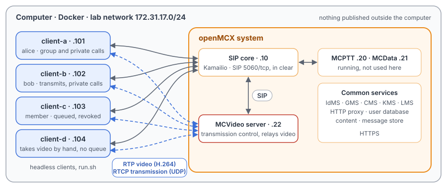
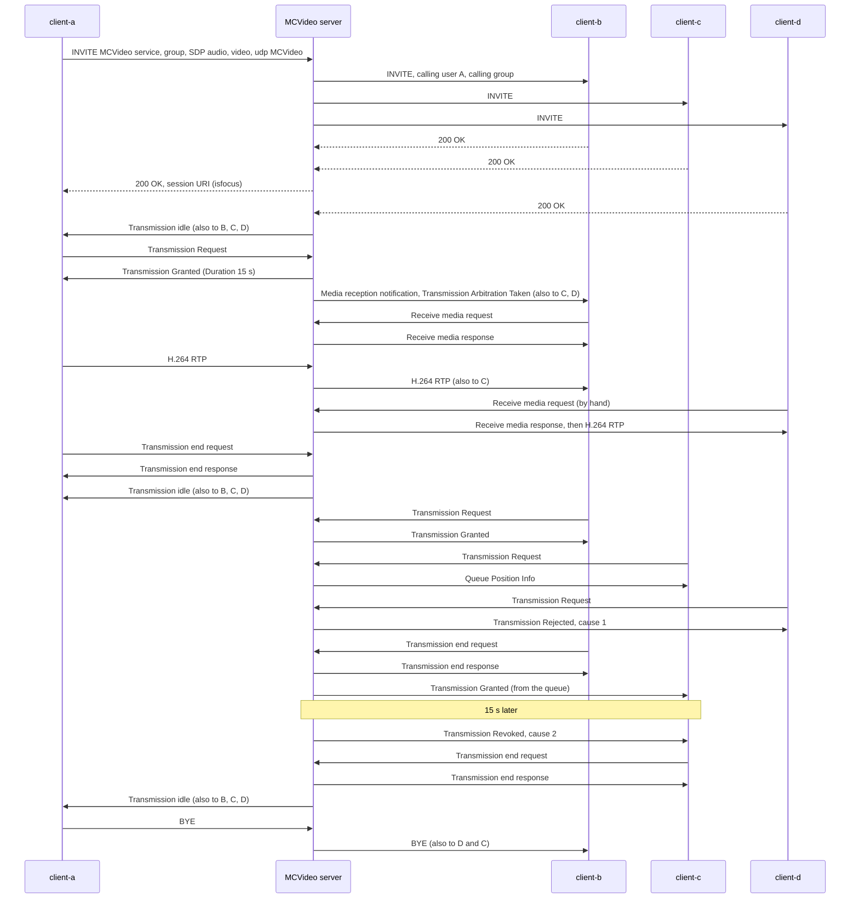
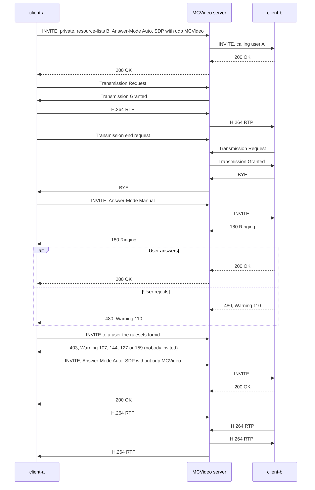

# Unit Test Tutorial 17: MCVideo group and private calls with transmission control

One computer runs the OpenMCX system from the published images, with four headless clients in place of phones.
A script takes them through on-network MCVideo calls (TS 24.281) and their transmission control (TS 24.581):

- a prearranged group call: every member joins, one member at a time transmits video, the others receive it;
- reception control: a member that accepts video by hand, and a member that pauses its reception;
- the transmission queue, a rejected request, and a transmission the server revokes after its 15 s;
- a group call with an implicit transmission request, and the two ways the server ends a group call;
- private calls with transmission control (automatic and manual commencement, declined, refused) and one without
  transmission control, where both users send video at once.

A capture of the lab network records every SIP message, every transmission control message and the H.264 video, so
you can follow each call in Wireshark.

The tutorial is built on two scenarios of the OpenMCX regression tests,
`tests/integration/mcvideo_group_call_scenario.py` and `tests/integration/mcvideo_private_call_scenario.py`, and uses
the same images.

> **SIP in clear, for learning.** The system runs in its debug mode: SIP goes over TCP without TLS (port 5060), so
> Wireshark shows every message, its SDP and its MCVideo XML. A real system uses TLS (tutorials 1 to 5). Video and
> transmission control are not encrypted in this tutorial in either mode. The HTTPS traffic to the common services
> (sign-in, configuration, keys) stays encrypted and is not captured.

<p align="center"></p>

## Transmission control in a few words

MCVideo has no floor in the MCPTT sense. A member asks the **transmission control server** (in the MCVideo server)
for permission to send video, and the server decides who transmits (TS 24.581 clause 6.3.4). Separately, each other
member decides whether it **receives** the video (reception control, clause 4.1.1.2): the server offers the video
with a Media reception notification, and the member accepts with a Receive media request. A member can stop and
resume its reception while the transmission goes on.

The messages are RTCP APP packets (payload type 204) with the names `MCV0` (sent by the client), `MCV1` (sent by
the server) and `MCV2` (sent by either), on the UDP port of the SDP line `m=application … udp MCVideo` (clause 9.2.2):

| Name, subtype | Message | Name, subtype | Message |
|---|---|---|---|
| MCV0, 0 | Transmission Request | MCV1, 7 | Receive media response |
| MCV0, 4 | Receive media request | MCV1, 8 | Media reception notification |
| MCV1, 0 | Transmission Granted | MCV1, 15 | Transmission idle |
| MCV1, 1 | Transmission Rejected | MCV2, 0 | Transmission end request |
| MCV1, 2 | Transmission Arbitration Taken | MCV2, 1 | Transmission end response |
| MCV1, 4 | Transmission Revoked | MCV2, 2 | Media reception end request |
| MCV1, 5 | Queue Position Info | MCV2, 3 | Media reception end response |

## What you need

- A computer with Docker and Docker Compose v2 (Linux, or Docker Desktop on macOS or Windows) and a bash shell for
  `run.sh` (on Windows: WSL or Git Bash).
- No phones, no camera, no network set-up, nothing to compile: the tutorial uses the **prebuilt OpenMCX images from
  Docker Hub** (`openmcx/openmcx-*:1.0.0`) and publishes no port; everything stays on the computer. The clients send a
  generated H.264 test pattern (240p, 15 pictures per second).
- [Wireshark](https://www.wireshark.org/) to look at the capture (optional: `run.sh` prints a summary).

## 1. Make the configuration

```bash
cd tutorials/unit-tests/17-mcvideo-calls
docker compose run --rm setup
```

The setup container runs the generator of the regression lab (`tools/prepare-prearranged-test.py --debug-sip
--mcvideo`). It writes `./config` with these parts:

- a new certificate authority with the servers' and clients' certificates;
- the users `alice` (client-a), `bob` (client-b), `client-c` and `client-d`, each also an MCVideo user
  (`sip:alice.mcvideo@mcx.test` and so on), members of the group `sip:operations@mcx.test`;
- the MCVideo server's transmission control: requests are queued, and a transmission lasts at most 15 s;
- the clients' settings: client-a, client-b and client-c accept offered video at once and queue their requests;
  client-d accepts video only by hand and does not queue;
- a private call ruleset in each user's MCVideo profile (TS 24.484): `alice` may call `bob` and `client-c` in any
  commencement mode; `bob` may call anyone automatically or manually; `client-c` may call anyone automatically and
  may be called only by `alice`; `client-d` may neither make nor receive private calls.

It runs once. To start over, see step 5. The certificates last 30 days.

## 2. Start the system

```bash
docker compose up -d --wait
```

After about half a minute `--wait` returns and every service is healthy, with the capture already running.

| Address | Container |
|---|---|
| 172.31.17.10 | SIP core (Kamailio) |
| 172.31.17.20 | MCPTT server (running, not used here) |
| 172.31.17.21 | MCData server (running, not used here) |
| 172.31.17.22 | MCVideo server |
| 172.31.17.101 | client-a, user `alice` |
| 172.31.17.102 | client-b, user `bob` |
| 172.31.17.103 | client-c, user `client-c` |
| 172.31.17.104 | client-d, user `client-d` |

## 3. Run the steps

```bash
./run.sh
```

The script sends each command to a client and waits until the clients show its result before going on. Each
receiver compares every picture it decodes with the picture the sender encoded for the same RTP timestamp. It takes
about a minute and a half:

```
3. client-a asks to transmit and is granted; client-d accepts the video by hand; client-b pauses its reception
  $ client-a: mcvideo-transmit
  ok: client-a transmits
  ok: the others know client-a transmits, and were offered the video
  ok: client-d receives nothing before it accepts
  $ client-d: mcvideo-receive
  ok: client-b, client-c and client-d decode the pictures client-a sends
...
5. client-c transmits for too long: the server revokes its transmission after 15 s
  ok: client-c revoked with cause 2 (transmitted too long)
...
12. The capture: captures/17-mcvideo-calls-run.pcap.gz
```

Each command is the same program the clients run, with `--command`. To type one yourself:

```bash
docker compose exec client-a mcx-client --config /config/client-a.json --command "mcvideo-private sip:bob.mcvideo@mcx.test manual"
```

| Step | Command | What happens (TS 24.281 and TS 24.581) |
|---|---|---|
| 1 | none | The four clients sign in, get MCVideo service authorisation and affiliate to the group. |
| 2 | `client-a: mcvideo-call` | client-a's INVITE to the MCVideo service (TS 24.281 clause 9.2.1.2.1.1) offers audio, H.264 video and the transmission control entity. The server, as controlling function, invites the other affiliated members (clause 9.2.1.4.2) and answers client-a. Transmission idle goes to everyone. Each member subscribes to the session's conference events (clause 9.2.3) and sees the four participants. |
| 3 | `client-a: mcvideo-transmit`, `client-d: mcvideo-receive`, `client-b: mcvideo-stop-receiving` and `mcvideo-receive` | client-a's Transmission Request is granted (TS 24.581 clause 6.3.4.4.2). The others get a Media reception notification and a Transmission Arbitration Taken. client-b and client-c accept at once with a Receive media request; client-d gets no video until its user accepts. client-b then ends its reception (Media reception end request) and resumes it. |
| 4 | `client-a: mcvideo-end`, then `client-b`, `client-c`, `client-d: mcvideo-transmit`, `client-b: mcvideo-end` | client-a ends its transmission with a Transmission end request (clause 6.2.4.5.3), and Transmission idle follows. client-b is granted. client-c's request is queued (Queue Position Info); client-d, which does not queue, is rejected (Transmission Rejected, cause #1). When client-b ends, the server grants client-c from the queue, without a new request. |
| 5 | none | client-c transmits for longer than the 15 s its Transmission Granted allowed (Duration field). The server revokes the transmission (Transmission Revoked, cause #2 "Media burst too long"), and client-c ends it with a Transmission end request (clause 6.2.4.5.5). |
| 6 | `client-a: mcvideo-hangup` | client-a started the call and leaves it: by the server's local policy, it releases the group call for everyone (TS 24.281 clause 6.3.8.1 item 3) and sends BYE to the other three. |
| 7 | `client-d: mcvideo-call implicit`, then `mcvideo-hangup` on client-a, client-b and client-c | client-d's offer carries `mc_implicit_request` (clause 6.4): it is granted as the call starts, without a Transmission Request. client-a and client-b leave and the call goes on; when client-c leaves, client-d is alone and the server releases the call (clause 6.3.8.1 item 2). |
| 8 | `client-a: mcvideo-private <bob> auto`, both `mcvideo-transmit` and `mcvideo-end`, `client-b: mcvideo-hangup` | A private call with transmission control and automatic commencement (clause 10.2.2): the INVITE names `bob` in a resource list and carries `Answer-Mode: Auto`. Only these two are in the call; they take turns to transmit. client-b's BYE ends it for both. |
| 9 | `client-a: mcvideo-private <bob> manual`, `client-b: mcvideo-answer`, then again with `mcvideo-reject` | Manual commencement: client-b rings (180 Ringing) and answers when its user accepts. The second time it declines with 480 and Warning 110, which the server relays to client-a. |
| 10 | four `mcvideo-private … auto` | The server checks the private call rulesets before inviting anyone (clauses 10.2.2.3.1.1 and 10.2.2.3.2): 403 with Warning 107 (client-d may not make private calls), 144 (alice may not call client-d), 127 (client-d may not be called) and 159 (client-c may not be called by bob). |
| 11 | `client-a: mcvideo-private <bob> auto no-control`, `client-a: mcvideo-hangup` | A private call without transmission control (clause 10.2.3): the offer has no `udp MCVideo` line, there is no transmission control message, and both users send video at the same time. |

## 4. Look at the capture

The script `run.sh` copies the capture of your run to `captures/17-mcvideo-calls-run.pcap.gz`. The folder also holds a reference run,
[`captures/17-mcvideo-calls-full.pcap.gz`](captures/17-mcvideo-calls-full.pcap.gz) (238 KB, 2 667 frames): the frame numbers below and in the call flow are
those of the reference. Wireshark opens the compressed file directly (or `gunzip` it first).

The capture filter is `ip and not host 172.31.17.1 and (tcp port 5060 or (udp and not port 53) or icmp)`:

- SIP on 5060/tcp, with every TCP segment, so Wireshark rebuilds a message split over two segments;
- every UDP flow, since the video and transmission control ports come from the SDP and are not fixed;
- ICMP, which shows media sent to a closed port.

DNS, the encrypted HTTPS and the host's own traffic on the bridge (172.31.17.1) are left out.

Useful display filters:

| Filter | Shows |
|---|---|
| `sip.Method == "INVITE" \|\| sip.Method == "BYE" \|\| sip.Status-Code >= 300` | The calls and how each one ended. **Telephony → SIP Flows** draws them as ladders. |
| `sip.Warning` | The responses with an MCVideo warning text (110, 107, 144, 127, 159). |
| `rtcp.app.name matches "^MCV"` | Transmission control. Add a column for `rtcp.app.subtype` and read it with the table above. |
| `rtp` | The H.264 video. **Telephony → RTP → RTP Streams** lists each sender's stream and the server's copy to each receiver; they keep the sender's SSRC. |
| `sdp.media contains "MCVideo"` | The SDP with a transmission control entity; compare with the offer of step 11, which has none. |

Wireshark 4.2 has no dissector for the fields of the MCVideo messages and shows them as application data. In the
Transmission Granted of frame 695, `01 02 00 0f` is the Duration field (field ID 1, 15 s), `0e 06 …` the audio SSRC
(field ID 14), `17 06 db 94 ab 1b …` the video SSRC (field ID 23) and `00 02 00 00` the priority (field ID 0) (TS
24.581 clause 9.2.5).

What to look for, in the reference run:

- **Group call set-up** (frames 529 to 585): client-a's INVITE (536, after the SIP core's `407` challenge to 529) goes
  to `sip:mcvideo@mcx.test` with `P-Preferred-Service: urn:urn-7:3gpp-service.ims.icsi.mcvideo`, the MCVideo XML with
  `<session-type>prearranged</session-type>` and the group, and an SDP with `m=audio` (AMR-WB), `m=video` (`H264/90000`,
  `packetization-mode=1`) and `m=application 5200 udp MCVideo` with `mc_queueing`. The server invites client-b (546),
  client-c (555) and client-d (562); each invitation names client-a in `<mcvideo-calling-user-id>` and the group in
  `<mcvideo-calling-group-id>`. It answers client-a (572, 579) once client-b and client-c have accepted, with the
  session URI and `isfocus` in the Contact, and with no 180 Ringing before it (TS 24.281 clause 9.2.1.4.2). The 200 OK
  carries `P-Asserted-Identity` (the MCVideo service) and the option tags `tdialog`, `norefersub`, `explicitsub` and
  `nosub` in `Supported` (clause 6.3.3.2.3.2). Transmission idle goes to every member (574,
  575, 585, 576).
- **Conference events** (frames 652 to 676): client-a's SUBSCRIBE with `Event: conference` to the session (655) and
  the server's NOTIFY with the participants (676); the other members do the same.
- **Transmission and reception** (frames 694 to 902): client-a's Transmission Request (694), Transmission Granted
  (695), and to each other member a Media reception notification and a Transmission Arbitration Taken (696 to 701).
  client-b and client-c accept (702, 703) and get a Receive media response (705, 704); client-a's video starts at 706
  and reaches client-b at 710. client-d gets no video until its Receive media request (802) and response (803); its
  first picture is 807. client-b's Media reception end request (884) and response (885) stop its copy, which RTP
  Streams shows as 5 "lost" packets, until its new Receive media request (901, 902).
- **End, queue and reject** (frames 919 to 989): client-a's Transmission end request (919), response (920) and
  Transmission idle to all (921 to 924). client-b's request (925) and grant (926). client-c's request (958) gets
  Queue Position Info (959); client-d's (972) a Transmission Rejected (973). client-b's Transmission end request
  (986) and response (987), and at once Transmission Granted to client-c (988), which asked only once.
- **Revoke** (frames 988 to 1704): client-c's video from 999. Exactly 15 s after its grant comes the Transmission
  Revoked (1698); client-c's Transmission end request (1699), the response (1700) and Transmission idle to all
  (1701 to 1704).
- **The initiator leaves** (frames 1705 to 1733): client-a's BYE (1708); the server's BYEs to client-d (1717),
  client-c (1723) and client-b (1733), none of which asked to leave.
- **Implicit request** (frames 1789 to 2169): client-d's offer has `mc_implicit_request` (1796), and so has the
  server's answer (1831). Transmission Granted to client-d (1852) without a Transmission Request; its video from 1885.
  client-a (2064), client-b (2110) and client-c (2149) leave; then the server's BYE to client-d (2169).
- **Private call with transmission control** (frames 2184 to 2333): client-a's INVITE (2191) has `Answer-Mode: Auto`,
  `<session-type>private</session-type>` and an `application/resource-lists+xml` body naming `bob`. Then the
  INVITE to client-b (2201), its 200 OK (2203) and the 200 OK to client-a (2214), with no 180 Ringing: client-b
  answers automatically and never rings, and the server sends one only when the called client's arrives (TS 24.281
  clause 10.2.2.4.2). client-a's request and grant (2222, 2223), its video at client-b (2231), its Transmission end
  request (2270); client-b's request and grant (2274, 2275), its video at client-a (2283). client-b's BYE (2325) and
  the server's BYE to client-a (2333).
- **Manual commencement and decline** (frames 2340 to 2446): client-b's 180 Ringing (2358), passed on to client-a
  (2364), and 200 OK (2367); in the second call its 480 with `Warning: 399 mcx "110 user declined the call invitation"` (2437), relayed to client-a
  (2446).
- **Refused** (frames 2453 to 2522): the 403 responses with Warning 107 (2464), 144 (2482), 127 (2501) and 159 (2519),
  each relayed to the caller. None of the called users gets an INVITE.
- **Without transmission control** (frames 2527 to 2654): client-a's offer (2533) has `m=audio` and `m=video` but no
  `m=application … udp MCVideo`. No transmission control message at all; client-b's video starts at 2558 and
  client-a's at 2564, and the two run at the same time. client-a's BYE (2653).

## 5. Stop or start over

```bash
docker compose down -v        # remove the containers and their data (status files, capture)
rm -rf config                 # with down -v: start over at step 1
```

To run the steps again on the same system, run `./run.sh` again: the capture keeps everything since `up`. For a new
capture, `docker compose down -v` and `docker compose up -d --wait` first (the configuration stays).

## Images

The compose file names every image in full, all from Docker Hub:

| Image | What it is |
|---|---|
| `docker.io/openmcx/openmcx-setup:1.0.0` | The setup: the lab's generator |
| `docker.io/openmcx/openmcx-mcvideo-server:1.0.0` | The MCVideo server |
| `docker.io/openmcx/openmcx-mcptt-server:1.0.0`, `docker.io/openmcx/openmcx-mcdata-server:1.0.0` | The MCPTT and MCData servers (running, not used here) |
| `docker.io/openmcx/openmcx-common:1.0.0`, `docker.io/openmcx/openmcx-http-proxy:1.0.0`, `docker.io/openmcx/openmcx-user-db:1.0.0` | The common services |
| `docker.io/openmcx/openmcx-client:1.0.0` | The headless client (`OpenMCX/openmcx-client` repository) |
| `docker.io/openmcx/openmcx-kamailio:1.0.0` | The SIP core |
| `docker.io/library/mysql@sha256:…` | The SIP core's database |
| `docker.io/nicolaka/netshoot@sha256:…` | tcpdump, for the capture |

To use images you built yourself, change the `image:` lines in `docker-compose.yaml` (building them:
[docs/BUILD.md](../../../docs/BUILD.md)).

## When something does not work

- **A service stays unhealthy**: `docker compose logs <service>`.
- **A step of run.sh fails**: it prints the step that did not complete. `docker compose exec client-a cat
  /artifacts/client-a/status.json` shows a client's state (`mcvideo_call_state`, `mcvideo_transmitting`,
  `mcvideo_transmitter`, `mcvideo_receiving`, `mcvideo_queue_position`, `mcvideo_reject_cause`, `mcvideo_last_call`).
  Start over from a clean state with `docker compose down -v` and `docker compose up -d --wait`.
- **No capture, or `capture` exited**: `docker compose logs capture`. The capture container uses the host's network
  to reach the lab's bridge (`openmcx-ut17`), and the address range 172.31.17.0/24 must be free on the computer.
- **Certificates expired** (after 30 days): start over (step 5).

## How it is put together

- `docker-compose.yaml`: the regression lab of `prepare-prearranged-test.py --debug-sip --mcvideo`, written for the
  published images by `tools/tutorial-compose.py`. Each container has a fixed address, so the capture reads by role.
  The status files are in a volume, and the capture runs on the lab's bridge.
- `run.sh`: steps from `tests/integration/mcvideo_group_call_scenario.py` (group call, transmission and reception
  control, queue, reject, revoke, implicit request) and `tests/integration/mcvideo_private_call_scenario.py`
  (automatic and manual commencement, decline, the four refusals, the call without transmission control). Left out:
  the chat group call, the forced automatic answer, the MCVideo user profile checks, and the audio of an MCVideo call
  (the clients send video only).
- `captures/17-mcvideo-calls-full.pcap.gz`: the reference run.

## Call flow

Drawn from the reference capture. Registration and service authorisation come before it. Each SIP arrow passes
through the SIP core, which is left out, as are digest challenges, ACKs and TCP acknowledgements.

Group call, transmission and reception control, queue and revoke (steps 2 to 6):



Private calls (steps 8 to 11):



The messages in the reference capture (A, B, C, D = client-a to client-d). A frame pair is the message on both
legs, through the SIP core:

| Message | Frames |
|---|---|
| Step 2: A INVITE (group); INVITE to B, C, D | 536, 538; 546, 555, 562 |
| Step 2: B, C, D 200 OK; 200 OK to A; Transmission idle to B, C, A, D | 548, 558, 564; 572, 579; 574, 575, 585, 576 |
| Step 2: A SUBSCRIBE (conference); NOTIFY to A | 655, 658; 676 |
| Step 3: A Transmission Request; Granted; notification and Arbitration Taken to B, C, D | 694; 695; 696 to 701 |
| Step 3: C, B Receive media request; responses; A's video; at B | 702, 703; 704, 705; 706; 710 |
| Step 3: D Receive media request; response; first video to D | 802; 803; 807 |
| Step 3: B Media reception end request; response; B Receive media request; response | 884; 885; 901; 902 |
| Step 4: A Transmission end request; response; Transmission idle to all | 919; 920; 921 to 924 |
| Step 4: B request; Granted; C request; Queue Position Info; D request; Rejected | 925; 926; 958; 959; 972; 973 |
| Step 4: B Transmission end request; response; Granted to C; C's video | 986; 987; 988; 999 |
| Step 5: Transmission Revoked to C; C end request; response; Transmission idle to all | 1698; 1699; 1700; 1701 to 1704 |
| Step 6: A BYE; BYE to D, C, B | 1708, 1709; 1717, 1723, 1733 |
| Step 7: D INVITE (implicit request); 200 OK (implicit request); to D; Granted to D; D's video | 1796, 1798; 1831; 1837; 1852; 1885 |
| Step 7: A, B, C BYE; BYE to D | 2064, 2110, 2149; 2169 |
| Step 8: A INVITE (private, auto); INVITE to B; B 200 OK; 200 OK to A | 2191, 2193; 2201; 2203; 2214 |
| Step 8: A request; Granted; A's video at B; A end request; B request; Granted; B's video at A | 2222; 2223; 2231; 2270; 2274; 2275; 2283 |
| Step 8: B BYE; BYE to A | 2325, 2326; 2333 |
| Step 9: A INVITE (manual); to B; B 180 Ringing; 180 Ringing to A; B 200 OK; 200 OK to A | 2346; 2356; 2358; 2364; 2367; 2376 |
| Step 9: A INVITE; to B; B 480 (Warning 110); 480 to A | 2416; 2426; 2437; 2446 |
| Step 10: 403 (107) to D; 403 (144) to A; 403 (127) to B; 403 (159) to B | 2464, 2467; 2482, 2485; 2501, 2504; 2519, 2522 |
| Step 11: A INVITE (no udp MCVideo); 200 OK to A; B's video; A's video; A BYE | 2533; 2554; 2558; 2564; 2653 |
