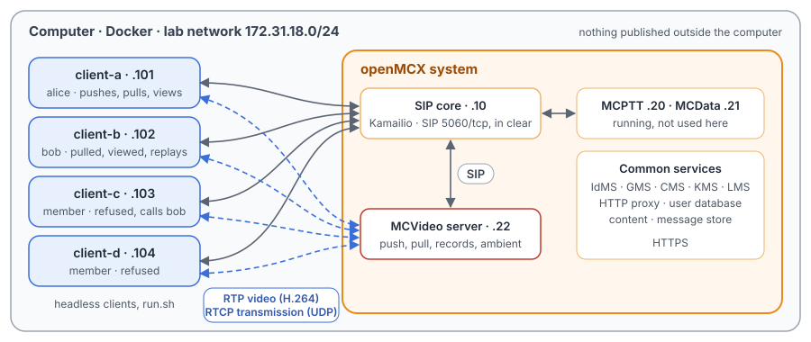
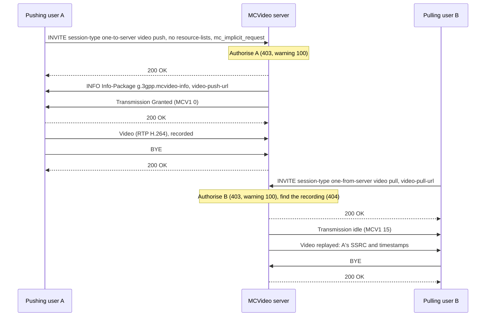
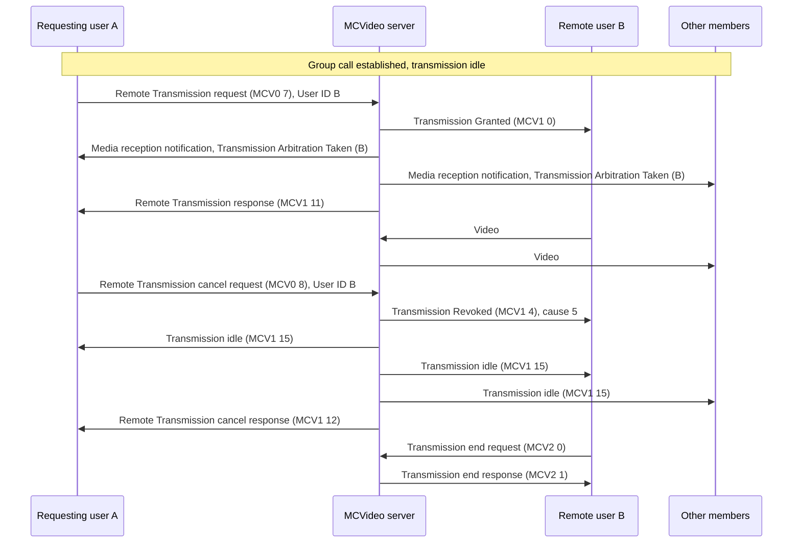
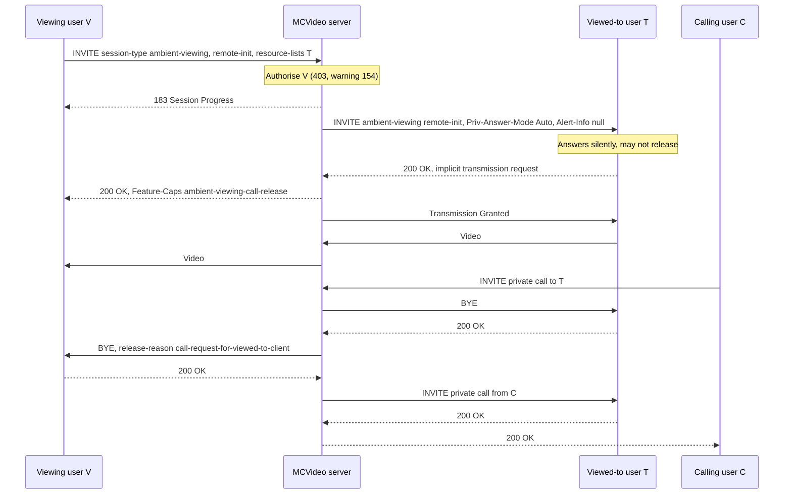

# Unit Test Tutorial 18: MCVideo pull and push of video, and ambient viewing calls

One computer runs the OpenMCX system from the published images, with four headless clients in place of phones. Each
client sends a synthetic H.264 picture sequence as its camera. A script takes them through the MCVideo services in
which one user's video goes to another user, or to and from the server, without the usual request to transmit:

- a **video push** (TS 24.281 clause 13.2): client-a sends its video to client-b, and then to the MCVideo server,
  which records it and tells client-a where the recording is;
- a **video pull** (TS 24.281 clause 12.2): client-a asks for client-b's video, and then client-b asks the server for
  client-a's recording and sees the very pictures client-a pushed;
- **remote transmission** in a group call (TS 23.281 clauses 7.7.1.3.6.3 and 7.7.1.3.7, with the messages of TS 24.581
  clauses 9.2.22 to 9.2.25): client-a makes client-b transmit, then stops it;
- an **ambient viewing call** (TS 24.281 clause 15): client-a views client-b's camera without client-b's user being
  able to end it, or client-a asks client-b to view it; then a server release when someone calls client-b;
- refused requests for each.

A capture of the lab network records every SIP message, every video packet and every transmission control message,
so you can follow each call in Wireshark.

The tutorial is built on the scenarios `tests/integration/mcvideo_pull_push_scenario.py` and
`tests/integration/mcvideo_ambient_scenario.py` of the OpenMCX regression tests and uses the same images.
[Unit Test Tutorial 9](../09-remote-ambient-calls/README.md) shows the MCPTT ambient listening call, on which the
ambient viewing call is modelled.

> **SIP in clear, for learning.** The system runs in its debug mode: SIP goes over TCP without TLS (port 5060), so
> Wireshark shows every message, its SDP and its MCVideo XML. A real system uses TLS (End to End Tutorials 1 to 5).
> Video and transmission control are not encrypted in this tutorial in either mode. The HTTPS traffic to the common
> services (sign-in, configuration, keys) stays encrypted and is not captured.

<p align="center"></p>

## The services

| | Who sends video | How it starts | Who may end it |
|---|---|---|---|
| One-to-one video push | the caller (client-a) | its INVITE is the implicit transmission request (`mc_implicit_request`) | either side |
| One-to-one video pull | the called user (client-b) | its 200 OK is the implicit request | either side |
| Video push to the server | the caller; the server records | the server answers at once and sends the recording's URL in a SIP INFO | the caller |
| Video pull from the server | the server replays a recording | the INVITE names the recording in `<video-pull-url>` | the caller |
| Remote transmission | the user named by the requester | a Remote Transmission request (RTCP APP `MCV0`, subtype 7) in a running call | the requester, by a cancel request (subtype 8) |
| Ambient viewing, `remote-init` | the viewed-to user (client-b), without being asked | client-a's INVITE; client-b's device answers silently | client-a only |
| Ambient viewing, `local-init` | the viewed-to user, who asked (client-a) | client-a's INVITE; client-b is told and views | both |

## What you need

- A computer with Docker and Docker Compose v2 (Linux, or Docker Desktop on macOS or Windows) and a bash shell for
  `run.sh` (on Windows: WSL or Git Bash).
- No phones, no camera, no network set-up, nothing to compile: the tutorial uses the **prebuilt OpenMCX images from
  Docker Hub** (`openmcx/openmcx-*:1.0.0`) and publishes no port; everything stays on the computer.
- [Wireshark](https://www.wireshark.org/) to look at the capture (optional: `run.sh` prints a summary).

## 1. Make the configuration

```bash
cd tutorials/unit-tests/18-mcvideo-pull-push-ambient
docker compose run --rm setup
```

The setup container runs the generator of the regression lab (`tools/prepare-prearranged-test.py --debug-sip
--mcvideo`). It writes `./config` with these parts:

- a new certificate authority with the servers' and clients' certificates;
- the users `alice` (client-a), `bob` (client-b), `client-c` and `client-d`, each with an MCVideo ID
  (`sip:alice.mcvideo@mcx.test`, …), all in the group `operations`;
- their MCVideo rights (TS 24.484): alice may push to and pull from the server, start and end other users'
  transmissions and make both types of ambient viewing call; bob may pull from the server only; client-c may do none
  of these, but may make private calls; client-d may make no private calls, so no one-to-one push or pull either.

It runs once. To start over, see step 5. The certificates last 30 days.

## 2. Start the system

```bash
docker compose up -d --wait
```

After about half a minute `--wait` returns and every service is healthy, with the capture already running.

| Address | Container |
|---|---|
| 172.31.18.10 | SIP core (Kamailio) |
| 172.31.18.20 | MCPTT server (running, not used here) |
| 172.31.18.21 | MCData server (running, not used here) |
| 172.31.18.22 | MCVideo server |
| 172.31.18.101 | client-a, user `alice` |
| 172.31.18.102 | client-b, user `bob` |
| 172.31.18.103 | client-c, user `client-c` |
| 172.31.18.104 | client-d, user `client-d` |

## 3. Run the steps

```bash
./run.sh
```

The script sends each command to a client and waits until the clients and the server show its result before going
on. It takes about two minutes. Each client compares the pictures it decodes with the ones the sender encoded, by RTP
timestamp, so a step passes only if the video arrived intact:

```
2. Video push: alice pushes her video to bob
  $ client-a: mcvideo-push sip:bob.mcvideo@mcx.test auto
  ok: alice and bob in a one-to-one video push call
  ok: alice transmits without asking; bob does not transmit
  ok: bob decodes alice's pictures, each equal to the one she encoded
...
7. Remote transmission in a group call: alice has bob transmit, then stops him; client-c may do neither
  $ client-a: mcvideo-call
  ok: all four in the MCVideo group call, nobody transmits
  $ client-a: mcvideo-remote-transmit sip:bob.mcvideo@mcx.test
  ok: alice's Remote Transmission request is granted (Result 1)
...
12. The capture: captures/18-mcvideo-pull-push-ambient-run.pcap.gz
```

Each command is the same program the clients run, with `--command`. To type one yourself:

```bash
docker compose exec client-a mcx-client --config /config/client-a.json --command "mcvideo-pull sip:bob.mcvideo@mcx.test auto"
docker compose exec client-a mcx-client --config /config/client-a.json --command "mcvideo-hangup"
```

| Step | Command | What happens |
|---|---|---|
| 1 | — | The four clients sign in and affiliate to `operations` for MCVideo. |
| 2 | `client-a: mcvideo-push <bob> auto`, `mcvideo-hangup` | A private call with `<session-type>one-to-one video push` (TS 24.281 clause 13.2.2.1). alice's offer is her transmission request, so the server grants it as soon as the call is up (TS 24.581 clause 6.2). bob is told the call is a push (clause 13.2.2.2), and asks to receive the video. |
| 3 | `client-a: mcvideo-pull <bob> auto`, `mcvideo-hangup` | The same with `one-to-one video pull` (clause 12.2): this time bob, the called user, transmits from his answer (clause 12.2.2.2). |
| 4 | `client-a: mcvideo-push-server`, `mcvideo-hangup` | `one-to-server video push` (clause 13.2.2.4), with no `resource-lists` body. The server answers at once, records the video, and sends the recording's URL to alice in a SIP INFO with `Info-Package: g.3gpp.mcvideo-info` and a `<video-push-url>` (clause 13.2.3.2.3). |
| 5 | `client-b: mcvideo-pull-server <url>`, `mcvideo-hangup` | `one-from-server video pull` (clause 12.2.2.4) names the recording in `<video-pull-url>`. The server replays it as recorded (clause 12.2.3.2.5): same SSRC, same RTP timestamps, so bob's pictures can be checked against alice's. |
| 6 | four refused calls | client-c pulling from and pushing to the server: 403 with warning `100` (clauses 12.2.3.2.5 and 13.2.3.2.3 step 2); bob pulling an unknown recording: 404; client-d pushing to alice: 403 with warning `107` (no private calls, clause 13.2.3.2.1 step 2). Nobody is invited. |
| 7 | `client-a: mcvideo-call`, `mcvideo-remote-transmit <bob>`, `mcvideo-remote-cancel <bob>`; client-c the same | In the group call, alice's Remote Transmission request names bob: the server grants bob the transmission as if he had asked, and answers alice. client-c may not end it. alice's cancel request revokes bob's transmission with cause #5 ("terminate the RTP stream"); bob ends it (TS 24.581 clause 6.2.4.5.5). client-c may not start client-d's transmission, and a cancel for a user who is not transmitting fails. |
| 8 | `client-a: mcvideo-ambient <bob> remote`, `client-b: mcvideo-hangup`, `client-a: mcvideo-hangup` | client-a views client-b (clause 15.2.1.1). bob's device is invited with `Priv-Answer-Mode: Auto` and a null `Alert-Info`, answers silently and transmits from its answer. Only alice gets the release capability (`Feature-Caps`, annex D.3), so bob's own client refuses his hangup (clause 15.2.1.3 step 1). alice ends it. |
| 9 | `client-a: mcvideo-ambient <bob> local`, `client-b: mcvideo-hangup` | alice asks bob to view her (`local-init`): bob is invited with the release capability and may end the call, which he does. |
| 10 | `client-b: mcvideo-ambient <alice> remote` | bob may not make ambient viewing calls: 403 with warning `154` (clause 15.4.2 step 3). |
| 11 | `client-a: mcvideo-ambient <bob> remote`, then `client-c: mcvideo-private <bob> auto` | A call to the viewed-to user ends the ambient viewing call (clause 15.4.3): BYE to bob first, then BYE to alice with `<release-reason>call-request-for-viewed-to-client`; only then is bob invited to client-c's call. |

## 4. Look at the capture

The script `run.sh` copies the capture of your run to `captures/18-mcvideo-pull-push-ambient-run.pcap.gz`. The folder also holds a reference
run, [`captures/18-mcvideo-pull-push-ambient-full.pcap.gz`](captures/18-mcvideo-pull-push-ambient-full.pcap.gz) (211 KB, 1 848 frames, more than a quarter of them video): the frame
numbers below and in the call flows are those of the reference. Wireshark opens the compressed file directly (or
`gunzip` it first).

The capture filter is `ip and not host 172.31.18.1 and (tcp port 5060 or (udp and not port 53) or icmp)`:

- SIP on 5060/tcp, with every TCP segment, so Wireshark rebuilds a message split over two segments;
- every UDP flow, since the video and transmission control ports come from the SDP and are not fixed;
- ICMP, which shows media sent to a closed port.

DNS, the encrypted HTTPS and the host's own traffic on the bridge (172.31.18.1) are left out.

Each request a client sends usually appears twice, because the SIP core challenges it with `407` first and the client
sends it again with its credentials; the frame numbers below are those of the second one.

Wireshark learns the video ports and the payload type from the SDP, so it shows the video packets as `RTP` and
`H264` without any setting. The transmission control messages are RTCP APP packets named `MCV0` (sent by a client),
`MCV1` (sent by the server) and `MCV2` (either); Wireshark shows their subtype as a number (TS 24.581 clause 9.2.2.1:
for example `MCV1` 0 Transmission Granted, 2 Transmission Arbitration Taken, 4 Transmission Revoked, 8 Media
reception notification, 15 Transmission idle).

Useful display filters:

| Filter | Shows |
|---|---|
| `sip.msg_body contains "session-type"` | The MCVideo INVITEs, with their session type. |
| `sip.Method == "INFO"` | The URL of the recording, from the server to client-a. |
| `sip.Warning` or `sip.Status-Code >= 400` | The refusals (warnings 100, 107, 154, and the 404). |
| `rtcp.app.name contains "MCV"` | Transmission control. |
| `rtp` | The video. |
| `sip.Method == "BYE"` | The releases; the server's BYE to the viewing user carries the `<release-reason>`. |

What to look for, in the reference run:

- **Video push to bob** (frames 544 to 644): alice's INVITE (544) with `<session-type>one-to-one video push`, bob in a
  `resource-lists` entry and `mc_implicit_request` in the SDP. The server invites bob (550, 554); bob answers (556),
  and only then does alice get her 200 OK (561, 567). The server tells bob the transmission is idle (563), grants alice
  (570) with no Transmission Request from her, and tells bob who transmits: Media reception notification (571) and
  Transmission Arbitration Taken (572). bob asks for the video, Receive media request (573), and the server answers
  (574). The video flows alice → server → bob (from 575 and 578). alice's BYE (636) ends it.
- **Video pull from bob** (frames 659 to 748): the INVITE (659) with `one-to-one video pull`; bob's 200 OK (671) carries
  his implicit request, so it is bob who is granted (678). alice gets Media reception notification (685) and
  Transmission Arbitration Taken (686), asks for the video (687, 688), and receives it (from 689 and 692). alice sends
  no video.
- **Video push to the server** (frames 770 to 860): the INVITE (770) with `one-to-server video push` and no
  `resource-lists`; the server answers 200 OK at once (774, 778) and invites nobody. Its INFO (781, to alice 783) has
  `Info-Package: g.3gpp.mcvideo-info` and the `<video-push-url>`
  `https://mcvideo-server/recordings/63477632464d5f45737a333578707132`, inside `<anyExt>` as the schema has it. alice
  answers 200 OK (784); her video (from 788, SSRC `0xfbea8351`) goes to the server only.
- **Video pull from the server** (frames 874 to 958): bob's INVITE (874) with `one-from-server video pull` and that URL
  in `<video-pull-url>`; 200 OK (878, 882). The server's video to bob (from 886) has alice's SSRC `0xfbea8351` and
  her RTP timestamps: the recording, replayed.
- **Refusals** (frames 972 to 1036): 403 with warning `100 function not allowed due to video pull from server not
  authorised` (976) and `… video push to server not authorised` (995) for client-c; 404 for the unknown recording
  (1014); 403 with warning `107 user not authorised to make private calls` for client-d's push (1033). No INVITE leaves
  the server for any of them.
- **Remote transmission** (frames 1048 to 1315): the group call (1048) reaches bob (1057), client-c (1068) and
  client-d (1074); nobody transmits. alice's Remote Transmission request (`MCV0` 7, 1212) names bob: bob is granted
  (1213), the others are told bob transmits (client-c's Transmission Arbitration Taken, 1217), and alice gets the
  Remote Transmission response (`MCV1` 11, 1220). bob's video reaches client-c (from 1223 and 1227). client-c's cancel
  request (1279) gets its response (1281) and changes nothing. alice's cancel request (1299) makes the server revoke
  bob (`MCV1` 4, 1300), tell everyone the transmission is idle (client-c, 1303), and answer alice (1305); bob ends his
  transmission, Transmission end request (`MCV2` 0, 1306) and response (1307). client-c's request for client-d (1308,
  1309) and alice's cancel for client-d (1310, 1311) grant nothing: client-d never transmits.
- **Ambient viewing, remote-init** (frames 1404 to 1576): alice's INVITE (1404) with `<session-type>ambient-viewing`
  and `<ambient-viewing-type>remote-init`. The server invites bob (1410, 1414) with `Priv-Answer-Mode: Auto` and
  `Alert-Info: <file:///dev/null>`, without the release capability; bob answers (1416) and alice gets her 200 OK with
  `Feature-Caps: *;+g.3gpp.mcvideo.ambient-viewing-call-release` (1421, 1425), without the null `Alert-Info`, which
  belongs only in the INVITE and in 180 and 183 responses (RFC 3261, RFC 7462). bob is granted (1429) and his video
  goes to alice (from 1433 and 1437). bob's client sends no BYE; alice's BYE (1569) ends the call (the server's BYE to bob,
  1576).
- **Ambient viewing, local-init** (frames 1591 to 1691): alice's INVITE (1591) with `local-init`; bob is invited with
  the release capability (1597, 1601) and no null alert. alice is granted (1616), her video reaches bob (from 1621 and
  1624), and bob's BYE (1684) ends it.
- **Refused ambient viewing call** (frames 1705 to 1713): bob's INVITE, 403 with warning `154 user not authorised to
  make ambient viewing call` (1709); alice is not invited.
- **Release by a call to the viewed-to user** (frames 1724 to 1834): alice views bob again (1724, 200 OK 1746).
  client-c's private call to bob (1787) reaches the server (1790); the server sends BYE to bob (1792), waits for his
  200 OK (1798), then sends BYE to alice with `<release-reason>call-request-for-viewed-to-client` (1800, 1801), and
  only then invites bob to client-c's call (1805, 1808); client-c gets its 200 OK (1822).

## 5. Stop or start over

```bash
docker compose down -v        # remove the containers and their data (status files, recordings, capture)
rm -rf config                 # with down -v: start over at step 1
```

To run the steps again on the same system, run `./run.sh` again: the capture keeps everything since `up`. For a new
capture, `docker compose down -v` and `docker compose up -d --wait` first (the configuration stays).

## Images

The compose file names every image in full, all from Docker Hub:

| Image | What it is |
|---|---|
| `docker.io/openmcx/openmcx-setup:1.0.0` | The setup: the lab's generator |
| `docker.io/openmcx/openmcx-mcvideo-server:1.0.0` | The MCVideo server |
| `docker.io/openmcx/openmcx-mcptt-server:1.0.0`, `docker.io/openmcx/openmcx-mcdata-server:1.0.0` | The MCPTT and MCData servers |
| `docker.io/openmcx/openmcx-common:1.0.0`, `docker.io/openmcx/openmcx-http-proxy:1.0.0`, `docker.io/openmcx/openmcx-user-db:1.0.0` | The common services |
| `docker.io/openmcx/openmcx-client:1.0.0` | The headless client (`OpenMCX/openmcx-client` repository) |
| `docker.io/openmcx/openmcx-kamailio:1.0.0` | The SIP core |
| `docker.io/library/mysql@sha256:…` | The SIP core's database |
| `docker.io/nicolaka/netshoot@sha256:…` | tcpdump, for the capture |

To use images you built yourself, change the `image:` lines in `docker-compose.yaml` (building them:
[docs/BUILD.md](../../../docs/BUILD.md)).

## When something does not work

- **A service stays unhealthy**: `docker compose logs <service>`.
- **A step of run.sh fails**: it prints the step that did not complete. `docker compose exec client-a cat
  /artifacts/client-a/status.json` shows a client's state (`mcvideo_call_state`, `mcvideo_video_mode`,
  `mcvideo_transmitting`, `mcvideo_last_call`, `mcvideo_remote_result`, `last_error`), and
  `/artifacts/mcvideo-server/status.json` the server's (`video_recorded`, `video_streamed`). Start over from a clean
  state with `docker compose down -v` and `docker compose up -d --wait`.
- **No capture, or `capture` exited**: `docker compose logs capture`. The capture container uses the host's network
  to reach the lab's bridge (`openmcx-ut18`), and the address range 172.31.18.0/24 must be free on the computer.
- **Certificates expired** (after 30 days): start over (step 5).

## How it is put together

- `docker-compose.yaml`: the regression lab of `prepare-prearranged-test.py --debug-sip --mcvideo` (the
  `mcvideo-pull-push` and `mcvideo-ambient` labs of `tools/regress.py`), written for the published images by
  `tools/tutorial-compose.py`. Each container has a fixed address, so the capture reads by role. The status files and
  the server's recordings are in a volume, and the capture runs on the lab's bridge.
- `run.sh`: MV-PP-01 to MV-PP-05 and MV-RT-01 to MV-RT-05 of `mcvideo_pull_push_scenario.py`, and MV-AV-01 to MV-AV-04
  of `mcvideo_ambient_scenario.py`, in one run. The SIP wire checks of the scenarios (MV-PP-06, MV-AV-05) are the
  frames listed in step 4. Left out: what the scenarios' test reports list as not implemented — remotely initiated
  video push, ambient viewing over a pre-established session, and the other release reasons of clause 15.4.3, which
  the MCPTT ambient listening call of [Unit Test Tutorial 9](../09-remote-ambient-calls/README.md) shows.
- `captures/18-mcvideo-pull-push-ambient-full.pcap.gz`: the reference run.

## Call flow

Drawn from the reference capture; the regression's test reports
([`tests/mcvideo/MCVIDEO_PULL_PUSH_TEST.md`](../../../tests/mcvideo/MCVIDEO_PULL_PUSH_TEST.md),
[`tests/mcvideo/MCVIDEO_AMBIENT_VIEWING_TEST.md`](../../../tests/mcvideo/MCVIDEO_AMBIENT_VIEWING_TEST.md)) have none.
The SIP core is left out.

**Video push to the server, then video pull from it** (steps 4 and 5). A = client-a, B = client-b.



**Remote transmission in a group call** (step 7). A = client-a, B = client-b, C = client-c (and client-d).



**Ambient viewing call, remote-init, then a release by a call to the viewed-to user** (steps 8 and 11). V = client-a
(viewing), T = client-b (viewed-to), C = client-c.



| Message | Frames |
|---|---|
| Push to bob: INVITE; server → bob; bob's 200 OK; 200 OK to alice; Granted to alice; first video in, out | 544; 550, 554; 556; 561, 567; 570; 575, 578 |
| Pull from bob: INVITE; bob's 200 OK; Granted to bob; first video in, out | 659; 671; 678; 689, 692 |
| Push to the server: INVITE; 200 OK; INFO with the URL; alice's 200 OK; first video | 770; 774; 781, 783; 784; 788 |
| Pull from the server: INVITE; 200 OK; first replayed video | 874; 878; 886 |
| Refusals: client-c pull, push (403); unknown recording (404); client-d push (403) | 976; 995; 1014; 1033 |
| Remote transmission: request; Granted to bob; response; bob's first video, to client-c | 1212; 1213; 1220; 1223, 1227 |
| Remote cancel: client-c's request, response; alice's request; Revoked; response; bob's end request, response | 1279, 1281; 1299; 1300; 1305; 1306, 1307 |
| Ambient remote-init: INVITE; server → bob; bob's 200 OK; 200 OK to alice; Granted to bob; first video in, out | 1404; 1410, 1414; 1416; 1421, 1425; 1429; 1433, 1437 |
| Ambient local-init: INVITE; server → bob; bob's 200 OK; Granted to alice; bob's BYE | 1591; 1597, 1601; 1603; 1616; 1684 |
| Ambient refused (154) | 1709 |
| Release: client-c's INVITE; BYE to bob; his 200 OK; BYE to alice with the reason; bob invited to client-c's call | 1787; 1792; 1798; 1800; 1805 |
