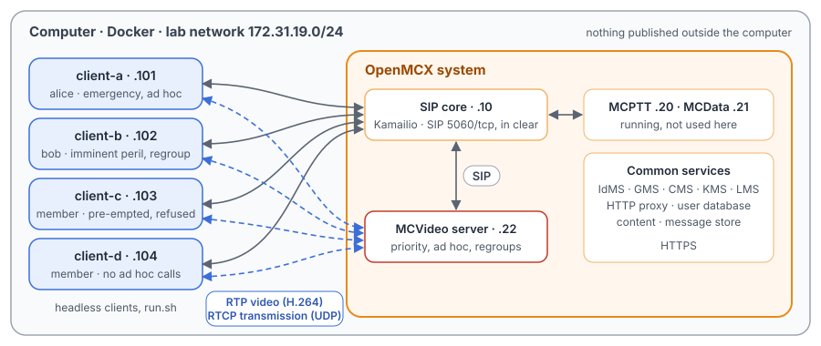
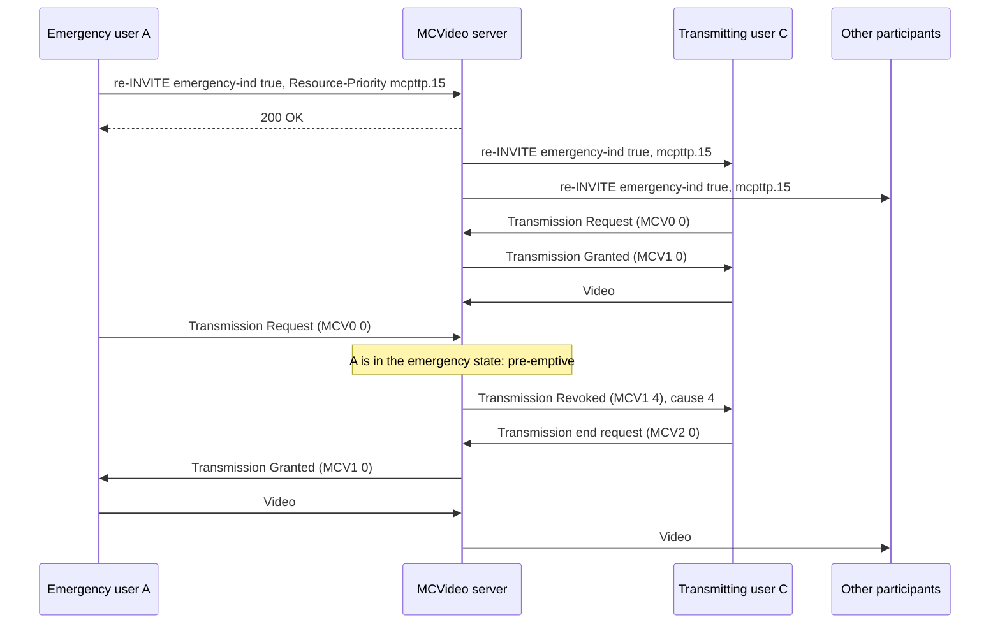
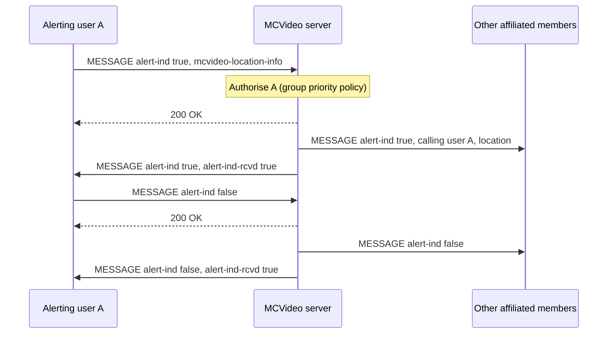
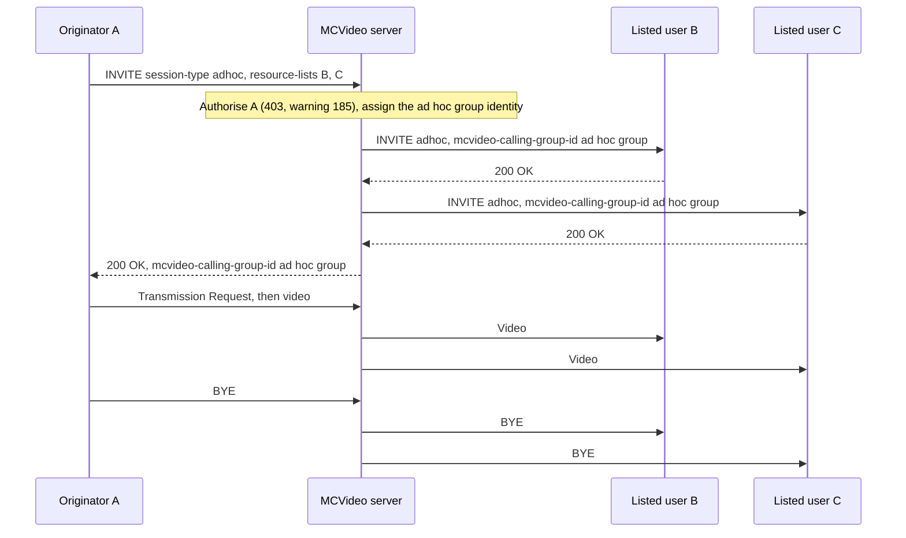
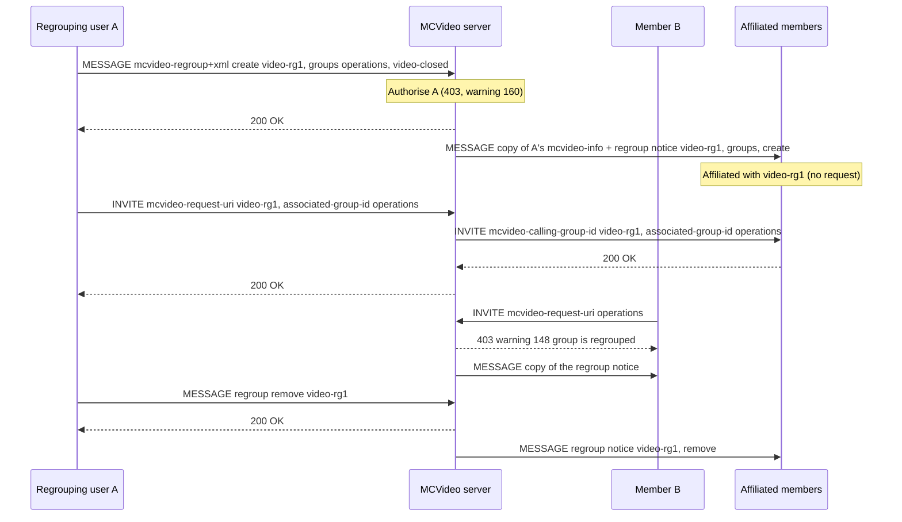

# Unit Test Tutorial 19: MCVideo emergency, ad hoc and regrouped video calls

One computer runs the openMCX system from the published images, with four headless clients in place of phones. Each
client sends a synthetic H.264 picture sequence as its camera. A script takes them through the MCVideo services that
change who is called, or how urgently:

- an **emergency group call** (TS 24.281 clauses 6.2.8.1 and 9.2.1.4): its cancellation, a refused upgrade, **imminent
  peril**, and an emergency that **pre-empts** a normal transmission (TS 24.581 clause 6.3.4.4);
- an **emergency private call** (TS 24.281 clause 10.2.2) and an **emergency alert** with its cancellation (clause 11.2);
- **ad hoc group calls** (clause 22), with a list of users and with participant criteria, and an **ad hoc group
  emergency alert** (clause 12.1A);
- **regroups using a preconfigured group** (clause 21): a group regroup, a call on it, the refusals while it lasts, and a
  user regroup.

A capture of the lab network records every SIP message, every video packet and every transmission control message,
so you can follow each call in Wireshark.

The tutorial is built on the scenarios `tests/integration/mcvideo_emergency_scenario.py`,
`tests/integration/mcvideo_adhoc_scenario.py` and `tests/integration/mcvideo_regroup_scenario.py` of the openMCX
regression tests and uses the same images. The MCPTT counterparts are Unit Test Tutorials
[5](../05-emergency-imminent-peril/README.md) (emergency and imminent peril), [8](../08-adhoc-group-calls/README.md)
(ad hoc group calls) and [10](../10-dynamic-groups/README.md) (regroups): MCVideo follows the same procedures, with its
own MIME bodies and transmission control in place of floor control.

> **SIP in clear, for learning.** The system runs in its debug mode: SIP goes over TCP without TLS (port 5060), so
> Wireshark shows every message, its SDP and its MCVideo XML. A real system uses TLS (End to End Tutorials 1 to 5).
> Video and transmission control are not encrypted in this tutorial in either mode. The HTTPS traffic to the common
> services (sign-in, configuration, keys) stays encrypted and is not captured.

<p align="center"></p>

## The services

| | How it is asked for | Who is told | Resource-Priority |
|---|---|---|---|
| Emergency group call | INVITE, or re-INVITE in the call, with `<emergency-ind>` true | every participant, by INVITE or re-INVITE | `mcpttp.15` |
| Imminent peril | the same with `<imminentperil-ind>` true | every participant | `mcpttp.10` |
| Emergency private call | private call INVITE with `<emergency-ind>` true | the called user | `mcpttp.15` |
| Emergency alert | SIP MESSAGE with `<alert-ind>` true and the user's location | the other affiliated members; the sender gets a receipt (`<alert-ind-rcvd>`) | — |
| Ad hoc group call | INVITE with `<session-type>adhoc` and a list of users, or criteria | the users listed, or those meeting the criteria | `mcpttp.0` |
| Ad hoc group emergency alert | SIP MESSAGE with `<adhoc-alert-ind>` true and criteria | the users meeting the criteria; the sender gets a receipt | — |
| Group regroup | SIP MESSAGE with an `application/vnd.3gpp.mcvideo-regroup+xml` body naming groups | every affiliated member of the groups | — |
| User regroup | the same, naming users | the users named | — |

The Resource-Priority values use the namespace `mcpttp` of RFC 8101, which TS 24.281 clause 4.6.1 asks MCVideo to use
as well.

## What you need

- A computer with Docker and Docker Compose v2 (Linux, or Docker Desktop on macOS or Windows) and a bash shell for
  `run.sh` (on Windows: WSL or Git Bash).
- No phones, no camera, no network set-up, nothing to compile: the tutorial uses the **prebuilt openMCX images from
  Docker Hub** (`openmcx/openmcx-*:v1`) and publishes no port; everything stays on the computer.
- [Wireshark](https://www.wireshark.org/) to look at the capture (optional: `run.sh` prints a summary).

## 1. Make the configuration

```bash
cd tutorials/unit-tests/19-mcvideo-emergency-adhoc-regroup
docker compose run --rm setup
```

The setup container runs the generator of the regression lab (`tools/prepare-prearranged-test.py --debug-sip
--mcvideo`). It writes `./config` with these parts:

- a new certificate authority with the servers' and clients' certificates;
- the users `alice` (client-a), `bob` (client-b), `client-c` and `client-d`, each with an MCVideo ID
  (`sip:alice.mcvideo@mcx.test`, …), all in the group `operations`; alice is also the only member of `video-closed`;
- the preconfigured group `video-regroup`, which may not be called itself (`<preconfigured-group-use-only>`): a
  regroup takes its configuration from it;
- the MCVideo priority policy of `operations`: alice and bob may raise and cancel an emergency, imminent peril and an
  emergency alert, only alice may cancel an alert, and client-c may do none of these; alice may make emergency private
  calls;
- the MCVideo rights (TS 24.484): every user but client-d may make ad hoc group calls; alice may raise and cancel an
  ad hoc group emergency alert; alice may regroup (`<allow-regroup>`), bob may not.

It runs once. To start over, see step 5. The certificates last 30 days.

## 2. Start the system

```bash
docker compose up -d --wait
```

After about half a minute `--wait` returns and every service is healthy, with the capture already running.

| Address | Container |
|---|---|
| 172.31.19.10 | SIP core (Kamailio) |
| 172.31.19.20 | MCPTT server (running, not used here) |
| 172.31.19.21 | MCData server (running, not used here) |
| 172.31.19.22 | MCVideo server |
| 172.31.19.101 | client-a, user `alice` |
| 172.31.19.102 | client-b, user `bob` |
| 172.31.19.103 | client-c, user `client-c` |
| 172.31.19.104 | client-d, user `client-d` |

## 3. Run the steps

```bash
./run.sh
```

The script sends each command to a client and waits until the clients and the server show its result before going
on. It takes about two minutes. Where video flows, the receiving client compares the pictures it decodes with the
ones the sender encoded, by RTP timestamp, so a step passes only if the video arrived intact:

```
2. Emergency group call: alice calls operations as an emergency; she cancels the emergency
  $ client-a: mcvideo-call emergency
  ok: all four in the group call
  ok: every member knows the call is an emergency
  $ client-a: mcvideo-emergency off
  ok: alice's cancellation is accepted (200)
  ok: every member back to normal
...
15. The capture: captures/19-mcvideo-emergency-adhoc-regroup-run.pcap.gz
```

Each command is the same program the clients run, with `--command`. To type one yourself:

```bash
docker compose exec client-a mcx-client --config /config/client-a.json --command "mcvideo-call emergency"
docker compose exec client-a mcx-client --config /config/client-a.json --command "mcvideo-hangup"
```

| Step | Command | What happens (TS 24.281 unless noted) |
|---|---|---|
| 1 | — | The four clients sign in and affiliate to `operations` for MCVideo. |
| 2 | `client-a: mcvideo-call emergency`, `mcvideo-emergency off` | alice's INVITE carries `<emergency-ind>` true, `<alert-ind>` false and `Resource-Priority: mcpttp.15` (clause 6.2.8.1.1). The server puts the group in the in-progress emergency state and invites the members with the same indication and priority (clause 9.2.1.4.1.1 step 6). alice cancels with a re-INVITE in her dialog, `<emergency-ind>` false and `mcpttp.0`; the server sends re-INVITEs to the other three, which bring them back to normal (clause 9.2.1.4.7 step 8). |
| 3 | `client-c: mcvideo-emergency on` | client-c is not in the group's priority policy: 403 (clause 9.2.1.4.7 step 3) with an MCVideo body whose `<emergency-ind>` and `<alert-ind>` are false (clause 6.3.3.1.13); the others are not told. |
| 4 | `client-b: mcvideo-imminent on`, `off` | bob's re-INVITE with `<imminentperil-ind>` true and `mcpttp.10` (clause 6.2.8.1.9): the server sends re-INVITEs to the others at `mcpttp.10` (clause 9.2.1.4.8); bob ends it the same way with `mcpttp.0`. |
| 5 | `client-a: mcvideo-emergency on`, `client-c: mcvideo-transmit`, `client-a: mcvideo-transmit`, `mcvideo-end`, `mcvideo-emergency off`, `mcvideo-hangup` | alice raises the emergency in the call (clause 9.2.1.4.7 step 6), and client-c, a normal user, starts to transmit. alice then asks to transmit: a request from a user in the emergency state pre-empts (TS 24.581 clause 6.3.4.4). The server revokes client-c's transmission with cause #4 (pre-empted), client-c ends it, and alice is granted; bob decodes her pictures. alice ends her transmission, cancels the emergency and leaves: under the server's policy the call ends for all, as she started it (clause 6.3.8.1). |
| 6 | `client-a: mcvideo-private <bob> auto emergency` | An emergency private call (clause 10.2.2): `<emergency-ind>` true and `mcpttp.15`, kept in the INVITE to bob (clause 10.2.2.4.1 step 6). |
| 7 | `client-a: mcvideo-alert on`, `off` | The emergency alert (clause 11.2.1.1): a SIP MESSAGE with `<alert-ind>` true and alice's location in `application/vnd.3gpp.mcvideo-location-info+xml`. The server answers 200, tells bob, client-c and client-d with the location (clause 11.2.3.1), and then sends alice a receipt with `<alert-ind-rcvd>` true (clause 6.3.3.1.19). The cancellation goes the same way with `<alert-ind>` false (clause 11.2.3.2). |
| 8 | `client-a: mcvideo-adhoc <bob> <client-c>`, `mcvideo-transmit`, `mcvideo-end`, `client-b: mcvideo-transmit`, `client-a: mcvideo-hangup` | An ad hoc group call with a list (clause 22.2.2.1.1): `<session-type>adhoc` and the two MCVideo IDs in a `resource-lists` body. The server assigns the ad hoc group identity (clause 22.4.2) and names it in `<mcvideo-calling-group-id>` of its INVITEs and of alice's 200 OK; client-d is not invited. The transmission goes round as in a group call. alice, the originator, leaves and the call ends (`end_when_initiator_leaves`). |
| 9 | `client-a: mcvideo-adhoc criteria affiliated:operations`, `client-d: mcvideo-adhoc <alice>` | The participants by criteria, in `<anyExt><call-participants-criteria>` (clause 22.2.2.1.1 step 12): every user affiliated to `operations` is invited. client-d may not make ad hoc group calls: 403 with warning `185` (clause 22.3.2.1.1); nobody is invited. |
| 10 | `client-a: mcvideo-adhoc-alert affiliated:operations`, `cancel`; `client-b: mcvideo-adhoc-alert …` | The ad hoc group emergency alert (clause 12.1A.1.1): a SIP MESSAGE with `<adhoc-alert-ind>` true, the criteria and alice's location. The server creates an ad hoc group for it, tells the users meeting the criteria, and sends alice a receipt with `<adhoc-alert-ind-rcvd>` true (clause 12.1A.3.1). alice cancels it (clause 12.1A.3.2): the users are told, and after the 200 OK the server sends alice a receipt with `<adhoc-alert-ind>` false, `<adhoc-alert-ind-rcvd>` true and her `<mcvideo-client-id>` (clause 12.1A.3.2 step 4 g)); her client stays cancel pending (AH-MEA 4) until it arrives. bob may not raise one: 403 with `<adhoc-alert-ind>` false. |
| 11 | `client-b: mcvideo-regroup create …`, `client-a: mcvideo-regroup create <video-rg1> <video-regroup> groups operations,video-closed` | bob has no `<allow-regroup>`: 403 with warning `160` (clause 21.2.2.2). alice's request is accepted (clause 21.2.3.1): 200, and every affiliated member of both groups is told with a SIP MESSAGE (clause 21.2.2.4): a multipart body with a copy of alice's `application/vnd.3gpp.mcvideo-info+xml` body first, then the regroup body, and both Accept-Contact header fields of her request (step 3 b) and d)). Each member told is affiliated with the regroup (step 3 h)). |
| 12 | `client-a: mcvideo-call group=<video-rg1>`, `mcvideo-transmit`, `mcvideo-hangup` | The notice made every member affiliated with the regroup (clause 21.2.1.3 step 4), so nobody sends an affiliation request for it. alice's call names the group she calls from, `operations`, in `<associated-group-id>` (clause 9.2.1.2.1.1 step 14 d) i)). The server invites the members of both groups; each INVITE names the regroup in `<mcvideo-calling-group-id>` and the member's constituent group in `<associated-group-id>` (clause 6.3.4.1.2 steps 6a and 6b). Her video reaches client-c. |
| 13 | `client-b: mcvideo-call`, `client-b: mcvideo-regroup remove …`, `client-a: mcvideo-regroup remove <video-rg1>` | A call on `operations` while it is regrouped: 403 with warning `148`, then the server sends bob a copy of the regroup notice (clause 9.2.1.4.2 step 5 c)). bob may not remove the regroup: 403 with warning `161`. alice removes it: 200, and every member is told, without the list of groups (clause 21.2.2.5). |
| 14 | `client-a: mcvideo-regroup create <video-rg2> <video-regroup> users bob,client-c`, `client-b: mcvideo-call group=<video-rg2>`, `client-a: mcvideo-regroup remove <video-rg2>` | A user regroup (clause 21.3): only bob and client-c are told, which affiliates them with it (clause 21.3.2.4), and bob's call on it reaches client-c, not alice or client-d. When bob leaves, client-c is alone and the server ends the call (clause 6.3.8.1). The removal tells both. |

## 4. Look at the capture

`run.sh` copies the capture to `captures/19-mcvideo-emergency-adhoc-regroup-run.pcap.gz`. The folder also holds a
reference run, `captures/19-mcvideo-emergency-adhoc-regroup-full.pcap.gz` (241 KB, 2 727 frames): the frame
numbers below and in the call flows are those of the reference. Wireshark opens the compressed file directly (or
`gunzip` it first).

The capture filter is `ip and not host 172.31.19.1 and (tcp port 5060 or (udp and not port 53) or icmp)`:

- SIP on 5060/tcp, with every TCP segment, so Wireshark rebuilds a message split over two segments;
- every UDP flow, since the video and transmission control ports come from the SDP and are not fixed;
- ICMP, which shows media sent to a closed port (a few packets still on their way when a client has left a call).

DNS, the encrypted HTTPS and the host's own traffic on the bridge (172.31.19.1) are left out.

Each request a client sends usually appears twice, because the SIP core challenges it with `407` first and the client
sends it again with its credentials; the frame numbers below are those of the second one. A request from the MCVideo
server also appears twice: once from the server to the SIP core, once from the SIP core to the client.

Wireshark learns the video ports and the payload type from the SDP, so it shows the video packets as `RTP` and
`H264` without any setting. The transmission control messages are RTCP APP packets named `MCV0` (sent by a client),
`MCV1` (sent by the server) and `MCV2` (either); Wireshark shows their subtype as a number (TS 24.581 clause 9.2.2.1:
for example `MCV0` 0 Transmission Request, `MCV1` 0 Transmission Granted, 4 Transmission Revoked, 15 Transmission
idle, `MCV2` 0 Transmission end request).

Useful display filters:

| Filter | Shows |
|---|---|
| `sip.Resource-Priority` | The priority of each request: `mcpttp.0`, `mcpttp.10`, `mcpttp.15`. |
| `sip.msg_body contains "emergency-ind"` | The emergency INVITEs, re-INVITEs and MESSAGEs. |
| `sip.msg_body contains "alert-ind"` | The alerts, their receipts and the ad hoc group alerts. |
| `sip.msg_body contains "adhoc"` | The ad hoc group calls and alerts. |
| `sip.msg_body contains "regroup-action"` | The regroup requests and notices. |
| `sip.Warning` or `sip.Status-Code >= 400` | The refusals (warnings 148, 160, 161, 185). |
| `rtcp.app.name contains "MCV"` | Transmission control. |

What to look for, in the reference run:

- **Emergency group call** (frames 551 to 592): alice's INVITE (551) with `Resource-Priority: mcpttp.15`,
  `<emergency-ind>` true and `<alert-ind>` false. The server's INVITEs to bob (557), client-c (568)
  and client-d (575) carry the same priority and indication; alice's 200 OK (592) too.
- **Cancellation** (frames 716 to 732): alice's re-INVITE (716) with `<emergency-ind>` false and
  `mcpttp.0`, the 200 OK (721), and the server's re-INVITEs to bob (723), client-c (728) and
  client-d (732).
- **Refused upgrade** (frames 771 to 778): client-c's re-INVITE (771) at `mcpttp.15`; the 403 (775,
  to client-c 778) with `<emergency-ind>` false and `<alert-ind>` false. No re-INVITE goes to the others.
- **Imminent peril** (frames 790 to 858): bob's re-INVITE (790) with `<imminentperil-ind>` true and
  `mcpttp.10`, the re-INVITEs to alice (796), client-c (801) and client-d (805); bob's
  re-INVITE back to `mcpttp.0` (844) and its re-INVITEs (850 to 858).
- **Pre-emption** (frames 900 to 1123): alice's emergency re-INVITE (900) and the server's re-INVITEs
  (906 to 915); client-c's Transmission Request (`MCV0` 0, 946) and Granted (947).
  alice's Transmission Request (982) makes the server revoke client-c (`MCV1` 4, 983); client-c ends its
  transmission (`MCV2` 0, 985), and only then is alice granted (987). Her video reaches the server
  (998) and bob (1001). alice's cancellation (1061) and her BYE (1114), then the server's BYEs to bob
  (1118), client-d (1120) and client-c (1123).
- **Emergency private call** (frames 1209 to 1243): alice's INVITE (1209) with `<session-type>private`,
  `<emergency-ind>` true and `mcpttp.15`; the server's INVITE to bob (1215) keeps both.
- **Emergency alert** (frames 1262 to 1334): alice's MESSAGE (1262) with `<alert-ind>` true and the
  `mcvideo-location-info` body; the 200 OK (1266); the MESSAGEs to bob (1268), client-c (1271) and
  client-d (1273) with alice in `<mcvideo-calling-user-id>` and her location; the receipt to alice
  (1277) with `<alert-ind-rcvd>` true. The cancellation (1304, 200 OK 1307) goes to the same three
  (1309 to 1314), and its receipt (1319) has `<alert-ind>` false and `<alert-ind-rcvd>`
  true.
- **Ad hoc group call** (frames 1350 to 1584): alice's INVITE (1350) with `<session-type>adhoc` and bob and
  client-c in `resource-lists`. The server's INVITEs to bob (1356) and client-c (1366) name the ad hoc
  group `sip:adhoc-WJAvBGyxy8MzJ6Iv3pRBYd5ZFGhPrAZuDI3zxVU8dTw@mcx.test` in `<mcvideo-calling-group-id>`, as does alice's 200 OK (1378). alice is granted
  (1467) and her video reaches client-c (1479); then bob is granted (1530). alice's BYE
  (1578) and the server's BYEs to client-c (1582) and bob (1584). No INVITE goes to client-d.
- **By criteria** (frames 1643 to 1903): alice's INVITE (1643) with
  `<anyExt><call-participants-criteria>affiliated:sip:operations@mcx.test`; INVITEs to bob (1649), client-c
  (1659) and client-d (1666). client-d's own ad hoc INVITE (1895) gets 403 with
  `Warning: 399 mcvideo-server "185 user not authorised to initiate the adhoc group call"` (1903).
- **Ad hoc group emergency alert** (frames 1912 to 1996): alice's MESSAGE (1912) with
  `<adhoc-alert-ind>` true, the criteria and her location; the 200 OK (1920); the MESSAGEs to bob (1916),
  client-c (1918) and client-d (1921) with the alert's ad hoc group `sip:adhoc-DTUAuDiB11Hwvz0bTIpdGYgomdry8no4rZWBLwFfKH4@mcx.test`; the receipt to
  alice (1926) with `<adhoc-alert-ind-rcvd>` true. The cancellation (1954) and its MESSAGEs (1958 to
  1961), then, after its 200 OK (1962), the receipt to alice (1972) with `<adhoc-alert-ind>` false,
  `<adhoc-alert-ind-rcvd>` true, the alert's ad hoc group and her `<mcvideo-client-id>`.
  bob's alert (1992) is refused with 403 and `<adhoc-alert-ind>` false (1996).
- **Group regroup** (frames 2004 to 2047): bob's request (2004) refused with warning `160` (2008). alice's
  MESSAGE (2016) with `application/vnd.3gpp.mcvideo-regroup+xml`: `<mcvideo-regroup-uri>` `video-rg1`,
  `<preconfigured-group>` `video-regroup`, `<groups-for-regroup>` and `<regroup-action>create`; the 200 OK (2020);
  the notices to alice (2023), bob (2025), client-c (2027) and client-d
  (2031). Each notice is a multipart body, a copy of alice's mcvideo-info body (her `<mcvideo-client-id>`) first and
  then the regroup body, with both Accept-Contact header fields of her request, `+g.3gpp.mcvideo` and the MCVideo ICSI.
  The copy after a refused call and the removal notices below are built the same way.
- **The call on the regroup** (frames 2063 to 2385): no affiliation request precedes it. alice's INVITE (2063) with
  `video-rg1` in `<mcvideo-request-uri>` and `operations` in `<associated-group-id>`; the server's INVITEs to bob
  (2070), client-c (2080) and client-d (2087) with `video-rg1` in `<mcvideo-calling-group-id>` and `operations` in
  `<associated-group-id>`; alice's video reaches client-c (2246).
- **While regrouped** (frames 2476 to 2543): bob's call on `operations` (2476) gets 403 with warning `148`
  (2480), then a copy of the regroup notice (2482). bob's removal (2500) gets 403 with warning `161`
  (2504). alice's removal (2512, 200 OK 2516) and the notices (2519 to 2528) with
  `<regroup-action>remove` and no `<groups-for-regroup>`.
- **User regroup** (frames 2556 to 2719): alice's request (2556) with `<users-for-regroup>`; notices to bob
  (2562) and client-c (2564) only. bob's call (2587) reaches client-c (2593); bob's BYE
  (2665) and the server's BYE to client-c (2669). The removal (2704) tells bob (2710) and client-c
  (2713).

## 5. Stop or start over

```bash
docker compose down -v        # remove the containers and their data (status files, capture)
rm -rf config                 # with down -v: start over at step 1
```

To run the steps again on the same system, run `./run.sh` again: the capture keeps everything since `up`. For a new
capture, `docker compose down -v` and `docker compose up -d --wait` first (the configuration stays).

## Images

The compose file names every image in full, all from Docker Hub:

| Image | What it is |
|---|---|
| `docker.io/openmcx/openmcx-setup:v1` | The setup: the lab's generator |
| `docker.io/openmcx/openmcx-mcvideo-server:v1` | The MCVideo server |
| `docker.io/openmcx/openmcx-mcptt-server:v1`, `docker.io/openmcx/openmcx-mcdata-server:v1` | The MCPTT and MCData servers |
| `docker.io/openmcx/openmcx-common:v1`, `docker.io/openmcx/openmcx-http-proxy:v1`, `docker.io/openmcx/openmcx-user-db:v1` | The common services |
| `docker.io/openmcx/openmcx-client:v1` | The headless client (`openMCX/openmcx-client` repository) |
| `docker.io/openmcx/openmcx-kamailio:6.1.4-2` | The SIP core |
| `docker.io/library/mysql@sha256:…` | The SIP core's database |
| `docker.io/nicolaka/netshoot@sha256:…` | tcpdump, for the capture |

To use images you built yourself, change the `image:` lines in `docker-compose.yaml` (building them:
[docs/BUILD.md](../../../docs/BUILD.md)).

## When something does not work

- **A service stays unhealthy**: `docker compose logs <service>`.
- **A step of run.sh fails**: it prints the step that did not complete. `docker compose exec client-a cat
  /artifacts/client-a/status.json` shows a client's state (`mcvideo_call_state`, `mcvideo_call_type`,
  `mcvideo_group`, `mcvideo_priority`, `mcvideo_priority_result`, `mcvideo_alerts`, `mcvideo_adhoc_alert_state`,
  `mcvideo_regroups`, `mcvideo_regroup_result`, `mcvideo_last_call`, `last_error`), and
  `/artifacts/mcvideo-server/status.json` the server's (`affiliations`). Start over from a clean state with
  `docker compose down -v` and `docker compose up -d --wait`.
- **A step stops after the regroup is created**: a regroup lives until it is removed; if a run stopped half-way, start
  over from a clean state as above.
- **No capture, or `capture` exited**: `docker compose logs capture`. The capture container uses the host's network
  to reach the lab's bridge (`openmcx-ut19`), and the address range 172.31.19.0/24 must be free on the computer.
- **Certificates expired** (after 30 days): start over (step 5).

## How it is put together

- `docker-compose.yaml`: the regression lab of `prepare-prearranged-test.py --debug-sip --mcvideo` (the
  `mcvideo-emergency`, `mcvideo-adhoc` and `mcvideo-regroup` labs of `tools/regress.py`), written for the published
  images by `tools/tutorial-compose.py`. Each container has a fixed address, so the capture reads by role. The status
  files are in a volume, and the capture runs on the lab's bridge.
- `run.sh`: MV-EM-01 to MV-EM-07 of `mcvideo_emergency_scenario.py`, MV-AH-01 to MV-AH-04 and MV-AH-06 of
  `mcvideo_adhoc_scenario.py`, and MV-RG-01 to MV-RG-06 of `mcvideo_regroup_scenario.py`, in one run. The SIP wire
  checks of the scenarios (MV-EM-08, MV-AH-05, MV-RG-07) are the frames listed in step 4. Left out: what the scenarios'
  test reports list as not exercised — the late emergency alert, cancelling an emergency private call, modifying an ad
  hoc call's participants, a regroup removed by the server, chat regroups.
- `captures/19-mcvideo-emergency-adhoc-regroup-full.pcap.gz`: the reference run.

## Call flow

Drawn from the reference capture; the regression's test reports
([`tests/mcvideo/MCVIDEO_EMERGENCY_TEST.md`](../../../tests/mcvideo/MCVIDEO_EMERGENCY_TEST.md),
[`tests/mcvideo/MCVIDEO_ADHOC_TEST.md`](../../../tests/mcvideo/MCVIDEO_ADHOC_TEST.md),
[`tests/mcvideo/MCVIDEO_REGROUP_TEST.md`](../../../tests/mcvideo/MCVIDEO_REGROUP_TEST.md)) have none. The SIP core is
left out.

**An emergency in a group call, and the pre-emption** (step 5). A = client-a, C = client-c (transmitting), O = the
other participants.



**Emergency alert and its cancellation** (step 7). A = client-a, M = bob, client-c and client-d.



**Ad hoc group call with a list** (step 8). A = client-a, B = client-b, C = client-c.



**Group regroup, a call on it, and a call on a regrouped group** (steps 11 to 13). A = client-a, B = client-b,
M = all members (A, B, client-c, client-d).



| Message | Frames |
|---|---|
| Emergency group call: INVITE; to bob, client-c, client-d; 200 OK to alice | 551; 557, 568, 575; 592 |
| Cancellation: re-INVITE; 200 OK; re-INVITEs to bob, client-c, client-d | 716; 721; 723, 728, 732 |
| Refused upgrade: client-c's re-INVITE; 403 | 771; 775 |
| Imminent peril: bob's re-INVITE; re-INVITEs to alice, client-c, client-d; bob's end | 790; 796, 801, 805; 844 |
| Pre-emption: alice's emergency re-INVITE; client-c's request, Granted; alice's request; Revoked to client-c; client-c's end request; Granted to alice | 900; 946, 947; 982; 983; 985; 987 |
| Call end: alice's BYE; BYEs to bob, client-c, client-d | 1114; 1118, 1123, 1120 |
| Emergency private call: INVITE; to bob | 1209; 1215 |
| Emergency alert: MESSAGE; 200 OK; to bob, client-c, client-d; receipt | 1262; 1266; 1268, 1271, 1273; 1277 |
| Alert cancellation: MESSAGE; 200 OK; to bob, client-c, client-d; receipt | 1304; 1307; 1309, 1311, 1314; 1319 |
| Ad hoc call: INVITE; to bob, client-c; 200 OK; Granted to alice; alice's BYE; BYEs to bob, client-c | 1350; 1356, 1366; 1378; 1467; 1578; 1584, 1582 |
| By criteria: INVITE; to bob, client-c, client-d; client-d's INVITE; 403 (185) | 1643; 1649, 1659, 1666; 1895; 1899 |
| Ad hoc alert: MESSAGE; 200 OK; to bob, client-c, client-d; receipt; cancellation; its 200 OK; its receipt; bob's 403 | 1912; 1920; 1916, 1918, 1921; 1926; 1954; 1962; 1972; 1996 |
| Group regroup: bob's 403 (160); alice's MESSAGE; 200 OK; notices to alice, bob, client-c, client-d | 2008; 2016; 2020; 2023, 2025, 2027, 2031 |
| Call on the regroup: INVITE; to bob, client-c, client-d; 200 OK to alice | 2063; 2070, 2080, 2087; 2106 |
| While regrouped: bob's INVITE; 403 (148); notice copy; bob's removal 403 (161); alice's removal; notices | 2476; 2480; 2482; 2504; 2512; 2519, 2521, 2523, 2528 |
| User regroup: MESSAGE; notices to bob, client-c; bob's INVITE; to client-c; removal; notices | 2556; 2562, 2564; 2587; 2593; 2704; 2710, 2713 |
