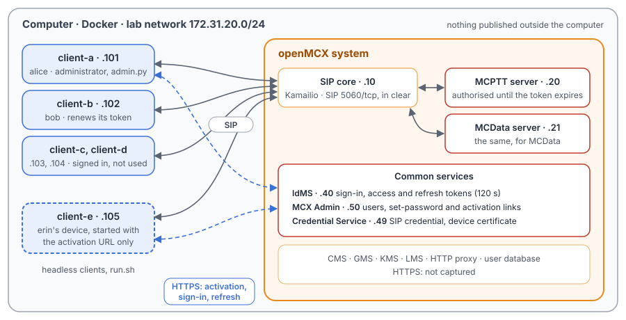
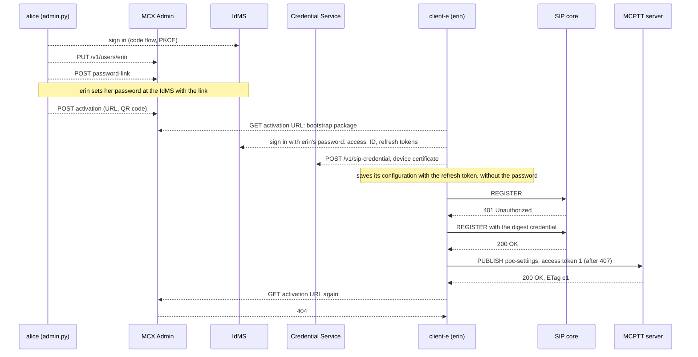
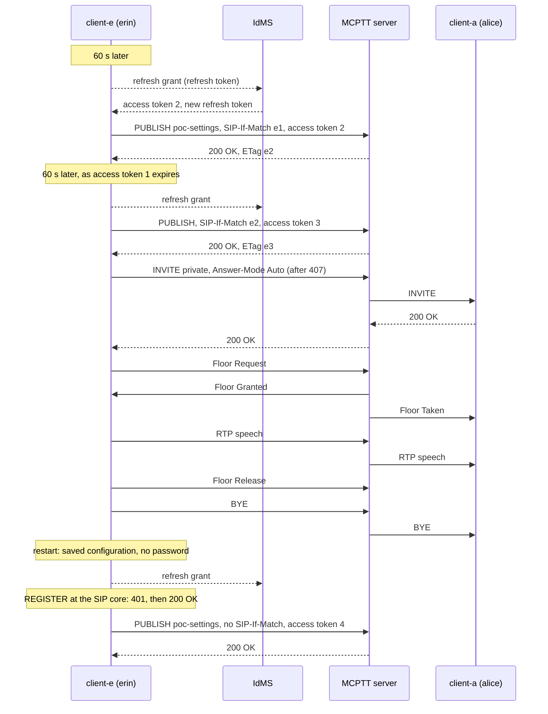

# Unit Test Tutorial 20: Identity and tokens: MCX Admin activation and token refresh

One computer runs the openMCX system from the published images, with headless clients in place of phones. A script
takes them through how a user gets onto the system and how a client stays signed in:

- an administrator creates a new user, `erin`, in MCX Admin; erin sets her own password from a one-time link;
- the administrator issues an activation URL, and erin's device, started with that URL and nothing else, activates:
  it gets its settings, signs in at the identity management server (IdMS) and gets its SIP credential;
- every client holds an access token that lasts only 120 s; before it expires, the client gets a new one with its
  refresh token (TS 33.180 annex B.5) and gives it to the servers in a new SIP PUBLISH (TS 24.379 and TS 24.282
  clause 7.2.2), so it stays authorised;
- with renewed tokens, erin calls alice and talks; then erin's device restarts and signs in with its refresh token
  alone.

A capture of the lab network records every SIP message, the floor control and the speech, so you can follow in
Wireshark what the servers see of the activation and of each token renewal.

The tutorial is built on two scenarios of the openMCX regression tests, `tests/integration/admin_scenario.py`
(creation, set-password link, activation) and `tests/integration/token_refresh_scenario.py`, and uses the same images.

> **SIP in clear, for learning.** The system runs in its debug mode: SIP goes over TCP without TLS (port 5060), so
> Wireshark shows every message and its XML, and here even the **access tokens** in the PUBLISH bodies. An access
> token is a bearer token: whoever holds it can use it until it expires. A real system uses TLS (tutorials 1 to 5),
> and can also encrypt the token in the body (XML protection, Unit Test Tutorial 12). The HTTPS traffic to MCX Admin,
> IdMS, the Credential Service and the other common services stays encrypted and is not captured.

<p align="center"></p>

## Tokens in a few words

A client signs in at the **IdMS** with OpenID Connect (TS 24.482 clause 6.2.1, TS 33.180 annex B.4): the user's name
and password, an authorisation code, and in exchange three tokens:

- the **ID token**, for the client itself: who signed in;
- the **access token**, for the servers: a signed JSON Web Token naming the user (`mcptt_id`), the client
  (`client_id`) and the services, valid until its `exp` time. The client gives it to each server it uses in the SIP
  PUBLISH of **service authorisation** (`Event: poc-settings`, TS 24.379 and TS 24.282 clause 7.2.2); the server checks
  the signature and keeps the client authorised only until the token expires;
- the **refresh token**, kept by the client: with it the client gets a new access token from the IdMS without the
  password (the refresh grant, TS 33.180 annex B.5).

The lab gives access tokens a lifetime of 120 s (a real system: hours). The clients renew halfway, here after 60 s,
and send the new token in a new PUBLISH. That PUBLISH modifies the client's existing publication: it carries
`SIP-If-Match` with the entity tag of the server's last `200 OK` (RFC 3903 clause 4.4), so the server keeps the
authorisation, the affiliations and any call; nothing else changes.

## MCX Admin activation in a few words

MCX Admin is openMCX's administration service: users, groups and their profiles. It is not a 3GPP function; it writes
what the 3GPP servers read. Activation is its way to set up a device without typing settings into it:

1. the administrator creates the user and gets a **one-time set-password link** to the IdMS, so the user chooses a
   password the administrator never sees;
2. the administrator issues a **one-time activation URL** (also as a QR code, for a phone's camera);
3. the device fetches its **bootstrap package** from the URL: the system's trust root, the IdMS, the SIP identity and
   the servers. It signs in at the IdMS with the user's password, asks the **Credential Service** for its SIP digest
   credential (and a device certificate), and saves the result. It keeps the **refresh token, not the password**, so
   from then on it signs in without the password.

## What you need

- A computer with Docker and Docker Compose v2 (Linux, or Docker Desktop on macOS or Windows) and a bash shell for
  `run.sh` (on Windows: WSL or Git Bash).
- No phones, no network set-up, nothing to compile: the tutorial uses the **prebuilt openMCX images from Docker Hub**
  (`openmcx/openmcx-*:v1`) and publishes no port; everything stays on the computer. The speech is a WAV file in
  `speech/`.
- [Wireshark](https://www.wireshark.org/) to look at the capture (optional: `run.sh` prints a summary).

## 1. Make the configuration

```bash
cd tutorials/unit-tests/20-admin-activation-token-refresh
docker compose run --rm setup
```

The setup container runs the generator of the regression lab (`tools/prepare-prearranged-test.py --debug-sip --admin
--admin-image openmcx-admin:v1 --private-call --token-ttl 120`). It writes `./config` with these parts:

- a new certificate authority with the servers' and clients' certificates;
- the users `alice` (client-a), `bob` (client-b), `client-c` and `client-d`, with their passwords in the clients'
  configurations; `alice` is also an administrator of MCX Admin;
- the IdMS with a token lifetime of 120 s;
- MCX Admin, its database seeded with the lab's users and groups, and the Credential Service;
- a private call ruleset in each user's MCPTT profile (TS 24.484): `bob` may call anyone, `alice` only `bob` and
  `client-c`;
- `config/activate-e/`: erin's device with its local settings only (ports, paths, the address of the SIP core). It
  has no identity, no password and no credential; the activation brings them.

It runs once. To start over, see step 5. The certificates last 30 days.

## 2. Start the system

```bash
docker compose up -d --wait
```

After about a minute `--wait` returns and every service is healthy, with the capture already running. client-a to
client-d sign in with their passwords as they start. client-e is not started yet: it belongs to the compose profile
`activation`, and `run.sh` starts it once it has an activation URL.

| Address | Container |
|---|---|
| 172.31.20.10 | SIP core (Kamailio) |
| 172.31.20.20 | MCPTT server |
| 172.31.20.21 | MCData server (the clients authorise for MCData too) |
| 172.31.20.40 | IdMS |
| 172.31.20.49 | Credential Service |
| 172.31.20.50 | MCX Admin |
| 172.31.20.101 | client-a, user `alice` (also where `admin.py` runs, as alice's computer) |
| 172.31.20.102 | client-b, user `bob` |
| 172.31.20.103, .104 | client-c, client-d (signed in, renew their tokens, otherwise not used) |
| 172.31.20.105 | client-e, erin's device (from step 3 of `run.sh`) |

## 3. Run the steps

```bash
./run.sh
```

The script runs each step and waits until the clients show its result before going on. Most of its three minutes is
step 4, which watches the clients past the expiry of their tokens:

```
3. alice issues erin's activation URL; erin's device (client-e) activates with it and signs in
  $ alice: an activation URL (and its QR code) for erin
  https://mcxadmin:8443/activate/pvOmuGE8vk_R3f2guqtKsb0Y4yeEauLGDGfM6D0KU3Q#pin=-XPBAf4GkZeP_CFs8KQ10sHDa2h7o4fbXpC5ZAe5DGI
  $ docker compose --profile activation up -d client-e
  ok: client-e activated: registered and authorised as erin
  ok: client-e never used erin's password for the access token: it signed in with the refresh token
  ok: the activation URL works only once (404 the second time)

4. The tokens expire: each client renews its own with the refresh token and publishes the new one
  (watching the three clients for 131 s, until 15 s after the last of their current tokens expires)
  ok: alice, bob and erin stay registered and authorised all along
  ok: each renewed its token at least once, by the refresh token, never with the password again
...
7. The capture: captures/20-admin-activation-token-refresh-run.pcap.gz
```

`run.sh` runs once per system: the activation URL works only once, and erin exists after the first run. To run it
again, start over (step 5).

What alice does in MCX Admin is in `admin.py`: it signs in at the IdMS as alice (the authorisation code flow with
PKCE of TS 33.180 annex B.4.2) and calls MCX Admin's REST API with her access token. `run.sh` runs it in client-a's
container, on the lab network:

```bash
docker compose exec -T client-a python3 - activation < admin.py
```

| Step | What happens |
|---|---|
| 1 | client-a to client-d register at the SIP core and sign in at the IdMS with their passwords. Each sends its access token to the MCPTT server and to the MCData server in a service authorisation PUBLISH (TS 24.379 and TS 24.282 clause 7.2.2), and subscribes to its configuration and affiliates. Each token is valid for 120 s. |
| 2 | alice creates `erin` in MCX Admin (`PUT /v1/users/erin`, a copy of bob's profile and rights with erin's own identities and client ID). She gets a one-time set-password link from MCX Admin (`POST /v1/users/erin/password-link`), and erin sets her password at the IdMS with it. All HTTPS: nothing in the capture. |
| 3 | alice issues the activation URL (`POST /v1/users/erin/activation`: the URL and a QR code). `run.sh` writes it, and erin's password, to `config/activate-e/`, and starts client-e with `--activate`. client-e fetches the bootstrap package, signs in at the IdMS with erin's password, gets its SIP credential and device certificate from the Credential Service, and saves its configuration with the refresh token instead of the password. Then, on the wire: its REGISTER, challenged with `401` and accepted with the new credential (TS 24.229 clause 5.1.1.2), and its service authorisation PUBLISH. A second GET of the URL gets `404`. |
| 4 | About 60 s after each sign-in, each client uses its refresh token at the IdMS (HTTPS) and gets a new access token. It sends it in a PUBLISH with `SIP-If-Match` to the MCPTT server and, if it has MCData, to the MCData server; the `200 OK` carries a new entity tag for the next renewal. No client registers again, and none loses its authorisation when its first token expires. |
| 5 | erin calls alice: a private call with automatic commencement (TS 24.379 clause 11.1.1), allowed by bob's ruleset that erin got. erin asks for the floor, talks, releases it and hangs up. alice's first token expired 34 s before, erin's 19 s before. |
| 6 | client-e restarts. It starts from its saved configuration: no activation URL, no password. It gets an access token with its refresh token, registers again (`401`, then `200`) and publishes the token in a new publication, without `SIP-If-Match`. |

## 4. Look at the capture

`run.sh` copies the capture to `captures/20-admin-activation-token-refresh-run.pcap.gz`. The folder also holds a
reference run, `captures/20-admin-activation-token-refresh-full.pcap.gz` (112 KB, 1 682 frames, 157 s): the frame
numbers below and in the call flow are those of the reference. Wireshark opens the compressed file directly (or
`gunzip` it first).

The capture filter is `ip and not host 172.31.20.1 and (tcp port 5060 or (udp and not port 53) or icmp)`:

- SIP on 5060/tcp, with every TCP segment, so Wireshark rebuilds a message split over two segments;
- every UDP flow, since the speech and floor control ports come from the SDP and are not fixed;
- ICMP, which shows media sent to a closed port.

DNS, the encrypted HTTPS (activation, sign-in, refresh) and the host's own traffic on the bridge (172.31.20.1) are left
out: of the token renewal, the capture shows the result, the new token in a PUBLISH.

Useful display filters:

| Filter | Shows |
|---|---|
| `sip.Event == "poc-settings"` | Every service authorisation PUBLISH and its responses: at sign-in, and one per renewal per server. |
| `sip.msg_hdr contains "SIP-If-Match" \|\| sip.ETag` | The renewals and the entity tags of the `200 OK` they refer to. |
| `ip.addr == 172.31.20.105 && sip` | Everything erin's device does on SIP: registration, authorisation, renewals, the call, the restart. |
| `sip.Method == "REGISTER"` | One registration per client, and two for client-e (activation and restart). A renewal does not register again. |
| `sip.Method == "INVITE" \|\| sip.Method == "BYE"` | erin's private call to alice. **Telephony → SIP Flows** draws it. |
| `rtcp.app.name == "MCPT"` | Floor control of the call. While nobody talks, the server repeats Floor Idle every second (timer T7, TS 24.380 clause 6.3.4.3.4). |

**Reading a token.** In a service authorisation PUBLISH, open the `application/vnd.3gpp.mcptt-info+xml` part: the
`<mcptt-access-token>` element holds the token, three base64url parts separated by dots. The middle part decoded
(for example with `base64 -d`, after adding `=` to a multiple of 4 characters) is the token's claims. erin's first
token, in frame 453:

```json
{"iss": "https://idms:8443", "sub": "sip:erin.mcptt@mcx.test", "aud": "mcx-lab-server",
 "exp": 1791500276, "iat": 1791500156, "jti": "U-cRqQtHs4VwRKmq_4rACrYZocSjizr5zr4xsAzyXYo",
 "mc_id": "sip:erin.mc@mcx.test", "mcptt_id": "sip:erin.mcptt@mcx.test", "sip_uri": "sip:erin@mcx.test",
 "client_id": "urn:uuid:5d3c9a1e-6f0b-4c1e-9a55-0000000000e5", "token_type": "access",
 "scope": "openid 3gpp:mc:ptt_service 3gpp:mc:ptt_key_management_service ..."}
```

`exp` minus `iat` is the 120 s lifetime; `client_id` is also in the `<mcptt-client-id>` element next to the token.
Each renewal carries a token with a new `jti`, an `iat` before the old token's `exp`, and an `exp` 120 s later.

What to look for, in the reference run (times from the start of the capture):

- **alice signs in** (frames 232 to 270, at 5.4 s): her REGISTER (232), the SIP core's `401` (234), the REGISTER
  with credentials (236) and `200 OK` (237). Her service authorisation PUBLISH to `sip:mcptt@mcx.test` (238, `407`
  challenge, then 241) with `P-Preferred-Service: urn:urn-7:3gpp-service.ims.icsi.mcptt`, `Event: poc-settings`,
  `Expires: 4294967295` and a multipart body: the `mcptt-info` part with her access token and client ID, and the
  `poc-settings` part with her answer mode and selected user profile. The SIP core passes it on to the MCPTT server
  (243), and the `200 OK` (247) carries an `ETag`. The same to `sip:mcdata@mcx.test` (248, 255), with the MCData ICSI
  and an `mcdata-info` part (262 at the MCData server, `200 OK` 270). Her token: `iat` at 4.8 s, `exp` at 124.8 s.
- **erin's device activates** (frames 444 to 491, at 14.5 s): the HTTPS before it is not in the capture. Her first
  REGISTER (444) gets `401` (446); the second (448), with the digest credential the Credential Service issued, gets
  `200 OK` (449). Then her service authorisation PUBLISH (450, `407`, 453), at the MCPTT server (455), `200 OK`
  (459); her token's `sub` and `mcptt_id` are erin's. She subscribes to her configuration (460 to 491). She has no
  MCData ID and never publishes to the MCData server.
- **alice's first renewal** (frames 592 to 617, at 65.4 s, 60 s after she signed in): a PUBLISH to the MCPTT server
  (592, `407`, 597) with `SIP-If-Match` set to the `ETag` of frame 247, and a new token (`iat` 64.8 s, `exp` 184.8 s),
  at the MCPTT server (602), `200 OK` with a new `ETag` (608). The same to the MCData server (594, 600; 604; 612),
  with the `ETag` of frame 270. Her MCData client then refreshes its MCData affiliation too, with `SIP-If-Match`
  (614, 617). Her second renewal is at 125.4 s (780, 785), as her first token expires.
- **erin's renewals** (frames 670 to 680 at 74.5 s, 858 to 868 at 134.5 s): the same pattern; each `SIP-If-Match` is
  the `ETag` of the previous `200 OK` (459, then 680). Her first token expired at 133.8 s.
- **The call** (frames 872 to 1612, from 148.8 s): erin's INVITE (872, `407`, 879) to `sip:mcptt@mcx.test`, at the
  MCPTT server (881); the server's INVITE to alice (888, 892); alice's `200 OK` (894), the server's to erin (899, 905),
  with no `180 Ringing`. Floor Idle to alice (901) and erin (909); the server would repeat it every second
  (timer T7), but erin asks for the floor within half a second. erin's Floor Request (915), Floor
  Granted (916), Floor Taken to alice (917), erin's speech from 920 (at alice from 921), 337 RTP packets. Floor
  Release (1596), erin's BYE (1602, `407`, 1605), the BYE to alice (1612).
- **erin's device restarts** (frames 1633 to 1648, at 157.2 s): nothing from client-e between the call and the
  restart. Then a new REGISTER (1633, `401`, 1637, `200 OK` 1638) and a new service authorisation PUBLISH (1639,
  `407`, 1642), without `SIP-If-Match`: a new publication. Its token was issued at 156.8 s, just before the REGISTER:
  by the refresh grant, since the device has no password.
- **Never in the capture**: a second REGISTER of alice or bob, a PUBLISH with `Expires: 0` (logging off), or a
  PUBLISH answered with anything but `407` or `200 OK`.

## 5. Stop or start over

```bash
docker compose --profile activation down -v   # remove the containers (with client-e) and their data
rm -rf config                                 # with down -v: start over at step 1
```

`run.sh` runs once per system (erin's activation URL works only once). To run it again, start over from step 1.

## Images

The compose file names every image in full, all from Docker Hub:

| Image | What it is |
|---|---|
| `docker.io/openmcx/openmcx-setup:v1` | The setup: the lab's generator |
| `docker.io/openmcx/openmcx-mcptt-server:v1` | The MCPTT server |
| `docker.io/openmcx/openmcx-mcdata-server:v1` | The MCData server |
| `docker.io/openmcx/openmcx-common:v1`, `docker.io/openmcx/openmcx-http-proxy:v1`, `docker.io/openmcx/openmcx-user-db:v1` | The common services, among them the IdMS and the Credential Service |
| `docker.io/openmcx/openmcx-admin:v1` | MCX Admin (`openMCX/openmcx-admin` repository) |
| `docker.io/openmcx/openmcx-client:v1` | The headless client (`openMCX/openmcx-client` repository) |
| `docker.io/openmcx/openmcx-kamailio:6.1.4-2` | The SIP core |
| `docker.io/library/mysql@sha256:…` | The database of the SIP core and MCX Admin |
| `docker.io/nicolaka/netshoot@sha256:…` | tcpdump, for the capture |

To use images you built yourself, change the `image:` lines in `docker-compose.yaml` (building them:
[docs/BUILD.md](../../../docs/BUILD.md)).

## When something does not work

- **A service stays unhealthy**: `docker compose logs <service>`. A client that cannot reach the IdMS in time on a
  busy computer exits (`HTTPS transport: Timeout was reached`): run `docker compose up -d --wait` again.
- **A step of run.sh fails**: it prints the step that did not complete. `docker compose exec client-a cat
  /artifacts/client-a/status.json` shows a client's state (`registered`, `authorized`, `mcdata_authorized`,
  `token_expires_at`, `token_renewals`, `token_refreshes`, `password_logins`, `token_refresh_refusals`,
  `last_error`); `client-e`'s is in `/artifacts/client-e/status.json` too.
- **"erin was activated already on this system"** or **"the activation URL was refused"**: `run.sh` ran before on
  this system; start over (step 5).
- **client-e does not start**: `docker compose --profile activation logs client-e`. The client logs `activated` once
  it has saved its configuration, then `oidc_authenticated`, `sip_registered` and `service_authorized`.
- **No capture, or `capture` exited**: `docker compose logs capture`. The capture container uses the host's network
  to reach the lab's bridge (`openmcx-ut20`), and the address range 172.31.20.0/24 must be free on the computer.
- **Certificates expired** (after 30 days): start over (step 5).

## How it is put together

- `docker-compose.yaml`: the regression lab of `prepare-prearranged-test.py --debug-sip --admin --admin-image
  openmcx-admin:v1 --private-call --token-ttl 120`, written for the published images by `tools/tutorial-compose.py`.
  Each container has a fixed address, so the capture reads by role. The status files are in a volume, and the
  capture runs on the lab's bridge. client-e is in the compose profile `activation`: its entrypoint passes
  `--activate` with the URL and the password file of `config/activate-e/`, which it reads only until it is activated.
- `admin.py`: alice's sign-in at the IdMS and her calls to MCX Admin's REST API, and erin's use of the set-password
  link, from `tests/integration/admin_helper.py`.
- `run.sh`: steps from `tests/integration/admin_scenario.py` (ADM-05 the new user and her password, ADM-06 the
  activation and its one-time URL, ADM-18 the refresh token kept instead of the password) and
  `tests/integration/token_refresh_scenario.py` (renewal past the first expiry, one password sign-in, a call after
  it). Left out: suspension and restore, groups through MCX Admin, the web console, MCData for erin, and protected
  service authorisation (Unit Test Tutorial 12).
- `captures/20-admin-activation-token-refresh-full.pcap.gz`: the reference run.

## Call flow

Drawn from the reference capture and the clients' logs. The HTTPS messages (dashed) are not in the capture. Each
SIP arrow passes through the SIP core, which is left out except where it challenges; ACKs, TCP acknowledgements and
the configuration subscriptions are left out too.

Activation of erin's device (steps 2 and 3):



Token renewal, the call and the restart (steps 4 to 6):



The messages in the reference capture (A = client-a, E = client-e). A frame pair is the request before and after the
SIP core's challenge; "at S" is the message the SIP core passes on to the server:

| Message | Frames |
|---|---|
| Step 1: A REGISTER; 401; REGISTER; 200 OK | 232; 234; 236; 237 |
| Step 1: A PUBLISH to MCPTT; at S; 200 OK (ETag) | 238, 241; 243; 247 |
| Step 1: A PUBLISH to MCData; at the MCData server; 200 OK (ETag) | 248, 255; 262; 270 |
| Step 3: E REGISTER; 401; REGISTER; 200 OK | 444; 446; 448; 449 |
| Step 3: E PUBLISH to MCPTT; at S; 200 OK | 450, 453; 455; 459 |
| Step 4: A renewal 1 to MCPTT; at S; 200 OK | 592, 597; 602; 608 |
| Step 4: A renewal 1 to MCData; at the MCData server; 200 OK; MCData affiliation refresh | 594, 600; 604; 612; 614, 617 |
| Step 4: A renewal 2, to MCPTT and MCData | 780, 785; 782, 788 |
| Step 4: E renewal 1; at S; 200 OK | 670, 674; 676; 680 |
| Step 4: E renewal 2; at S; 200 OK | 858, 862; 864; 868 |
| Step 5: E INVITE; at S; INVITE to A; A 200 OK; 200 OK to E | 872, 879; 881; 888, 892; 894; 899, 905 |
| Step 5: Floor Idle to E; E Floor Request; Granted; Taken to A; E's speech; at A | 909; 915; 916; 917; 920; 921 |
| Step 5: E Floor Release; E BYE; BYE to A | 1596; 1602, 1605; 1612 |
| Step 6: E REGISTER; 401; REGISTER; 200 OK | 1633; 1635; 1637; 1638 |
| Step 6: E PUBLISH (new publication); at S; 200 OK | 1639, 1642; 1644; 1648 |
