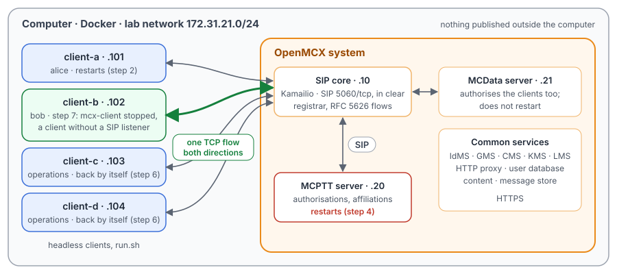
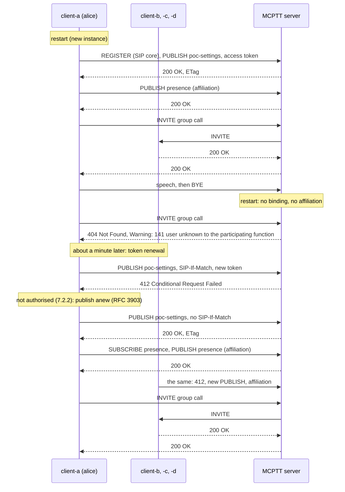

# Unit Test Tutorial 21: Resilience: server restart and SIP outbound flows

One computer runs the openMCX system from the published images, with headless clients in place of phones. A script
restarts parts of the system while the clients are signed in, and replaces a client by one that cannot be reached
except over the connection it opened itself:

- a client restarts: the new instance registers, is authorised (TS 24.379 clause 7.2.2) and affiliates (clause
  9.2.1.2) again, and the server serves it as before;
- the MCPTT server restarts: it starts with no authorisation and no affiliation, and refuses the calls of the users
  it no longer knows; the clients learn it at their next token renewal, are authorised and affiliate again, without a
  restart;
- a client without a SIP listener, as a phone behind a NAT or a firewall: it registers over a **SIP Outbound flow**
  (RFC 5626), and the SIP core sends it every request over that one TCP connection; when the flow closes, a call to it
  fails at once.

A capture of the lab network records every SIP message, the floor control and the speech, so you can follow in
Wireshark what each side sees of the restarts and of the flow.

The tutorial is built on three scenarios of the openMCX regression tests, `tests/integration/restart_scenario.py`
(the client restart), `tests/integration/server_restart_scenario.py` (the server restart) and
`tests/integration/outbound_flow_scenario.py` (the client without a listener), and uses the same images.

> **SIP in clear, for learning.** The system runs in its debug mode: SIP goes over TCP without TLS (port 5060), so
> Wireshark shows every message and its XML. A real system uses TLS (tutorials 1 to 5). The HTTPS traffic to the
> common services (sign-in, token renewal, configuration, keys) stays encrypted and is not captured.

<p align="center"></p>

## What survives a restart, in a few words

Signing in to MCPTT leaves state in three places:

- the **SIP core** holds the client's **registration** (its Contact, until the registration expires);
- the **MCPTT server** holds the **service authorisation**: the binding of the MCPTT ID to the IMS identity, made
  from the access token in the client's PUBLISH (`Event: poc-settings`, TS 24.379 clause 7.3.3), and the
  **affiliations** to groups (clause 9.2.2);
- the **client** holds its own view of both, and the entity tags (`SIP-ETag`) of its publications, which it quotes in
  `SIP-If-Match` when it refreshes them (RFC 3903).

When a **client** restarts, its state is gone; it signs in from the start, and the SIP core and the server simply
take the new registration and publications. When the **MCPTT server** restarts, its state is gone, but the clients
do not know: nothing tells them. The specification lets the server keep its bindings in an external database
(TS 24.379 clause 7.3.3, NOTE 2); the openMCX MCPTT server keeps them in memory, so a restart loses them. A client
learns it from the next response of the server:

- a call is refused with `404 (Not Found)` and the warning `141 user unknown to the participating function`
  (TS 24.379 clause 10.1.1.3.1.1 step 2a): the server has no binding for the caller;
- the refresh of its service authorisation, a PUBLISH with `SIP-If-Match`, gets `412 (Conditional Request Failed)`:
  the server has no publication with that entity tag (RFC 3903 section 6). The client then "shall consider that the
  MCPTT client is not authorised" (TS 24.379 clause 7.2.2) and, as RFC 3903 section 5 asks, does not repeat the
  request but publishes anew, without `SIP-If-Match`. That new publication authorises it again, and it affiliates
  again as after its first sign-in.

The openMCX client refreshes its service authorisation each time it renews its access token, so it is back within
one token renewal; with the two-minute tokens of this tutorial, within a minute.

## SIP Outbound in a few words

A SIP client normally registers a Contact with its own address and port, and the SIP core opens a connection there to
send it a request. A client behind a NAT or a firewall cannot accept that connection. With **SIP Outbound**
(RFC 5626) the client registers with `+sip.instance` (its instance ID), `reg-id` and the `ob` parameter, and keeps
the TCP connection it registered on open: that connection is the **flow**. The SIP core records the flow with the
binding and sends every request for the client over it, an initial request to the user (an INVITE) as well as a
request in a dialog (a NOTIFY).

In step 7 the client names itself with an unresolvable host (`….invalid`) in Via and Contact, as the openMCX Android
client does, and never listens on a port: a request reaches it over the flow or not at all. A client may not choose
the flow itself: the SIP core refuses a Contact that already carries Kamailio's `alias` parameter.

The client says it supports outbound (`Supported: outbound`), and the SIP core, its registrar, answers with
`Require: outbound` (RFC 5626 section 6): the flow is in use. When the flow is gone, the SIP core cannot reach the
client at all; it answers a request for it with `430 (Flow Failed)` (RFC 5626 section 5.3.1) instead of trying the
Contact's address.

## What you need

- A computer with Docker and Docker Compose v2 (Linux, or Docker Desktop on macOS or Windows) and a bash shell for
  `run.sh` (on Windows: WSL or Git Bash).
- No phones, no network set-up, nothing to compile: the tutorial uses the **prebuilt openMCX images from Docker Hub**
  (`openmcx/openmcx-*:1.0.0`) and publishes no port; everything stays on the computer. The speech is a WAV file in
  `speech/`.
- This tutorial's folder: step 7 runs `outbound_flow_client.py`, a small SIP client in Python (a copy of
  `tests/integration/outbound_flow_client.py`), in client-b's container.
- [Wireshark](https://www.wireshark.org/) to look at the capture (optional: `run.sh` prints a summary).

## 1. Make the configuration

```bash
cd tutorials/unit-tests/21-resilience-restart-outbound
docker compose run --rm setup
```

The setup container runs the generator of the regression lab (`tools/prepare-prearranged-test.py --debug-sip
--private-call --token-ttl 120`). It writes `./config` with these parts:

- a new certificate authority with the servers' and clients' certificates;
- the users `alice` (client-a), `bob` (client-b), `client-c` and `client-d`, with their passwords in the clients'
  configurations, all members of the group `operations`;
- a private call ruleset in each user's MCPTT profile (TS 24.484): `alice` may call `bob`;
- the IdMS with an access token lifetime of 120 s, so the clients renew their tokens every minute (Unit Test
  Tutorial 20): step 6 shows what a renewal meets after the server restart.

It runs once. To start over, see step 5. The certificates last 30 days.

## 2. Start the system

```bash
docker compose up -d --wait
```

After about a minute `--wait` returns and every service is healthy, with the capture already running. The clients
sign in as they start.

| Address | Container |
|---|---|
| 172.31.21.10 | SIP core (Kamailio) |
| 172.31.21.20 | MCPTT server |
| 172.31.21.21 | MCData server (the clients authorise for MCData too; it does not restart) |
| 172.31.21.101 | client-a, user `alice` |
| 172.31.21.102 | client-b, user `bob`; in step 7 the client without a listener, on the same address |
| 172.31.21.103, .104 | client-c, client-d |

## 3. Run the steps

```bash
./run.sh
```

The script runs each step and waits until the clients and the server show its result before going on. It takes
about a minute and a half, most of it in step 6, which waits for the next token renewal:

```
4. The MCPTT server restarts: it starts again with no service authorisation and no affiliation
  $ docker compose restart mcptt-server
  ok: a new MCPTT server instance, with nobody authorised or affiliated
  ok: the clients still count themselves signed in

5. client-a calls the group: the server does not know client-a any more and refuses the call
  $ client-a: call
  ok: the call refused with 404 and warning 141
  client-a's call failed with SIP 404, 399 mcptt-server "141 user unknown to the participating function"

6. Each client renews its access token: 412 to its PUBLISH refresh, then a new PUBLISH, and it affiliates again
  ok: every client renewed its token once more (about one minute)
  ok: every client authorised and affiliated again, and the server knows all four, without a restart
...
7. bob without a SIP listener: client-b's mcx-client stops, a client that only uses its outbound flow takes over
  $ docker compose stop client-b
  $ docker compose run client-b python3 /outbound_flow_client.py ...   (in the background)
  ok: registered over its flow (a Contact with alias refused first), authorised, NOTIFY over the flow
  $ client-a: private sip:bob.mcptt@mcx.test manual
  ok: the INVITE reached bob over the flow; bob answered 486 and closed the flow
  $ client-a: private sip:bob.mcptt@mcx.test manual
  ok: the next call to bob fails at once: 430 (Flow Failed) from the core, which does not dial the binding
  client-a's call failed with SIP 480
...
8. The capture: captures/21-resilience-run.pcap.gz
```

`run.sh` runs once per system: after it, client-b is stopped. To run it again, `docker compose down -v` and
`docker compose up -d --wait` (step 5).

| Step | Commands | What happens |
|---|---|---|
| 1 | | client-a to client-d register, sign in at the IdMS, send their access token to the MCPTT server in a service authorisation PUBLISH and affiliate to `operations` (PUBLISH `Event: presence`, TS 24.379 clause 9.2.1.2). |
| 2 | `docker compose restart client-a` | A new instance of client-a (a new instance ID) registers again and sends a new service authorisation PUBLISH, without `SIP-If-Match`: a new publication (RFC 3903 section 4.2). It affiliates again. The MCPTT server is the same instance and still serves the other three. |
| 3 | `client-a: call`, `ptt`, `hangup` | alice's group call reaches bob, client-c and client-d; she talks; she hangs up and the server ends the call (TS 24.379 clause 10.1.1). |
| 4 | `docker compose restart mcptt-server` | A new MCPTT server instance, with no binding and no affiliation. Nothing goes to the clients: the restart does not show on the wire. |
| 5 | `client-a: call` | The server cannot find a binding for alice: it refuses the INVITE with `404 (Not Found)` and the warning `141 user unknown to the participating function` (TS 24.379 clause 10.1.1.3.1.1 step 2a), and invites nobody. |
| 6 | (wait), then `client-a: call`, `ptt`, `hangup` | Each client renews its access token and sends it in a PUBLISH with `SIP-If-Match` (a modification of its publication). The new MCPTT server does not know the entity tag: `412 (Conditional Request Failed)`, RFC 3903 section 6. The client considers itself not authorised (TS 24.379 clause 7.2.2), sends a new PUBLISH without `SIP-If-Match` (RFC 3903 section 5), is authorised, subscribes to its affiliation status and affiliates again; it does not register again. The MCData server, which did not restart, answers `200 OK` to the same renewal. alice's group call works again. |
| 7 | `docker compose stop client-b`, the flow client, `client-a: private <bob> manual` twice | bob's flow client clears bob's registrations, has a Contact with an `alias` parameter refused (`400`), registers over its flow (`+sip.instance`, `reg-id=1`, `ob`; the SIP core answers with `Require: outbound`), is authorised and subscribes to its affiliation status. The server's NOTIFY (a request in a dialog) and alice's private call INVITE (an initial request to bob's AoR) reach it over the flow, at the port it sent from. It answers `486` and closes the flow. alice's next call to bob fails at once: the SIP core has no flow for the binding, does not connect to its address and answers the MCPTT server `430 (Flow Failed)`. |

## 4. Look at the capture

`run.sh` copies the capture to `captures/21-resilience-run.pcap.gz`. The folder also holds a reference run,
`captures/21-resilience-full.pcap.gz` (202 KB, 4 295 frames, 77 s): the frame numbers below and in the call flow are
those of the reference. Wireshark opens the compressed file directly (or `gunzip` it first).

The capture filter is `ip and not host 172.31.21.1 and (tcp port 5060 or (udp and not port 53) or icmp)`:

- SIP on 5060/tcp, with every TCP segment, so Wireshark rebuilds a message split over two segments; the flow client's
  connection is on 5060/tcp at the SIP core's end, so it is in the capture too;
- every UDP flow, since the speech and floor control ports come from the SDP and are not fixed;
- ICMP, which shows media sent to a closed port.

DNS, the encrypted HTTPS (sign-in, token renewal) and the host's own traffic on the bridge (172.31.21.1) are left
out.

Useful display filters:

| Filter | Shows |
|---|---|
| `sip.Method == "REGISTER"` | Each client's registration: at the start, client-a's after its restart (6.7 s), and the flow client's (75.7 s). After the server restart nobody registers again. |
| `sip.Event == "poc-settings"` | Every service authorisation PUBLISH: at sign-in, the renewals of step 6, their `412` from the MCPTT server and the new publications that follow. |
| `sip.Status-Code >= 400 && !(sip.Status-Code in {401 407})` | The refusals: the `404` of step 5, the `412`s of step 6, the `400`, `486`, `430` and `480` of step 7. |
| `sip.Warning` | The `404` of step 5 and its warning `141`. |
| `ip.addr == 172.31.21.102 && frame.number > 4185` | The flow client: every message to it goes to the port it sent its REGISTER from. |
| `tcp.port == 48116` | The flow itself (the port of the reference run; yours differs). |
| `rtcp.app.name == "MCPT"` | Floor control of the two group calls. |

What to look for, in the reference run (times from the first SIP message):

- **The sign-in** (frames 67 to 362, alice's): her REGISTER (67, `401`, 78, `200 OK` 86), her service authorisation
  PUBLISH (87, `407`, 92; at the server 100; `200 OK` 126) and her affiliation (252, 265; at the server 282; `200 OK`
  362). The other three clients do the same in the same half second.
- **client-a restarts** (frames 402 to 483, at 6.7 s): a new REGISTER (402, `401`, 406, `200 OK` 407), a new service
  authorisation PUBLISH (408, `407`, 411; at the server 413; `200 OK` 415) without `SIP-If-Match`, and a new
  affiliation (465, 479; 481; 483). No other client registers again.
- **The first call** (frames 493 to 2043, at 7.2 s): alice's INVITE (493, `407`, 500), at the server (502); the
  server's INVITEs to bob (510), client-c (520) and client-d (526), their `200 OK`s (512, 522, 528) and alice's (546).
  Floor Request (668), Floor Granted (669), Floor Taken to the three others (670 to 672), alice's speech from 675, 337
  RTP packets, Floor Release (2025), BYE (2035, `407`, 2038; `200 OK` 2043).
- **The server restarts** between frames 2119 and 2127 (between 14.7 s and 16.0 s). Nothing on the wire shows it.
- **The refused call** (frames 2127 to 2144, at 16.0 s): alice's INVITE (2127, `407`, 2134), at the server (2138),
  `404 Not Found` from the server (2140) in 0.4 ms, with `Warning: 399 mcptt-server "141 user unknown to the
  participating function"` (TS 24.379 clause 4.4.2: warn-code 399, then the MCPTT warning code and its text), passed
  to alice (2144). The server invites nobody.
- **The renewals** (frames 2151 to 2539, from 60.0 s to 66.7 s): client-d first. Its PUBLISH to the MCPTT server
  (2151, `407`, 2156) carries `SIP-If-Match` and a new access token; at the server (2161) it gets
  `412 Conditional Request Failed` (2165, to client-d 2166). At once client-d publishes anew, without
  `SIP-If-Match` (2167, `407`, 2174; at the server 2178; `200 OK` 2182, with a new `SIP-ETag`), and affiliates again
  (2215, 2221; at the server 2230; `200 OK` 2247). Its renewal to the MCData server (2153, 2159) gets `200 OK` (2171).
  bob (from 2227, at 60.0 s) and client-c (from 2258, at 60.1 s) the same; alice last, at 66.6 s, as her token is
  the one of her restart: her renewal (2452, 2457; at the server 2462), `412` (2466, to alice 2468), her new
  publication (2469, 2477; 2481; `200 OK` 2485), her affiliation status subscription (2489, 2506; `200 OK` 2515) and
  her affiliation (2516, 2524; 2531; `200 OK` 2539). Nobody registers again.
- **The second call** (frames 2558 to 4102, at 67.1 s): as the first. alice's INVITE (2558, 2565; 2567), the
  server's INVITEs (2575, 2585, 2591), Floor Granted (2728), 337 RTP packets from 2736, BYE (4094, 4097).
- **bob's flow** (frames 4189 to 4223, at 75.7 s): a REGISTER with `Contact: *` and `Expires: 0` (4189, `401`, 4193,
  `200 OK` 4194) clears the old bindings; a REGISTER with an `alias` parameter in its Contact (4195, 4197) is refused,
  `400 Contact alias parameter not allowed` (4198); the REGISTER over the flow (4199, 4201), from port 48116, with
  `Contact: <sip:bob@….invalid;transport=tcp;ob>;+sip.instance=…;reg-id=1` and `Supported: outbound, path`. The SIP
  core's `200 OK` (4202) has `Require: outbound` (RFC 5626 section 6) and lists the binding with
  `received="sip:172.31.21.102:48116;transport=tcp"`: the flow. Then bob's service authorisation (4203, 4206;
  `200 OK` 4212) and his subscription to his affiliation status (4213, 4215; at the server 4216). The server's NOTIFY
  (4218) reaches bob over the flow (4223): to port 48116, with the Request-URI of his Contact,
  `sip:bob@….invalid;transport=tcp;ob`.
- **The call over the flow** (frames 4229 to 4261): alice's private call (4229, 4236; at the server 4238), the
  server's INVITE to `sip:bob@mcx.test` (4242), and the SIP core's INVITE to bob (4246) over the flow, to port 48116.
  bob's `486 Busy Here` (4248) goes back to alice (4261). bob closes the connection.
- **The call to a closed flow** (frames 4267 to 4290, at 76.4 s): alice calls again (4267, 4273; 4275); the server's
  INVITE to bob (4278) gets `430 Flow Failed` from the SIP core (4284, RFC 5626 section 5.3.1) without anything sent
  towards bob, and alice gets `480 Temporarily Unavailable` (4290), 62 ms after her INVITE.

## 5. Stop or start over

```bash
docker compose down -v        # remove the containers and their data (status files, capture)
rm -rf config                 # with down -v: start over at step 1
```

To run the steps again, `docker compose down -v` and `docker compose up -d --wait` first (the configuration stays):
`run.sh` needs client-b running, and step 7 stops it.

## Images

The compose file names every image in full, all from Docker Hub:

| Image | What it is |
|---|---|
| `docker.io/openmcx/openmcx-setup:1.0.0` | The setup: the lab's generator |
| `docker.io/openmcx/openmcx-mcptt-server:1.0.0`, `docker.io/openmcx/openmcx-mcdata-server:1.0.0` | The MCPTT and MCData servers |
| `docker.io/openmcx/openmcx-common:1.0.0`, `docker.io/openmcx/openmcx-http-proxy:1.0.0`, `docker.io/openmcx/openmcx-user-db:1.0.0` | The common services |
| `docker.io/openmcx/openmcx-client:1.0.0` | The headless client (`openMCX/openmcx-client` repository); step 7 runs the flow client in it too |
| `docker.io/openmcx/openmcx-kamailio:1.0.0` | The SIP core |
| `docker.io/library/mysql@sha256:…` | The SIP core's database |
| `docker.io/nicolaka/netshoot@sha256:…` | tcpdump, for the capture |

To use images you built yourself, change the `image:` lines in `docker-compose.yaml` (building them:
[docs/BUILD.md](../../../docs/BUILD.md)).

## When something does not work

- **A service stays unhealthy**: `docker compose logs <service>`. A client that cannot reach the IdMS in time on a
  busy computer exits: run `docker compose up -d --wait` again.
- **A step of run.sh fails**: it prints the step that did not complete. `docker compose exec client-a cat
  /artifacts/client-a/status.json` shows a client's state (`registered`, `authorized`, `affiliated`, `instance_id`,
  `token_renewals`, `last_call_failure`), `/artifacts/mcptt-server/status.json` the server's (`instance_id`,
  `authorized_users`, `affiliated_users`), and `/artifacts/outbound-flow/status.json` the flow client's checks.
- **Step 1 fails after an earlier run**: client-b is still stopped from step 7. Start over (step 5).
- **Step 7 cannot find `outbound_flow_client.py`**: run `run.sh` from this tutorial's folder; it mounts
  `outbound_flow_client.py` from there.
- **No capture, or `capture` exited**: `docker compose logs capture`. The capture container uses the host's network
  to reach the lab's bridge (`openmcx-ut21`), and the address range 172.31.21.0/24 must be free on the computer.
- **Certificates expired** (after 30 days): start over (step 5).

## How it is put together

- `docker-compose.yaml`: the regression lab of `prepare-prearranged-test.py --debug-sip --private-call --token-ttl
  120`, written for the published images by `tools/tutorial-compose.py`. Each container has a fixed address, so the
  capture reads by role; the flow client takes client-b's. The status files are in a volume, and the capture runs on
  the lab's bridge.
- `run.sh`: the client restart of `tests/integration/restart_scenario.py` (step 2), the server restart of
  `tests/integration/server_restart_scenario.py` (steps 4 to 6), and `tests/integration/outbound_flow_scenario.py`
  (step 7), whose client `run.sh` runs in client-b's container. Left out: the regression's check of a listening
  client's binding (a REGISTER without Contact), and the SIP core's log.
- `outbound_flow_client.py`: the client without a listener of step 7, a copy of
  `tests/integration/outbound_flow_client.py`.
- `speech/`: the spoken test message alice transmits (16 kHz WAV, made with espeak-ng).
- `captures/21-resilience-full.pcap.gz`: the reference run, compressed.

## Call flow

Drawn from the reference capture. Each SIP arrow passes through the SIP core, which is left out except where it acts
on its own; authentication challenges (`401`, `407`), ACKs, TCP acknowledgements, the configuration subscriptions
and MCData are left out too.

The restarts (steps 2 to 6):



bob without a SIP listener (step 7):

```mermaid
sequenceDiagram
    participant B as client-b, flow client (bob)
    participant K as SIP core
    participant S as MCPTT server
    participant A as client-a (alice)
    B->>K: REGISTER Contact: *, Expires: 0
    K-->>B: 200 OK
    B->>K: REGISTER, Contact with ;alias=
    K-->>B: 400 Contact alias parameter not allowed
    B->>K: REGISTER, Contact ….invalid;ob, +sip.instance, reg-id=1, Supported: outbound (opens the flow)
    K-->>B: 200 OK, Require: outbound, binding with received = the flow
    B->>S: PUBLISH poc-settings
    S-->>B: 200 OK
    B->>S: SUBSCRIBE presence (affiliation status)
    S->>K: NOTIFY
    K->>B: NOTIFY over the flow
    A->>S: INVITE private call to bob
    S->>K: INVITE sip:bob@mcx.test
    K->>B: INVITE over the flow
    B-->>K: 486 Busy Here
    K-->>S: 486
    S-->>A: 486
    Note over B: closes the flow
    A->>S: INVITE private call to bob
    S->>K: INVITE sip:bob@mcx.test
    K-->>S: 430 Flow Failed (nothing sent to bob)
    S-->>A: 480 Temporarily Unavailable
```

The messages in the reference capture (A = client-a, B = client-b or the flow client). A frame pair is the request
before and after the SIP core's challenge; "at S" is the message the SIP core passes on to the MCPTT server:

| Message | Frames |
|---|---|
| Step 1: A REGISTER; 401; REGISTER; 200 OK | 67; 76; 78; 86 |
| Step 1: A PUBLISH poc-settings; at S; 200 OK | 87, 92; 100; 126 |
| Step 1: A PUBLISH presence (affiliation); at S; 200 OK | 252, 265; 282; 362 |
| Step 2: A REGISTER; 401; REGISTER; 200 OK | 402; 404; 406; 407 |
| Step 2: A PUBLISH poc-settings; at S; 200 OK | 408, 411; 413; 415 |
| Step 2: A PUBLISH presence; at S; 200 OK | 465, 479; 481; 483 |
| Step 3: A INVITE; at S; INVITE to B, C, D; their 200 OK; 200 OK to A | 493, 500; 502; 510, 520, 526; 512, 522, 528; 546 |
| Step 3: Floor Request; Granted; Taken to B, C, D; A's speech; Floor Release; BYE; 200 OK | 668; 669; 670 to 672; 675; 2025; 2035, 2038; 2043 |
| Step 5: A INVITE; at S; 404 with Warning 141; 404 to A | 2127, 2134; 2138; 2140; 2144 |
| Step 6: D renewal to MCPTT; at S; 412; to D. To MCData; 200 OK | 2151, 2156; 2161; 2165; 2166. 2153, 2159; 2171 |
| Step 6: D new PUBLISH poc-settings; at S; 200 OK. PUBLISH presence; at S; 200 OK | 2167, 2174; 2178; 2182. 2215, 2221; 2230; 2247 |
| Step 6: B, C renewal to MCPTT; 412 to the client; new PUBLISH; 200 OK; affiliation 200 OK at S | 2227, 2234; 2271; 2272, 2278; 2311; 2382. 2258, 2263; 2297; 2301, 2306; 2339; 2416 |
| Step 6: A renewal to MCPTT; at S; 412; to A | 2452, 2457; 2462; 2466; 2468 |
| Step 6: A new PUBLISH poc-settings; at S; 200 OK; SUBSCRIBE presence; 200 OK; PUBLISH presence; at S; 200 OK | 2469, 2477; 2481; 2485; 2489, 2506; 2515; 2516, 2524; 2531; 2539 |
| Step 6: A INVITE; at S; INVITE to B, C, D; 200 OK to A; Floor Granted; A's speech; BYE | 2558, 2565; 2567; 2575, 2585, 2591; 2606; 2728; 2736; 4094, 4097 |
| Step 7: B REGISTER Contact *; 200 OK | 4189, 4193; 4194 |
| Step 7: B REGISTER with alias; 400 | 4195, 4197; 4198 |
| Step 7: B REGISTER over the flow; 200 OK with Require: outbound | 4199, 4201; 4202 |
| Step 7: B PUBLISH poc-settings; 200 OK. SUBSCRIBE presence; at S; NOTIFY from S; NOTIFY to B | 4203, 4206; 4212. 4213, 4215; 4216; 4218; 4223 |
| Step 7: A INVITE; at S; INVITE from S; INVITE to B; B 486; 486 to A | 4229, 4236; 4238; 4242; 4246; 4248; 4261 |
| Step 7: A INVITE; at S; INVITE from S; 430 from the SIP core; 480 to A | 4267, 4273; 4275; 4278; 4284; 4290 |
